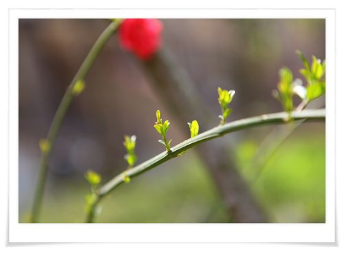
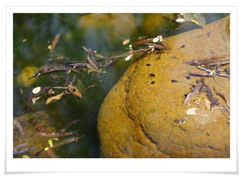
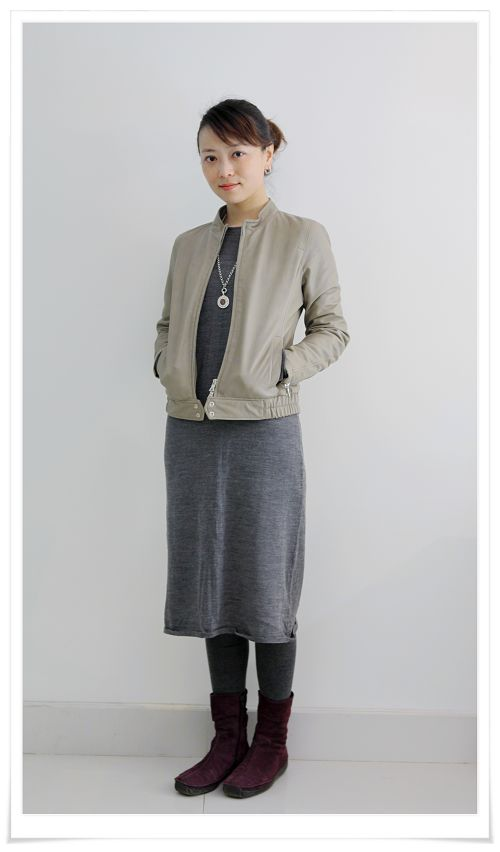
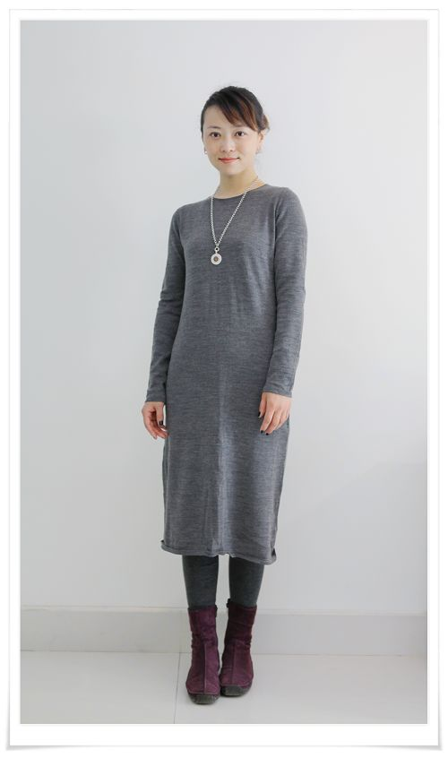

# 大自然的对话

“你中午也回家啊。。。”是的，如果中午不回去，狗狗们每天只能在夜色中散步了。早晨是万万没有时间带它们散步的，晴朗天气的中午它们可以享受到最好的散步时间，不是吗？  
  
受限的上班族，不能端着相机跑去更远的地方，哪怕在同一个城市中。每天散步也是为自己更换状态，看着园子里冒芽的新绿和绽放的花朵，仿佛自然界的植物正在进行悄然的对话，我甚至听见绿芽从棕色树枝里钻出来的声音，总有冲动想要拍几张过过瘾，于是频繁出现甜到腻的小品。今天拍到在岩石上晒太阳的小蝌蚪，和我昨夜的梦境契合，完全受到睡前看片的影响，所有生物在春季展现出饱满向上的生命力，不可阻挡。  
  
  
  
  
\*\*\*\*\*\*\*\*\*\*\*\*\*\*\*\*\*\*\*\*\*\*\*DRESS BLOG\*\*\*\*\*\*\*\*\*\*\*\*\*\*\*\*\*\*\*\*\*\*\*\*  
  

---

## 评论（11）

**itsmin** · 2010-04-09

今天的着装显得很恬静。

**Christina** · 2010-04-09

这条羊毛裙很薄，造成裙边往外翻的缺陷。

**itsmin** · 2010-04-09

嗯，细看是有点遗憾。

**vina** · 2010-04-09

茶为什么不试着束条宽腰带呢，我一直不敢尝试这样的筒式长裙，会显得人没有精神，好在茶的气质够沉静。

**zizi** · 2010-04-09

这个。。。

**陈问** · 2010-04-09

你今天好MUJI风哦，清淡，我喜欢，按你的说法是劳保产品么？哈哈。

**Christina** · 2010-04-09

哦，合身的款式，不是直筒裙。感觉不象MUJI风格哎~恩，我现在很接受劳保环保产品的：P

**喜刷刷** · 2010-04-09

喜欢围脖上那幅垂下来的花.怎么没放这里啊?

**[joanna](http://yanmer.cn/blog)** · 2010-04-09

muji风格，让我习惯下，感觉茶平日穿得不多:-)

**Sherry** · 2010-04-11

嗯？貌似你开始走日系路线了嘛。。。

**putooo** · 2010-04-14

那双鞋子很好看的~

