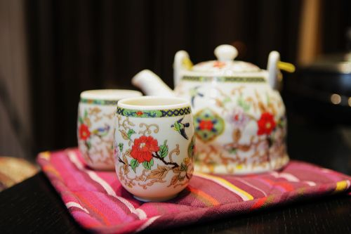
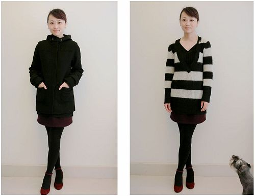
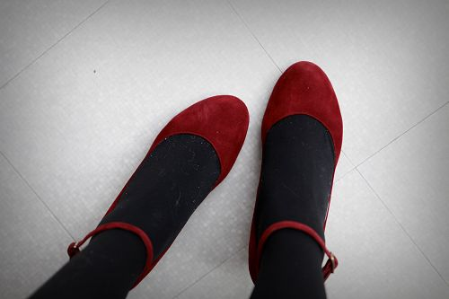

# 这夜晚

喝上一杯西湖龙井观看麦当娜08年阿根廷站的演出，对她的歌不是特别有兴趣，但爱看她的舞台表演，那些伴舞脸上都是戏，电脑做的舞美背景登风造极。麦当娜本身就是一个传奇，她活得真切，有五十岁了吧？两个多小时又唱又跳，健美的肌肉线条和良好的体力告诉观众台下的她有多勤奋，她也是孩子的母亲，人到中年，坦率的爱与不爱，独立又坚强，让人没有理由不欣赏她。她在舞台上就是一个女王，又是带着年轻人开party的大女人。阿根廷的观众也非常可爱，舞台上下的互动，让夜晚过得很high～  
  
  
  
\*\*\*\*\*\*\*\*\*\*\*\*\*\*\*\*\*\*\*\*\*\*\*DRESS BLOG\*\*\*\*\*\*\*\*\*\*\*\*\*\*\*\*\*\*\*\*\*\*\*\*  
  
  
袜子上沾了狗狗们路过的狗毛，悲。  
它不是大红色，是比酒红还要深沉一些的红。  
更爱磨毛皮面，比磨砂面易打理，且亚光状态下可保持原有色彩。  

---

## 评论（23）

**陈问** · 2010-04-13

红鞋好美。跟看艺术品一样。

**Christina** · 2010-04-13

穿在脚上就是易耗品，嘎嘎嘎嘎~  
今天没有想象的冷，昨天我听说开车到景德镇单程3小时，你不是想去婺源么？

**nd** · 2010-04-13

呵，茶的丝袜容易勾丝么？我的丝袜寿命超短，太容易勾丝了。。

**Christina** · 2010-04-13

买“厚木“的袜子寿命长。基本可以穿两年以上，清洗时套个洗衣袋再放进洗衣机洗。

**陈问** · 2010-04-13

是捏。路不算长，但听说人都很多。。。也是头大。

**林小毛** · 2010-04-13

红鞋哪里买的啊，好好看

**Christina** · 2010-04-13

TOP GLORIA，在金鹰买的，还有黑色款。

**[少爷](http://jennyshaoye.blogbus.com/)** · 2010-04-13

养狗想不被粘上毛,太难.我现在好象都不在乎了.不能让它们总是离我远点儿,是不是?

**[vina](http://vina-fanfan.blogbus.com/)** · 2010-04-13

喜欢有黑外套那一身.是我喜欢的范儿.

**Christina** · 2010-04-13

所以养狗人必备一把滚筒粘毛器，出门前想起来了就拿着它在衣服袜子上滚一滚，哈哈哈哈哈~

**frank** · 2010-04-13

看了CELTIC WOMEN的表演。很不错。最近我们这里的华人搞了一次虎年游行，有八万人参加，还真有气势，把老美都震了。

**[huangyuling](http://huang-yuling.net/blog/)** · 2010-04-14

茶套很漂亮，呵呵

**Christina** · 2010-04-14

茶套？指的是茶具还是茶垫？  
茶具是从好朋友那儿淘的，即使是她用过的东西我也喜欢。茶垫N年前上海IKEA买的。

**lilian** · 2010-04-14

恩，喜欢这双红鞋。。

**Sherry** · 2010-04-14

新鞋很美哦，改天给你看我买的北京布鞋，也是红色系腿的，78块，既美又超值，嘿嘿~

**Christina** · 2010-04-14

是平底的吗？

**[光光](http://gaoguangguang.blogbus.com)** · 2010-04-14

你有没看见我的红鞋？我也喜欢你的。

**Christina** · 2010-04-14

你的红鞋我留言啦~

**[huangyuling](http://huang-yuling.net/blog/)** · 2010-04-15

是那套茶具很漂亮，呵呵，一看就知道它很漂亮了

**微笑着沉默不语** · 2010-04-16

不厚道地飘一句：是“登峰造极”不是“登风造极”，美女，不好意思

**Christina** · 2010-04-16

我都没有不好意思，不要不好意思，你很能干！

**alicia** · 2010-04-19

喜欢右下角抢镜头的土豆，哈哈

**Christina** · 2010-04-19

土豆总是这样伸着脑袋看着我，好象我的粉丝哎，哈哈哈~

