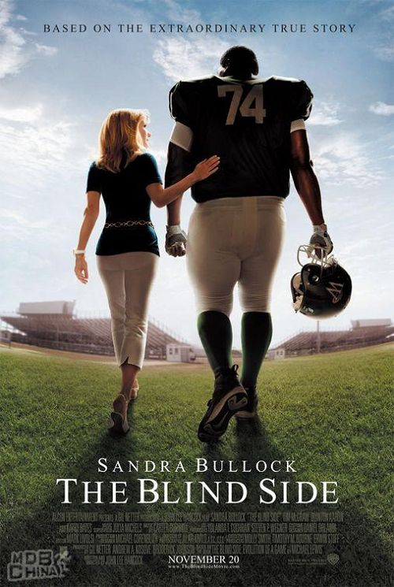

# 看碟

几个星期下来不过看了两部印象深刻的电影[**《The Blind Side 》**](http://movie.douban.com/subject/3552028/)（弱点）和[**《Precious》**](http://movie.douban.com/subject/3011072/)（珍爱），两部皆为励志片。  
  
在一种不能释放的难过中看完《The Blind Side 》，好在这种情绪在结局得以缓解。而《Precious》则只有同情，这部电影获得本届奥斯卡6项提名，但却没有启动我最脆弱的部分，可能是对黑暗、扭曲、变态、不幸的社会现象几尽麻木。有些时候，我们也是这些现象的经历者、受害者，在经历中我们变得不那么容易伤怀动情，变得冷静坚韧，接受残酷现实与丑陋人性，同时保留善良部分。弱者会让人产生大量同情心，有人说，做一个弱者没什么不好，至少能获得同情，可我更欣赏由弱变强，自强不息的人生。   
  
在整个人生的长途旅行中，我们可以选择看怎样的风景，走哪一条路，与怎样的人并肩同行，同时我们也尊重他人的选择。如果你有能力与一定的影响力，可以为社会做一些贡献，给予需要帮助的人以获得更好的人生，而不是决定他们的人生，那就足够了，不是吗？  
  

---

## 评论（6）

**大湖** · 2010-04-15

I watched the 《The Blind Side 》over the weekend as well. Since I live in the States for years, I knew how tough that is to be a black kids growing up in US and how lucky that black kid was, been adopted by a loving/caring family.

**大湖** · 2010-04-15

Meet the true Michael and his family,  
http://abcnews.go.com/2020/BlindSide/

In American football, Michael’s position is to protect the blind side of the Quarterback (the guy who throws the ball). So it is better to translate <The Blind Side> to <盲点>. It’s just my personal opinion.

**itsmin** · 2010-04-15

是的，那就足够了。

**Sherry** · 2010-04-15

我最近只看喜剧片或青春片，实在不想让自己有一点点难过的情绪。。

**lilian** · 2010-04-27

虽然这几周的工作压力特别大，但丝毫不能减退我对看片的热情……上周末分别在小店和网上淘了大量的碟，也有这张《The Blind Side 》。

**Christina** · 2010-04-27

The Blind Side 看了吗？很不错，赶紧看哦。  
我这两天工作的状态可以拿刀宰牛了。就象穿红马甲疯狂的经纪人、操盘手？天天嘴巴里骂骂咧咧的，好象只有这样才能安抚我的情绪。

