# 流连于这样的下午。

多么安静的角落，左边用来装茶叶的手绘蓝花瓷器，中间那个红色小瓷器磨砚台时用来滴水的，如今用来浇灌盆景。  
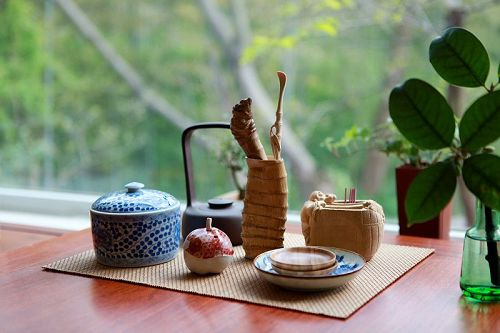  
  
下午偶尔露面的阳光斜射在仿清代的木桌上，那张竹垫子不是MUJI产品，而是在苏州淘到的宝贝，它那么不起眼，却衬托出茶具们的美。  
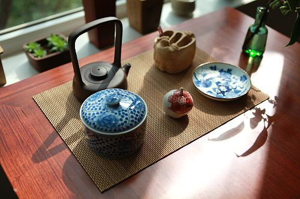  
  
滴水器皿上了半身红色花纹的釉，用手指堵住那个小孔，水自然停止，放开，水会继续流动，即使不用它帮忙磨砚，浇灌盆景，只是凝视、把握在手也满足。  
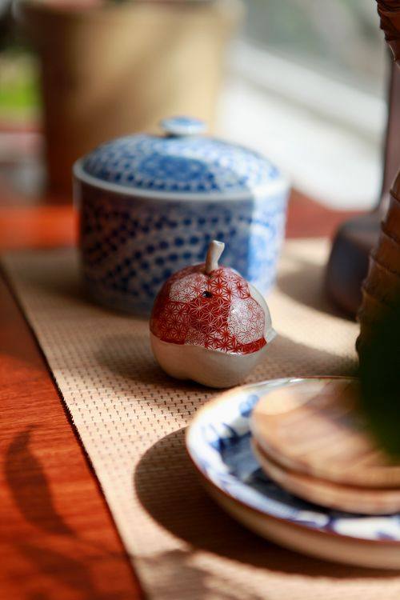  
  
整面墙的上半部分全是没有窗棱的玻璃窗，外面是郁郁葱葱紫金山景色，坐在屋内可观变化着的四季，仿佛看宽银幕电影。不多时槐花就要盛开，空气中会流动着槐花的芬芳，比香水更加自然香甜。  
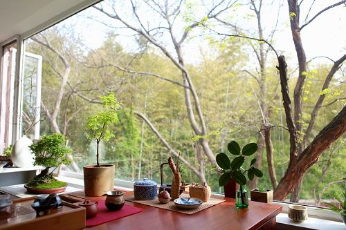  
  
据说此为珍贵植物，具体叫啥没记住，叶片后面长着淡绿色的小果实，两头尖中间饱。  
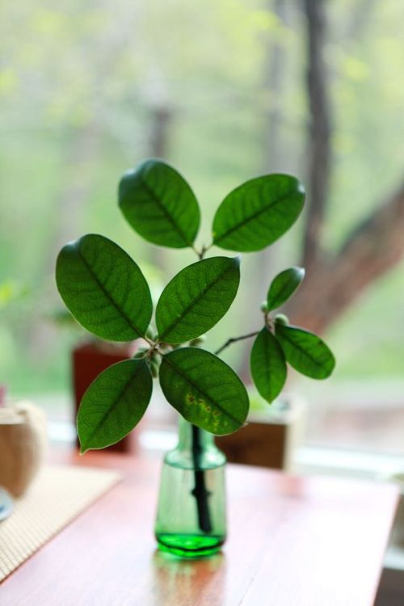  
  
就着竹子的根部雕刻的人像，用来挖茶叶的勺子，不知道雕刻的老师傅有没有培养接班人？  
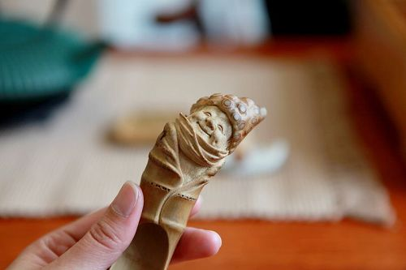  
  
整栋楼楼顶有个大露台，地面铺着木条板，风吹日晒后班驳的效果更加有些古朴的意境。那些绿色的缸在景德镇定做运回南京，用来养睡莲与荷花。我很想在这个大露台上打几个滚儿。  
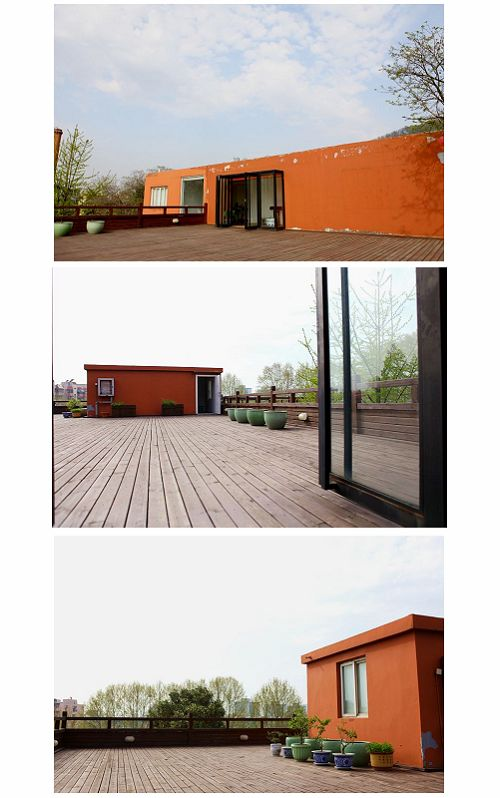  
  
有情趣的人会让随手拣来的枯树枝，配上本白色陶质花瓶而具有观赏性。  
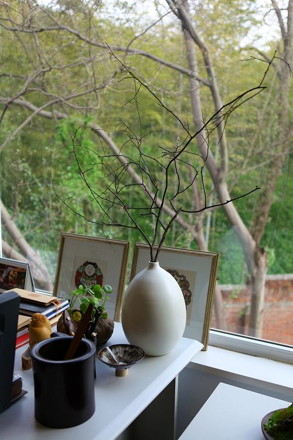  
  
植物与宠物也有命运吧？跟了不同的主人，各自有着不同的命运。这儿的植物茁壮到令人惊讶，即使小小的一株也用精致的器皿捧着，植物不同培养方式会有区别，多种植物同时被呵护得如此生命旺盛......先让我掩面为我家的植物难过一会儿...  
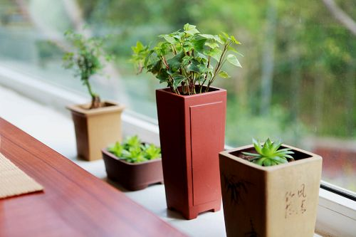   
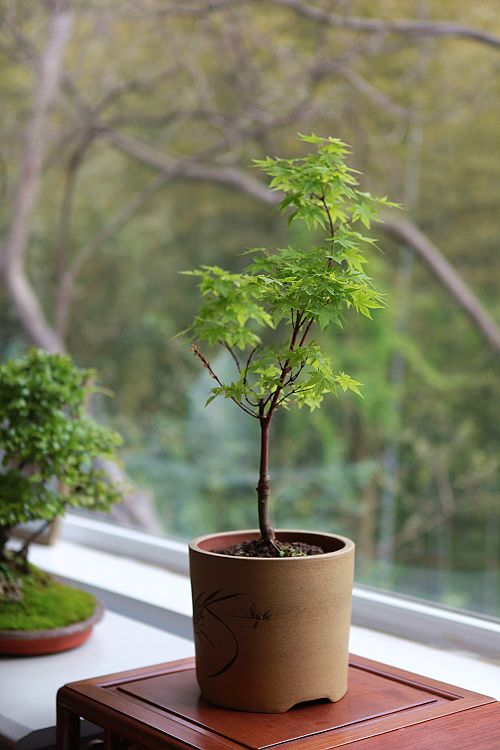   
  
小小的还未舒展开的荷叶冒出水面，那么小又那么坚韧。  
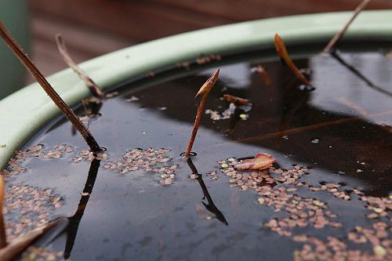  
  
睡莲花朵般的叶片安静地躲藏在水缸里面。  
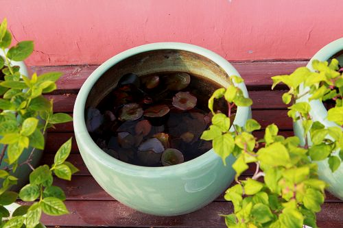   
  
造型浑圆，手感细腻的砚台木盒与眉毛纹石的砚台。  
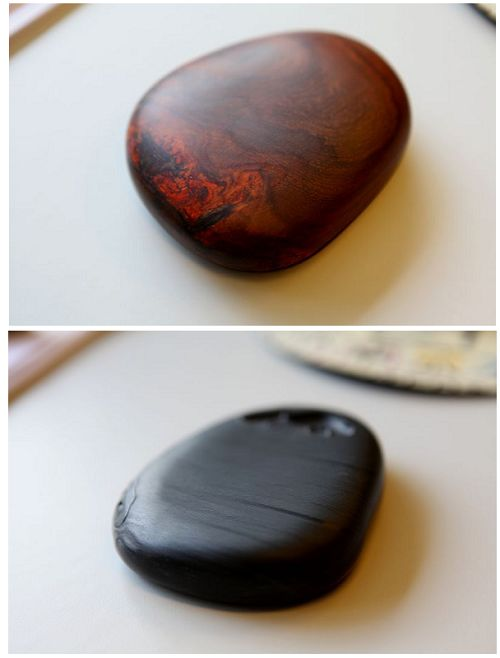  
  
古怪又可爱的老爷爷，他身后的金钱草长势正旺，每一片叶子绿油油的放射着诱人的光芒。以前我在办公室里养过金钱草，他们总是没精打采耷拉着脑袋，叶面上灰蒙蒙的，总之我觉得金钱草比较难伺候，那么见到这样一簇健美的金钱草，我问自己为什么别人能养得那么好捏？  
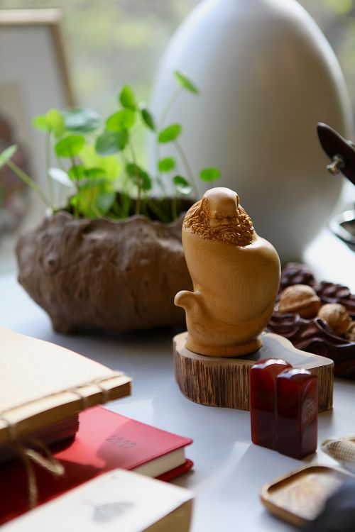   
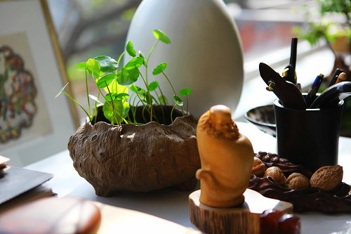  
  
一只变形的陶器里装着一截枯木，枯木上挂着两个金属制作的字“巴森”。  
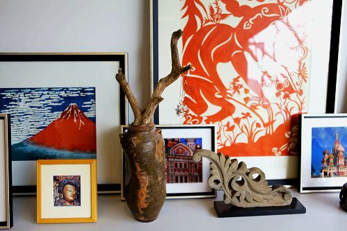  
  
用来喝白开水的杯子美到人心醉。。。想据为己有。  
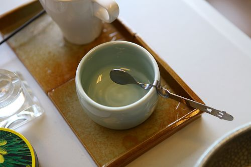  
  
装香料的瓶子。  
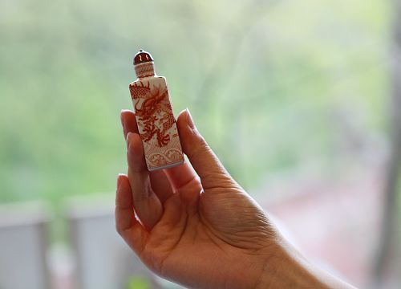  
  
随身携带香料的木质器皿。  
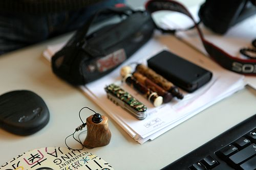  
  
她总是洋溢着甜美的笑容，我总是站没站相。我们站在露台上，紫金山混合着植物气味的空气让人感到愉悦。  
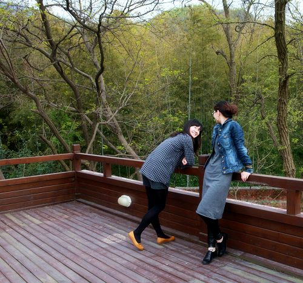  
  
墙壁上婆娑的树影，多么熟悉。  
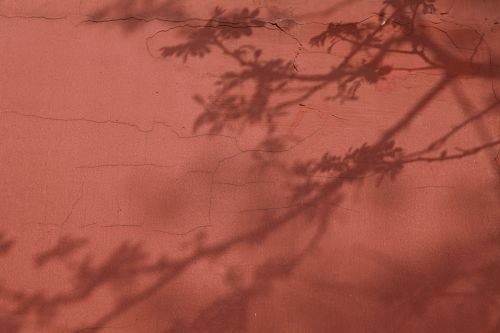  
  
这个下午品尝了多种茶，有：宜红、滇红、普尔、凤凰单枞、铁观音。有位好心的朋友送了我一大罐凤凰单枞，千叮咛万嘱咐“不要空腹喝”，此茶性凉，有些南方人喝此茶把胃喝坏了。我更喜于凤凰单枞泡出来的茶香多于它的口感。好吧，喝茶达人居然也不知道福建三大功夫茶之一的坦洋功夫茶，先让我小小的虚荣几秒，也要多谢送我坦洋功夫茶的朋友。话说上一周收到两罐西湖龙井，更爱红茶及铁观音类的大叶茶，对绿茶兴趣不大。而多年前在台湾人家里喝的高山乌龙茶让我牵挂至今，一定要找来享用一番。  
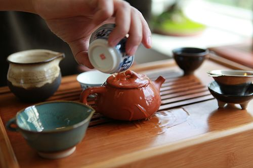  
  
储存宜红、滇红的陶罐，左边这只茶叶罐最难烧制，古时候完全靠经验手工烧制，温度很难控制，有时废几炉才能成功一只。如今电脑控制，但湖蓝色与红色部分是两个温度下形成，所以还是有一定难度的。  
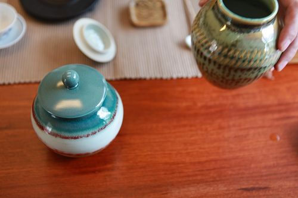  
  
我国三大红茶“宜红、滇红、祁红”，“祁红”未品尝过，“祁红”也是世界三大红茶之一，产于中国安徽省西南部黄山支脉区的祁门县一带。当地的茶树品种高产质优，植于肥沃的红黄土壤中，而且气候温和、雨水充足、日照适度，所以生叶柔嫩且内含水溶性物质丰富，又以8月份所采收的品质最佳。清饮最能品味祁红的隽永香气，即使添加鲜奶亦不失其香醇。春天饮红茶以它最宜，下午茶、睡前茶也很合适。  
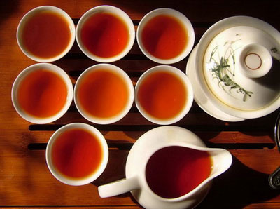  
*（此图片来自SINA）*

---

## 评论（29）

**vivian** · 2010-04-18

长见识了~

**shuwua** · 2010-04-18

主人很有情趣及眼光，做美术相关工作的吧。物件样样入眼，都很精致唯美。估计也是身价不菲之物，不过主人审美还是最重要。这组你拍得也很美。

**陈问** · 2010-04-18

搬小凳坐课堂~~

**Christina** · 2010-04-18

哦，主人既不是美术专业也不搞美术工作，是生意人。这些办公室里的物件只是冰山一角。

**微笑着沉默不语** · 2010-04-18

“春风修禊忆江南，洒榼茶炉共一担。”出自唐寅的这句诗正好送给Chinese Tea;)

**[oldphoebe](http://oldphoebe.spaces.live.com)** · 2010-04-18

古怪又可爱的老爷爷  
— 应该是达摩吧~

很有禅意的空间勒！

**喜刷刷** · 2010-04-18

透过物件看到一些难得的心境,不似刚冲泡的茶叶上下翻滚,倒似二三泡的,叶子安静地在杯底慢慢释放醇香,不惊艳,但绵长.美好.

**shwua** · 2010-04-18

纯生意人？难得！南京真是藏龙卧虎之地啊。那我也有信心继续修炼老！

**[山树](http://shanshu.blogbus.com)** · 2010-04-18

这个地方真是美啊.主人真是会享受的.把办公室布置的这么美.

**[少爷](http://jennyshaoye.blogbus.com/)** · 2010-04-18

你们俩小姑娘去人家办公室里乱拍一气呀，那个生意人生意一定做得不错的，有肚量：）

**killusoftly** · 2010-04-18

oldphoebe Says:  
2010-04-18   
古怪又可爱的老爷爷  
— 应该是达摩吧~

很有禅意的空间勒

——我私下也认为所刻为达摩祖师。

**vina** · 2010-04-18

那四叶的植物极美~

**itsmin** · 2010-04-18

花草树木无论阴生阳生，总不是为空调室内环境而生，总是需要阳光雨露的滋养。所以，时不时把它们放到外面见天的地方应该就会长得茁壮。

**itsmin** · 2010-04-18

忘了说一句，拍的片子都很美，新机子功不可没啊。。。当然，相信茶的技术底子也是过硬滴。

**[huangyuling](http://huang-yuling.net/blog/)** · 2010-04-18

看出来，很有境界

**vina** · 2010-04-18

对了茶，我给你的邮箱发了信，没有收到吗？

**Christina** · 2010-04-18

呵呵，少爷想多了，朋友，分享快乐呗～今天我没开电脑，明天看邮箱。

**eryu** · 2010-04-18

where is it?开放吗？

**Mandy** · 2010-04-18

怎么看也不象“乱拍一气”啊，看着挺享受的！我认识收藏宝贝的人，他们的乐事之一就是与朋友分享他们的藏品。

**Sherry** · 2010-04-18

你说的珍贵植物，记得说是桂花树的果子，很少见。“巴森”是主人的名字哦。  
受到启发，打算多买几盆植物回来好好养，争取把我家的大阳台改造成植物园，嚯嚯嚯。

**GG** · 2010-04-19

想喝好茶你可以疯我，我这里有点很不错的安吉白茶龙井，不敢说很顶，但是肯定比金鹰卖7600多一斤的要好不少。以你的身份，我至少可以分给你5钱到1两的，莫嫌少，地主家也没余粮的。

不要崇拜红茶，红茶只是一个传说，虽然我不是特别了解，不过大致判断，以你的体质，还是少喝红茶这么热的家伙，对于一个火药型选手未免火上浇油，你可以考虑在隆冬季节喝点。想喝祁红大红袍之类的可以找我，价高物美如假不换。

不要太迷恋茶的香味，闻起来香的基本加香精，好茶是余味在后，甘甜在喉。香，一样不过是个传说。

现天尚寒，可偶喝红少喝绿（以淡为主）多喝乌龙，南京夏天酷热，可转绿茶，舍得卖房子可以喝高档绿茶白茶，晚上转乌龙。

不要歧视绿茶，因为只有绿茶才是顶顶好大大地好地。你的明白？

**GG** · 2010-04-19

貌似我数学不好，应该是9500一斤不是7600一斤。

**Christina** · 2010-04-19

多谢赐教。俺对传说一般持怀疑态度，所以你甭担心我误入歧途。再贵的茶得喜欢、喝下舒服才好，建议之言貌似连家产也一块儿建议了？真有你的～暂且记下你的经验，等我有经验了咱俩再抬杠，哈哈～你家普尔大饼是几年的茶？给咱来点八月祁红，何如？有空我疯你个老愤青啊。

**[薇安](http://bulaoge.net/?vivianxu)** · 2010-04-19

很羡慕这样的下午，下次去南京也愿意去光顾一次

**Christina** · 2010-04-19

非消费场所，大姐。

**[光光](http://gaoguangguang.blogbus.com)** · 2010-04-20

那些东西好漂亮啊。还有一副Hukusai的画。你的照片也拍得好好看。

**[xiangzi](http://xiangziyu.blogbus.com/)** · 2010-04-20

是工作室吗？主人看来是个风雅之人。  
这组拍的真好看，我中意绿色大缸。  
养花还是用瓦盆或紫砂盆，透气舒坦。这家全用的紫砂盆哦

**[Yucheng](http://www.xbtxbt.net)** · 2010-04-21

真是厉害！有再大的烦恼，在这样的环境里，也该放下了。

**林小毛** · 2010-04-22

是虾米相机拍的啊，好好看

