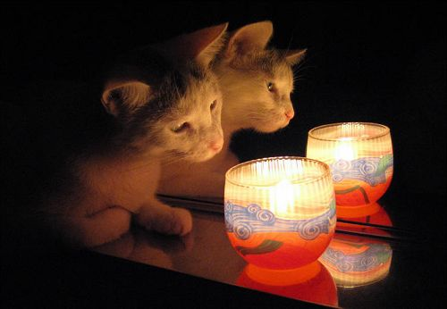

# 为玉树祈福

早晨上班路上习惯性打开收音机，每个台都在播有关玉树的新闻，哦，今天停止娱乐，全国为玉树哀悼，听着那些来自各个单位记者的报道，浑身的毛孔就张开了。  
  
通过shuwua介绍，扑土联系到青海林业局，他们开设有玉树救灾快速通道，扑土、小原子、问问和我等几个朋友，每个人各买了十来条毛毯由扑土牵头邮寄到青海.....仅仅为社会尽了一点微薄之力。我不是一个热血青年，对政治、社会问题有时候的反应会比较冷漠，我甚至从来没有献过血，以往公司组织的捐助活动基本上没有过温暖的感觉，即使在我前天晚上拿钱出来买毯子也没有感到温暖，但是今天早晨听着那些报道，心里开始温润起来，为自己做的这么点小事情感到欣慰。  
  
由于涉及消毒的问题，好像旧衣物无法运输。目前前方急需:净水片、药品、帐篷、保暖设备（被褥、垫子）、太阳能充电器、电力设备、照明。锅碗盆、粮食。  
  

---

## 评论（8）

**[septulip](http://septulip.spaces.live.com/)** · 2010-04-21

祈祷

**zyz** · 2010-04-21

中国的凝聚力在灾难面前才显得那么有震撼力。为死难同胞祈福。。。

**[huangyuling](http://huang-yuling.net/blog/)** · 2010-04-21

虽然知道世界并不完美，但请求上苍赐给人们多点安居乐业的日子吧，少些灾害，少些别离…

**[joanna](http://yanmer.cn/blog)** · 2010-04-21

我在中国红十字会网站弄了2次在线捐助，支付时都以失败告终。只能打地方捐助热线（最开始没有选择这种方式，感觉不愿成为地方政府相互攀比捐助款的工具）

**陈问** · 2010-04-21

你有一颗温润的心！

**okdata2003** · 2010-04-21

小百合贴图版有组相关善后照片，倍感沉重惨烈  
http://bbs.nju.edu.cn/bbstcon?board=Pictures&file=M.1271581597.A

**okdata2003** · 2010-04-21

小百合贴图版有组相关善后照片，倍感沉重惨烈  
http://bbs.nju.edu.cn/bbstcon?board=Pictures&file=M.1271581597.A  
http://bbs.nju.edu.cn/bbstcon?board=Pictures&file=M.1271657938.A

**红裤子** · 2010-05-10

你的心态真地很好。。

