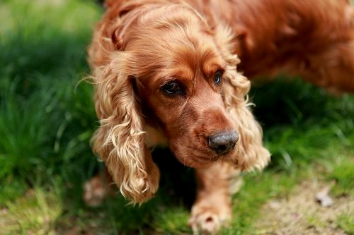
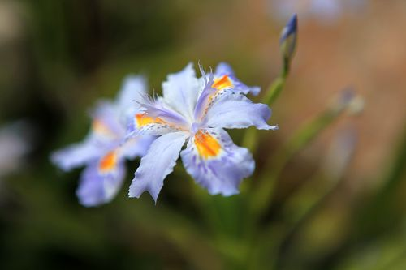
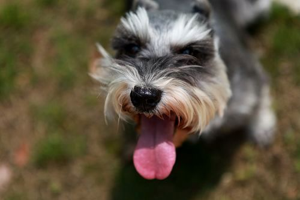
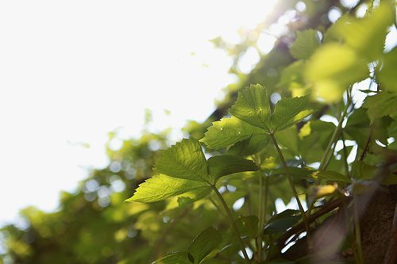
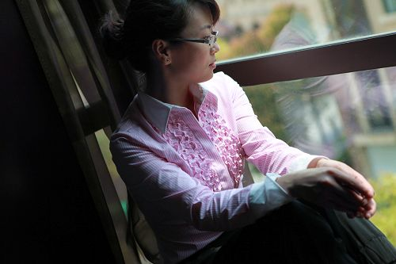

# 晴朗好时光

早晨醒来的时候满脑子都是狗狗，各种各样的狗，好象这一夜的梦都是有关狗，只因前一晚睡觉前给两狗狗洗澡？狗毛把淋浴间的下水道给堵了。。。雨一停，我就想快点给两狗狗洗澡，它们不怕雨，下多大的雨也会冲出去撒欢儿，所以早早身上便散发出淡淡的圈味儿。好几次我给撒欢儿回来的Luke擦脚，它用软软温暖的舌头轻轻地舔我的手背，土豆则喜欢舔我的鼻子，那时侯我的心立刻变得好柔软好柔软。  
  
问加班的女同事：“你每天这么晚回家，不牵挂你的女儿吗？”  
一个同事插嘴说：“她家孩子有人带。”  
“可是我每次离开家来上班，都有点舍不得我家狗狗。”  
  
看着土豆肥肥的小屁股一扭一扭爬上楼梯，站在高处沮丧地望着我。。。  
听到我一声“88”，Luke立刻转身回到自己的窝里趴下。。。  
那个时候我就不想去上班了。。。  
  
宠物尚且如此，那些有孩子的人每晚和我一样滞留在办公室，甚至比我还晚，我不能理解也体会不了她们的心情。我家狗狗现在被允许频繁上沙发了，看电影时间，它们会想方设法依偎在主人身边才满足。  
  
雨停了，情绪立刻从笼子里被释放出来，每个毛孔都在迎接春天的阳光，希望天气能持续晴朗，多给我们一些出游的好时光。  
  
   
   
   
   

---

## 评论（17）

**sueanr** · 2010-04-23

狗狗好可爱，真想摸摸。  
最后一张的你看去好安静，岁月静好。

**蒜泥** · 2010-04-23

很少看你穿粉红色呢

又见扁竹花，去年的时候你好像还问了这种花叫什么名字吧

**[少爷](http://jennyshaoye.blogbus.com/)** · 2010-04-24

我这一阵特别开心的原因,是因为能和狗狗们早夕相处.它们也变得更快活起来.我都不想再工作了:)

**[光光](http://gaoguangguang.blogbus.com)** · 2010-04-24

还是小狗乖啊，我的汤圆儿从来不让人抱的，它很少会来躺在你身上。狗和猫还真不一样。

**[至清](http://www.yangziqing.net)** · 2010-04-24

粉色，美。  
春色，美。

**frank** · 2010-04-24

人不能对PETS太依恋，和老美聊起过养狗养猫，如果一个人的生活就围着猫狗转的话，估计应该看心理医生了。

**玫瑰** · 2010-04-24

看到你对LUKE和土豆的感觉简直就像在写我对小猫高妮妮一样呢。我从不加班就是为了早点回家陪高小猫。下次去南京出差可以去看你的狗狗吗？小猫小狗是我的最爱。

**[huangyuling](http://huang-yuling.net/blog)** · 2010-04-24

每次看到博主博客的头顶图片都很有震撼力，很有意境，强势穿过眼球，冲击大脑。还有小狗很漂亮，很喜欢看花的微距照片，很漂亮

**Sherry** · 2010-04-24

又见鸢尾花。。有空咱再去拍花~  
衬衫不错，很少见你穿粉色和花朵。春天了，是该穿嫩一点。。

**[雪晴](http://blog.sina.com.cn/fromzq)** · 2010-04-24

说了别不高气，这件衣服的样式让你显得拘谨，虽然精致，但少了往日照片的灵气。欣赏你的博客多年，喜欢。

**[不羁之舟](http://blog.sina.com.cn/yangzhoumeiren)** · 2010-04-25

真的 春天来了 要好好打扮和陪伴心爱的——人和动物都是。粉色衬衫很漂亮~我也想加入你亲近下俩狗狗啊，我也有只，工作太忙寄养在亲戚家，看到我去送狗粮，激动得跳着爬着就来了~~是巧克力贵宾：）春日好！

**Christina** · 2010-04-26

我见过象小狗一样总是粘着人的猫，不过大部分猫不会献殷勤，不乐于逗主人开心，它们就是自己玩自己的，在游戏中也是将自己与人放在一个平等的地位上。我曾阅读过一篇有关“猫”的心理剖析的文章，写得真好，那本杂志被我朋友借走，3年过去了都没还我，哼~

不管猫还是狗，和人一样性格很关键，性格不同表现也会不同，我很庆幸我家LUKE憨厚，土豆乖巧。

玫瑰如果来南京提前通知我，我的邮箱tecinese@gmail.com

欢迎茶友阅狗，哈哈哈哈哈~

**Sherry** · 2010-04-26

说起猫，我算是见识多了。猫这种动物基本上是一个德行，想吃的时候粘着你叫唤，吃饱了踩都不踩你~

**[至清](http://www.yangziqing.net)** · 2010-04-29

@雪晴 为什么总有那么多人喜欢对人评头论足？

**TW** · 2010-05-01

Christina, Do you know what your problem is? I know you like taking pictures, but you’ve taken too many pictures of yourself. Showing off oneself is very tacky and should be avoided. Maybe you are proud of your looks, but enough is enough. Sophisticated folks will not be impressed by your over-exposures.

**Christina** · 2010-05-02

Christina, Do you know what your problem is?  
。。。。。。  
您太抬举我了，我对做高雅人士没兴趣。

**TW** · 2010-05-04

Christina,

I don’t think you understood what I said in my last post because your reply above sounded odd. All I commented was your over exposures by posting too many of your own photos. Remember, modesty is a virture.

