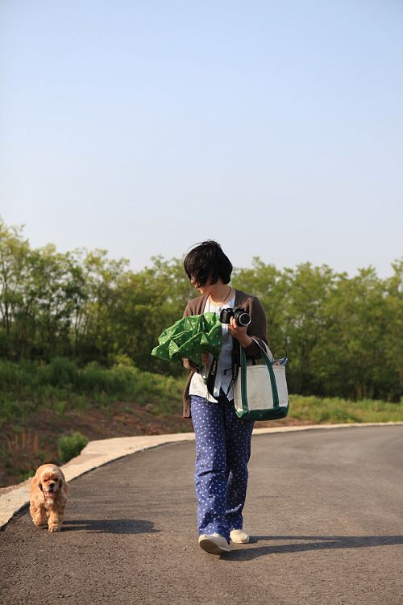
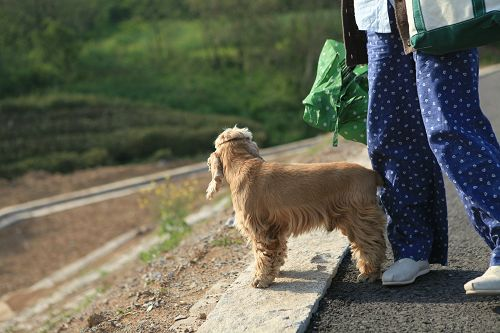
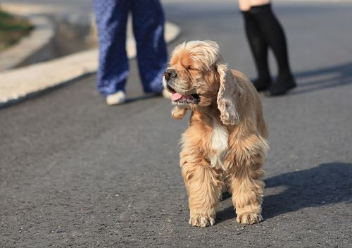
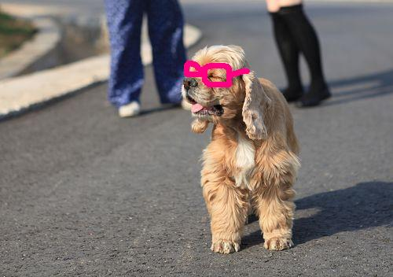
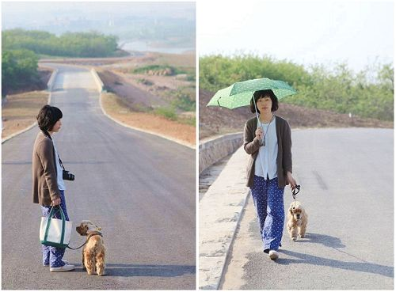
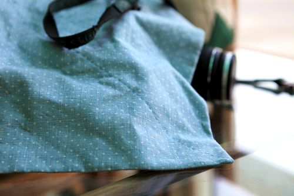
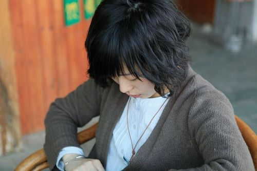

# 意外出场的主角

以为会是精力充沛的Zakky一起来登山，然而出现的是外外。  
它在楼下小解后上了问问的车，再如何，也不愿离开。  
于是，它成了登山的主角。  
  
只有它一只狗狗，人再多也不稀奇，哼。  
  
[**\*\*\*more pix here\*\*\***](http://photo.lifetea.org/v/my+friends/2010501/)  
  
有人问：“对宠物的情感有时真让人难以理解，它们会占用主人很多时间？”有时，我自己也难以理解，喜欢何须原因。外外既高兴又努力地行走着，还有鼓励的眼神时刻伴随它~  
  
  
山里的空气合着满目葱翠，时不时会引起外外的兴趣，它驻足，观望。是不是胸中也会泛起“心旷神怡”？   
  
  
外外：“我需要一副糖果色复古的太阳眼镜。”  
  
  
阿姨给你画一副哦~  
   
  
山口设了关卡，车不再能开上山了。  
不得不......步行经过这段本可以开车忽略而过的新路。  
路再好，也是上坡，也要挥汗。  
   
  
这块被缝纫后的圆点全棉花布，被问问用来做“相机包”。  
  
  
摄影杂志上有句印象深刻的文字：用相机留住她的容颜。  

---

## 评论（8）

**陈问** · 2010-05-02

选的两张和我一样。哈哈。  
相机太温柔，每每看到这色彩光晕，心就动。

**Christina** · 2010-05-02

多出去走走，就会有心动的感觉。  
用你的话讲：万物皆有灵，且美。

**陈问** · 2010-05-02

哈哈，残腿主角。

**putooo** · 2010-05-02

果然值得一去哦~···

**陈问** · 2010-05-02

不是我做的相机包，是达人小原子的手艺呕！

**喜刷刷** · 2010-05-03

给外整的眼镜好酷啊,抢眼~

**[少爷](http://jennyshaoye.blogbus.com/)** · 2010-05-05

问问撑着伞带狗走的那张, 我最喜欢

**Christina** · 2010-05-05

大图细节更好，我也是喜欢第一张。

