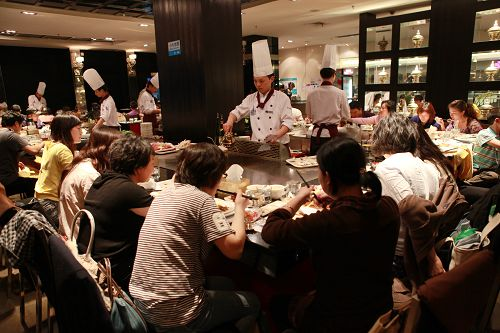
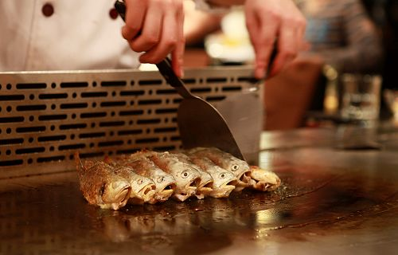
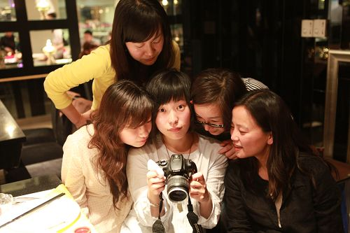
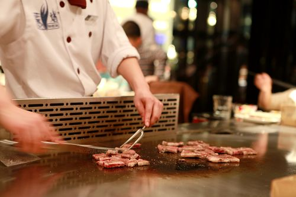
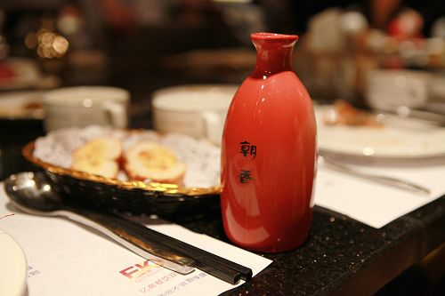
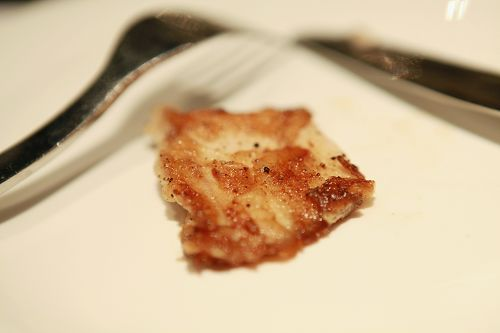
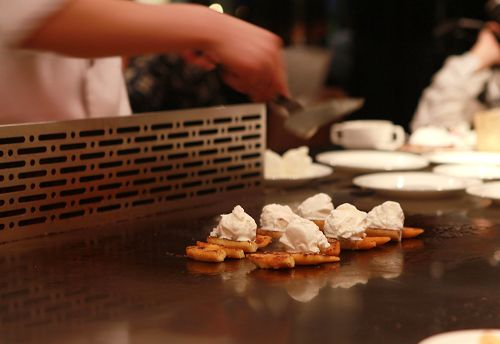
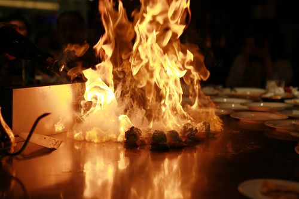
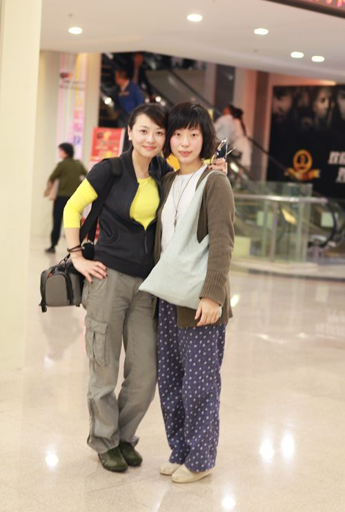

# 大口吃肉，尽情欢笑。

都说香港是个物欲都市，仿佛咽下鲍鱼，挽上LV，港人便满足了。 诚然，香港“犬儒的吃喝玩乐”盛行。但爱吃爱玩爱名牌，也包含了宣泄压力的原始冲动，虚荣，倒在其次。 为这个“为食忙”的城市，香港同事说，港人焦虑，直接影响到如厕品质，还称这是最多港人之疾。--周轶君  
  
在蓝焰法式餐厅与JM们大口吃肉时刻。  
所到之处，尽情欢笑。记得有一次去听民谣，观众身后的我们完全说笑到忘情，被人训斥两次，快乐，总会受到限制？  
  
  
煎烤结束的黄鱼，在铁板上排列整齐，象上班族。  
  
  
总是，迫不及待，看片。  
  
  
两三轮各类肉等吃下来，再也吃不下了。  
没有折扣的前提下，亏啊~  
  
  
清酒，来助兴。  
  
  
银雪鱼被煎成了大饼肌理，是不是？  
  
  
香蕉切成段儿，煎好，上面铺上一球冰淇淋。  
  
  
燃烧的冰淇淋。  
  
  
她，好乖哦。  
我们8个人在这个地方混战拍照，居然被围观。。。  

---

## 评论（18）

**putooo** · 2010-05-02

下次你不要开车时，咱们再大喝一次，哈哈~！

**Christina** · 2010-05-02

好哦，昨天的清酒口味不错滴~早晨醒来，怀念昨天吃不下的肉啊~

**陈问** · 2010-05-02

真是肉欲的一群女人哇。

**Christina** · 2010-05-02

倒~~~~~~~~~~~~  
肉欲~~~~~~~~~~~~

**小原子** · 2010-05-02

这几次都好看，你把火照得太美了~~  
8条小黄鱼都像我们的友谊欧~~挤在一起可爱史了…..

**[joanna](http://yanmer.cn/blog)** · 2010-05-02

法式餐厅？单位附近一家叫“鸿霖铁板”的自助，类似，我一直以为是吃日本餐的地方。最后的精彩也是这个火焰冰淇淋

**陈问** · 2010-05-02

8条小黄鱼，就是表情有点那个……

**wanze** · 2010-05-03

咦？呃？唉？哦？呜？哟？啊~~！  
……最后一个已经叫不出声了。  
这就是八小黄鱼的配音版。

**喜刷刷** · 2010-05-03

喜欢小黄鱼那个呆样:)

**shuwua** · 2010-05-03

笑死我了。真的是8条小黄鱼唉。每个表情都不一样。60号厨师铲刀所到之处，小黄鱼们无不崩溃。

**lilian** · 2010-05-03

对小黄鱼的比喻太贴切了，收藏～

**雯子** · 2010-05-03

对黄鱼的形容太有意思了。

**[光光](http://gaoguangguang.blogbus.com)** · 2010-05-04

那个抽油烟机真好。我们这里的这种店都没有这种设备，吃一次浑身都是味道，就再也不去第二次了。那个小黄鱼看着都流口水。

**[vina](http://vina-fanfan.blogbus.com/)** · 2010-05-04

茶呢？不见你的影子？

**Sherry** · 2010-05-04

冰激凌很好吃！餐馆实在太热了，一热就吃不下，吃一点就饱了，回家一会就开始饿。。

**[huangyuling](http://huang-yuling.net/blog)** · 2010-05-04

看着看着胃口大开，很丰盛的食物

**[少爷](http://jennyshaoye.blogbus.com/)** · 2010-05-05

茶最后一张照片的装束好酷喔:)

**Christina** · 2010-05-05

我那是为爬山准备的装束，呵呵~

