# 聚了又聚@新居

假期三天远远不够安排一切事务，最最要紧的是我好象一直没能从工作的疲惫中恢复过来，躺下来便不想起，起来了浑身散了架似的。这当然不是我的理想生活，如果身边没有亲朋们的温情，那简直不知道为什么而存在？  
  
shuwua从北京回来，女友们聚了又聚。恰好Maggie在河西买了120平的新居所，一个人搞设计跑装修，去年年底到现在，终于住进去了，下午茶顺理成章。新居所采用了我的建议，（请允许我小小得意一番）在装修和家具中加入少许东南亚元素，让千篇一律的家显得很有生活的味道。如果身边常常有许多快乐片段，单身女性的生活怎会孤苦？你有一个男人，也不必弱智的炫耀，因为男人不过是锦上添花，他们永远不是生活的主要部分。  
  
风格迥异的女友们相聚于新居所下午茶，世界上一定有许多这样的下午茶，在自留地看到另一些女性们的[**“理想的下午茶”**](http://sueworld.blogbus.com/index_2.html)，也有意思，各人选择不同的生活方式，但总有一些共同点让大家心甘情愿地聚在一起，也许是善良、爽朗，也许是孩子般明亮的心？重要的是，我们厮混在一起，不为世俗利益，不为相互利用，不要彼此抬着混社会，男人也不是我们的主要话题，这当然是最轻松愉悦的友谊。  
  
小原子在教授口金包缝纫经验，大家学得认真。  
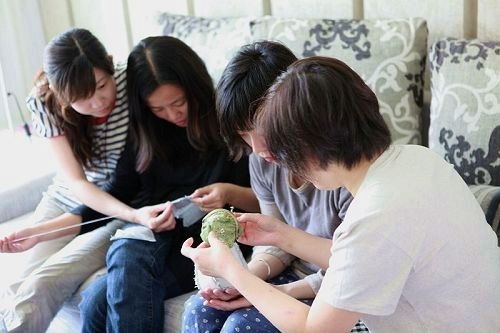  
  
并且当场缝制好送给Maggie的灯心绒面料的口斤包，放在随身包包里装零钱很方便。  
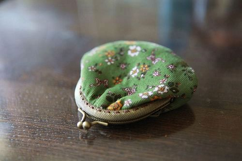  
  
介绍她去台湾的行程，有一天自己安排去泡温泉，不同价格档次的温泉，讲解得很详细。她身上的黑白风格棉麻裤，快成大家的仙女裤了。  
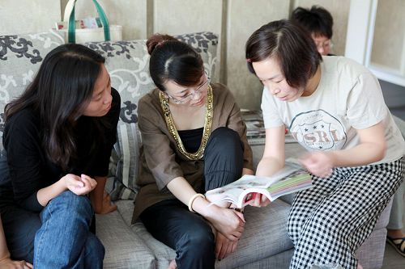  
  
shuwua这次回来也在忙装修的事儿。  
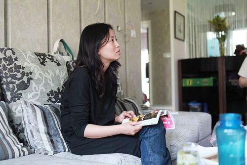  
  
她的小本子上记录着材料费用，房子图纸。。。有条理的人无论在工作上还是生活中一样会有条理。  
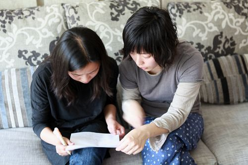  
  
下午茶准备了丰富的水果餐点，当然还有绿茶唠~  
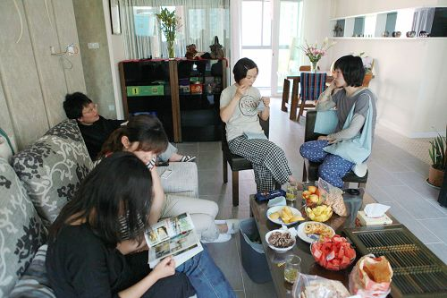  
  
照着shuwua棉布包包的款式，小原子给问问手工做了一个一样一样的，她有多喜欢？看看包包如何挂在身上便知道，她们给这个包起名叫“离家出走包”。当然这么挂着，也有内衣外穿的嫌疑~  
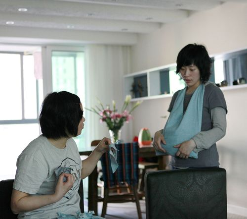  
  
据说旗娘此姿态时，大家正在谈论“凶”器。于是她默默地低下头，看了看自己？  
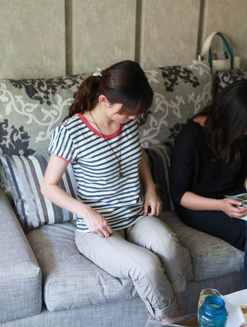  
  
没做好准备便惊恐出现的打劫者。  
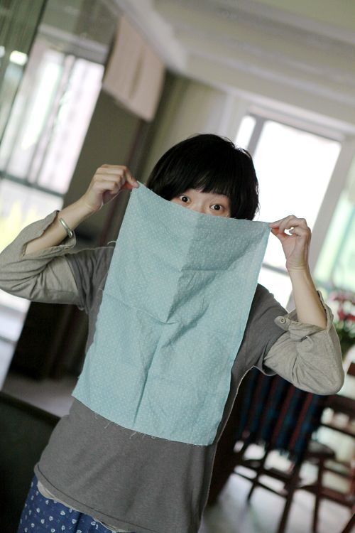  
  
进入不同的圈子，会受到不同的影响。  
比如我现在也倾向棉麻面料的衣服了。  
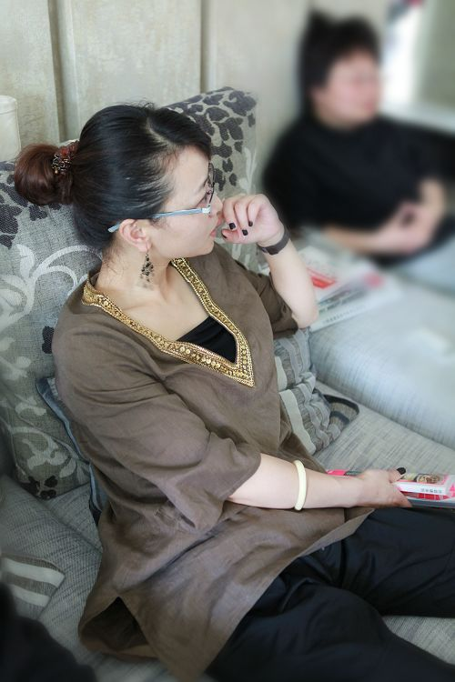  
  
用老房子房梁上的老榆木制作的餐桌椅，很沉，可以当传家宝。  
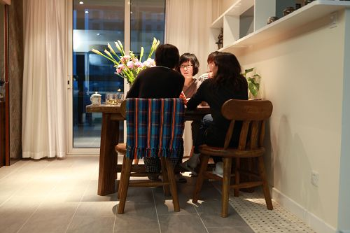   
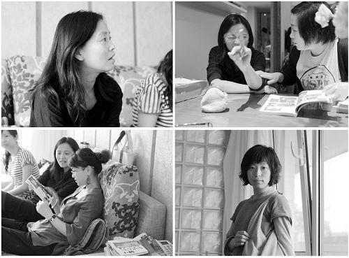  
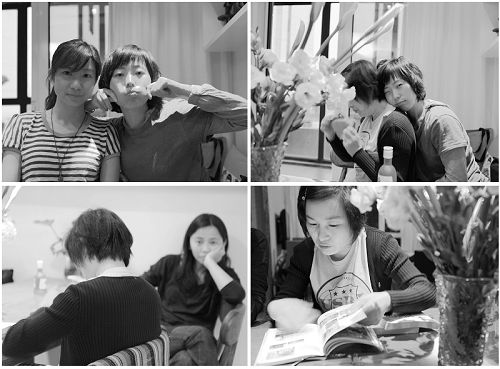  
  
扑土端上一锅青菜肉圆汤。我们严重怀疑不愿露面的Maggie事先准备好了饭菜，不然怎么那么快就烧好了一桌美食呢？最初计划仅仅是下午茶啊~  
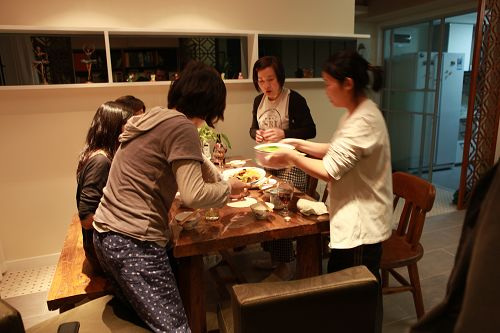  
  
看着就好吃，还有甜甜的月桂冠牌梅酒，在海关买的，我准备打个前战，为各位探探麦德龙有没有卖？中间未掀盖的砂锅里炖了红烧小公鸡，吃起来粘嘴哦，好吃的印象太深刻了。如果，人生就这样吃吃喝喝，多好。  
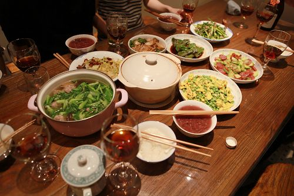

---

## 评论（15）

**陈问** · 2010-05-04

你速度！我还停留在1号下午。。。

**Christina** · 2010-05-04

你慢滴让我留汗，看了好几次网页，啥也没有，等不了唠~上班后不知道还有没有精力更新~

**小原子** · 2010-05-04

在马上要“离家出走”之前赶着给你留言…..写得真好，照片照得很生活化，我玩得 缝得 吃得 喝得 很开心，等待下次再聚~~撒花！！！

**陈问** · 2010-05-04

你让我更新。。。我、我、我更新来。只是更的不是最新嘛。。。。

**喜刷刷** · 2010-05-04

要不是putooo把几枚辣椒变成个狐皮青椒,都凑不齐8个菜.所有食材原本是我下一周的晚餐原料,没有可以准备晚餐.这一次才知道做8人饭,场面是如此宏大,在问家吃时还没觉得呢.惭愧….

**Sherry** · 2010-05-05

房子很漂亮，沙发很漂亮，口斤包很漂亮，还有一群漂亮的人儿~

**[不羁之舟](http://blog.sina.com.cn/yangzhoumeiren)** · 2010-05-05

如果身边常常有许多快乐片段，单身女性的生活怎会孤苦？你有一个男人，也不必弱智的炫耀，因为男人不过是锦上添花，他们永远不是生活的主要部分。

非常经典。相当同意。女子真能干。

**尹硕** · 2010-05-05

呵，你们这帮朋友总是让我羡慕啊！  
只是男性的朋友圈总不会这么温情的聚会

**[山树](http://shanshu.blogbus.com)** · 2010-05-05

手工活,我无论如何都静不下心来做.实在太为难了.那个口金包包,真漂亮.

**zq** · 2010-05-05

”如果，人生就这样吃吃喝喝，多好。“嗯哪，经典！

**纸鸢** · 2010-05-05

哈哈，我从问问那里溜过来，居然看到这里提到了我（理想的下午）。“我们厮混在一起，不为世俗利益，不为相互利用，不要彼此抬着混社会，男人也不是我们的主要话题，这当然是最轻松愉悦的友谊。”——说得真好！

**雯子** · 2010-05-05

巧手哦，做那个包包很好看的。针线活对于我来说简直太难了。羡慕哦

**Christina** · 2010-05-05

我也是静不下心来做手工活的，买了一堆布头，到现在还没拆快件包，自己晕一下~  
男性间的友情，俺们没体会过，呵呵~

**[光光](http://gaoguangguang.blogbus.com)** · 2010-05-06

是这样的，我是在出差回家的火车上看到你这篇。彼时黄昏时分，劳累一天，饥肠辘辘，看见那一桌子的菜，我这口水哗哗的，还有对那没揭开锅盖的小公鸡的想象。

**frank** · 2010-05-09

没有异性开PARTY太BORING吧

