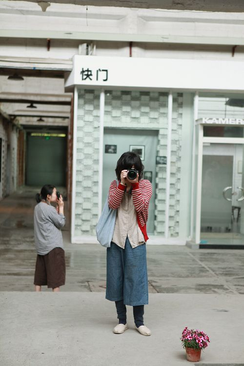
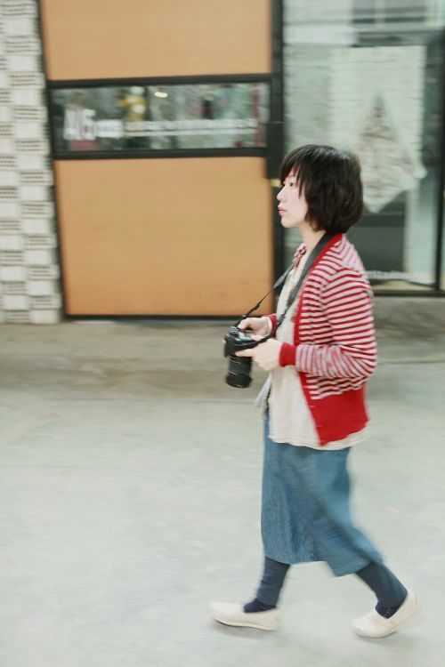
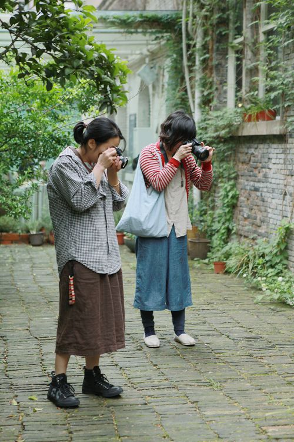
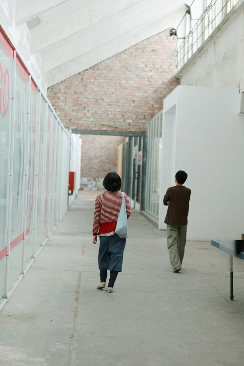
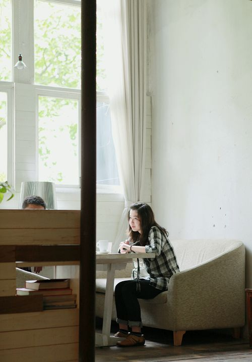
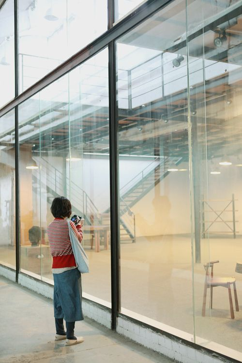

# 丝联LOFT@杭州

在杭州金华路上的丝联LOFT（好奇为何取名“丝联”）的蜜桃咖啡馆，除了咖啡还有可口的西餐，价格朴实。在整个LOFT里属最大的休闲餐厅。（下篇详解）  
  
黑白摄影工作室“快门”前，她们，不，是我们各自按下自己或胶片或数码相机的快门，很应景吧~   
  
  
客串《Chicken Run》。  
  
  
“蜜桃”古朴的前院。   
  
  
LOFT前身是个大工厂，大多斜顶，下有一排排利于采光通风的窗户，尤其爱靠近屋顶的窗户，在安静的走廊里行走，好象行走在一排明亮的光线下。   
  
  
坐在斜对面的陌生女孩，甜美的五官在白色窗帘前更加柔美。  
这是我拍下的第一张中的她，第二张她很配合地朝着镜头微笑，有点灿烂，象一朵渐渐绽放的百合。  
  
  
玻璃墙内零星摆放着中式实木家具，零星。。。留白，另一种想象？  

---

## 评论（9）

**纸鸢** · 2010-05-10

第一张问问真美

**Christina** · 2010-05-10

伪米国人当然理解不了这种日系搭配唠~  
象谁都不重要，重要的是自己喜欢。

**咳咳西里** · 2010-05-10

这种日系搭配还是要瘦的穿比较好看。短发女孩（问）很适合。

**Sherry** · 2010-05-10

同意C，穿什么自己喜欢就好啦，由别人评论去，走自己的路。

**陈问** · 2010-05-10

frank ：施主！你说对啦，我就是化缘的，化有缘人哇！

咳咳西里：我不瘦。而且扑土也有她自己的味道！我就很喜欢。

**shuwua** · 2010-05-10

你们都是蜜桃里的桃子。散发着甜甜的香。

**五月** · 2010-05-11

那个她的第二张可否放上来看看，这个小女生还挺好看的。

**Christina** · 2010-05-11

还有哪个“第二张”？不明白哎~请详解。

**youming** · 2010-05-11

丝联，印象中是原来杭丝联（原杭州丝绸印染联合厂）工厂的所在地。

