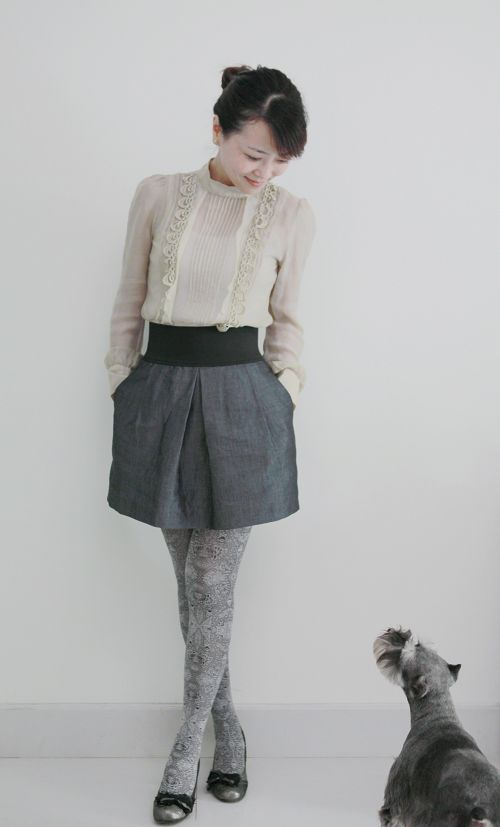

# Dress Blog

---

## 评论（13）

**月儿弯弯** · 2010-05-11

漂亮哎….

**Mavis** · 2010-05-11

美丽哦，而且和宠物色系一致~嘿嘿~

**Belinda** · 2010-05-11

表情很柔和。。。不过，我觉得袜子是败笔，然后鞋根再高些会更好看。。。

**[光光](http://gaoguangguang.blogbus.com)** · 2010-05-11

好美啊，土豆都看呆了。

**[huangyuling](http://huang-yuling.net/blog)** · 2010-05-11

博主可以去做模特了！

**Christina** · 2010-05-11

袜子是亮点，俺觉得好看死了~俺每天是走在办公室里，而不是T型台上，太高的鞋跟有损工作效率。美观的同时必须照顾到实用和舒服。

**nd** · 2010-05-11

好美：）

**sophie0927** · 2010-05-11

我也觉的袜子是亮点哎! 让我想起昨天在世博会捷克馆看到关于蕾丝和立体主义的内容。这袜子将两者很好地结合了：）

Christina, 可以分解一下衣服，裙子，袜子的来历吗？非常不同寻常。。。

**Christina** · 2010-05-11

分解如下：裙子ZARA，袜子在苏黎世班赫夫大街一家百货商场里买的。为什么国内袜子那么贵，尤其厚木的，那家商场的大牌连裤袜不会超过五百元，花色还多。

**lilian** · 2010-05-12

我觉得茶如果在淘宝上开店肯定会火。。。我最近的白日梦就是在淘宝上开家服饰店，从你这里得来的灵感：每天穿上PLYY自拍，至少可以为保持身材找到动力。同时也可以提高我的摄影技术，又为逛街找到理由……最终的目的只是想找到一种可以不被金钱和时间所逼迫的生活。哈哈！

**Christina** · 2010-05-12

真要开店，倒不适合老板自己抛头露面，你想想呢？

**itsmin** · 2010-05-12

真好看。办公室里要是坐着这么个大美女俺们工作效率肯定略大于零！还好只有一棵绿萝和几杆竹子。

**纸鸢** · 2010-05-12

袜子真棒，我是一辈子也穿不出这种味道的。  
土豆很可爱啊，我从问问那里知道了土豆的过去，真替她高兴啊。

