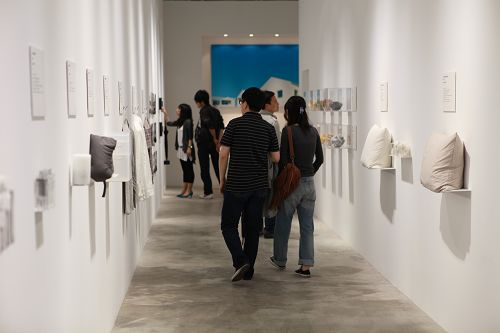
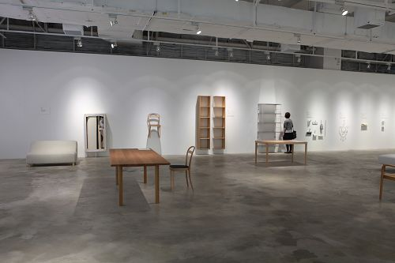
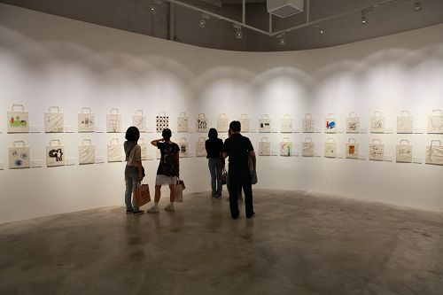
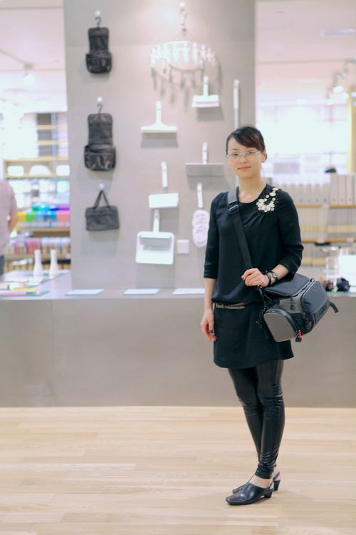

# 杭州MUJI展

MUJI展不是我们此行的目的，恰好遇上欧阳应霁喜欢的产品也不错，没有设计的设计，还真需要不一般的功力才可能有感觉，当然YY功力深厚也可以。之前我一直觉得MUJI就是劳保用品，爱屋及乌心态下会试图去了解、理解。  
  
看过MUJI展，忽然觉得这个品牌有点太极或气功的高玄，非我这样的小民所能体会，转念一想，MUJI产品好似照片中的留白，给予人想象空间并突出主题。  
  
万象城这座商场里的MUJI店没有南京水游城价格好，南京店常常有优惠，也有可能销售不好不得已优惠？南京MUJI货品没有杭州丰富，由此可见对于商家，南京是位于杭州之后的城市。类似产品在他处也可寻到零散销售，MUJI成功之处是将产品做到系列化，提供品质保证，倡导低碳环保的生活方式，自然胜人一筹。  
  
这条走廊连接了两个小展厅，白色墙面+金属灰地面，让人想通过N次。  
  
  
好喜欢这个展厅的地面，好喜欢工业感的设计，搭配原材料感强的家具，也有和谐美。  
看着MUJI产品少有占有欲，但那么多MUJI产品成列在眼前，却有想生活其中的愿望。  
  
  
全棉环保手袋，邀请各国各行业名人，从建筑设计师到服装设计师，艺术家、作家等等自创图案手绘在上面，艾未未画了只表情很Q的草泥马，呵呵~每款全棉手袋都很薄，做展示可以，怀疑实际使用会有承重问题，缺乏安全感。  
  
  
在MUJI店铺里扑土帮忙拍的，我不是摄影师，而是摄影爱好者。  

---

## 评论（10）

**ilovehangzhou** · 2010-05-09

不准拍照，为何要拍？

**[一棵树](http://5656@163.com)** · 2010-05-10

谢谢分享，让没去过的人也开心了一把。  
不准拍是担心公布后，缺乏吸引人的理由，流失去二楼购物客户吧。  
爱的还是爱的，路人还会继续是路人。

**陈问** · 2010-05-10

这个规定本身也不合理，眼睛和相机都是记录的工具，只要不影响别人就好。其实展览不算精彩，蛮遗憾的。但是这组照片角度好，也有空间感。让我觉得也有小小的加分。有时候，为了心里的小喜欢，难免要违反规则。

**[leep](http://www.sina.com)** · 2010-05-10

很喜欢博主的眼镜，能否告知牌子，哪里买的？

**Christina** · 2010-05-10

我想拍照，所以就拍了，需要理由吗？

眼镜没牌子，家门口眼镜店里买的，200元，很便宜，呵呵~

**[B](http://wenyiran99.spaces.live.com/)** · 2010-05-10

一次无意搜索到，于是看了几个月至今，看到杭州的展MUJI，无缘无故就想冒个泡，证明这里有个观众，看得想家了，呵呵

**Christina** · 2010-05-10

你想杭州太能理解了，况且还有家在那儿。这次去杭州我快爱上它了，人杰地灵，非常有灵气的城市，环境好得没话说！

**[一叶](http://blog.leafdown.com)** · 2010-05-10

如此便多多来。因你过来的关系，倒是想起以前一众博友，所以也就在这周搞个小聚会了。

**喜刷刷** · 2010-05-10

地面非常好,我曾经尝试过和设计师沟通做这样的地面,遗憾未果.

**[joanna](http://yanmer.cn/blog)** · 2010-05-10

来杭州了？下次可提前联系我，拜见闻名的茶。万象城的位置是杭州定位的日后“浦东”，即将开出的LV，据说是全国最大的舰旗。杭州商店不似上海，高档的许多，不过一两家，几乎全浙江的老板都跑来消费，导致销售额可能连上海的商家都要汗颜

