# 蜜桃咖啡馆@杭州

前一晚俺头疼地扑倒在酒店床上，扑土则对着电脑勤奋地查着第二天可去的地方，其中[**“蜜桃咖啡馆”**](http://www.metoocafe.com/index2.html)以为是左八设计的LOGO，求证后不是。蜜桃好象挺有名的，名字起的好粉嫩呐。第二天午后我按照GPS指示找到它，问问、W从南京抵达与扑土在那里已经吃上了。确切的说蜜桃更象是休闲餐厅，看了它的网站介绍，经常会举办一些小型的音乐表演。感觉还不错，比想象的要大许多，环境也好。蜜桃是LOFT里最大的吃饭喝咖啡的点儿，生意看上去也不错。听说老板是设计师。  
  
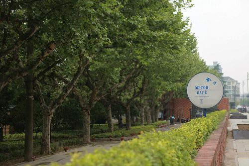   
  
拍这张的时候我说：“扑土，把头低下去。”她真的把自己藏得无影无踪唠~  
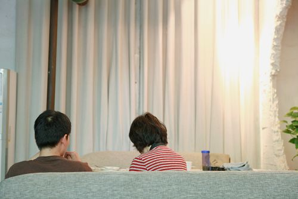   
  
超喜欢蜜桃的白色大窗户，白色窗帘。  
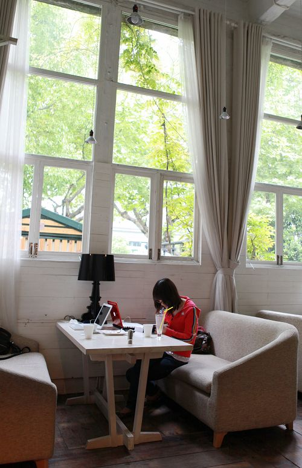   
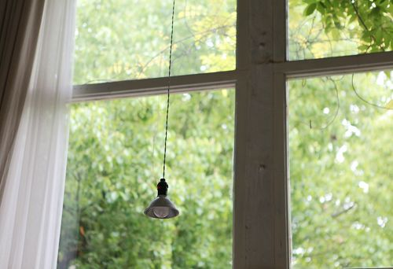   
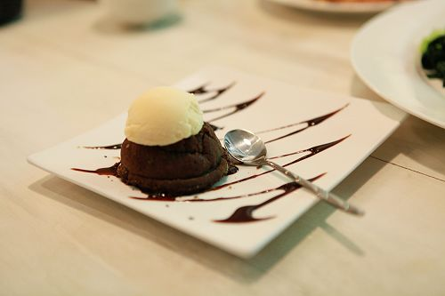  
  
他们吃的杯盘狼籍我才到，就这样我还是在里面扒了两口吃的，虽然我刚在绿茶吃过午饭。  
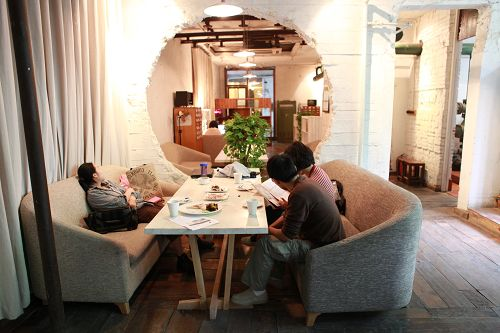  
  
蜜桃的前院又是另一种调调。  
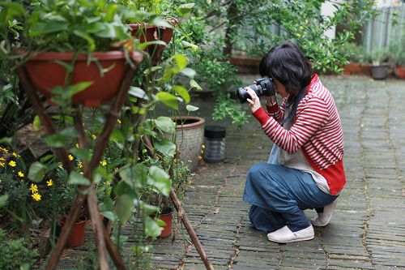   
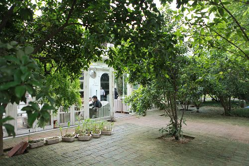   
  
她抿下一口拉花的卡布其诺，扭头朝声音传来的方向张望，斜躺在沙发里的我（坐没坐相）就势从这个角度拍下她。或可以在拍摄中更勤奋地爬高上低，以获取更多新鲜特别的角度？她身后白色的大窗户真是太美了。  
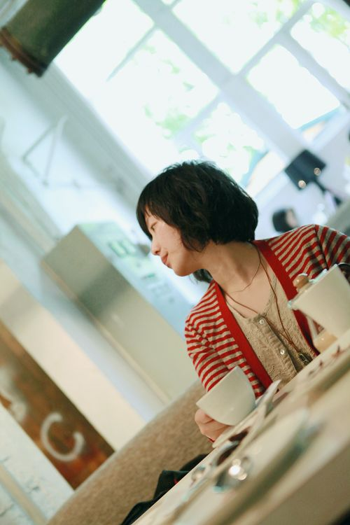   
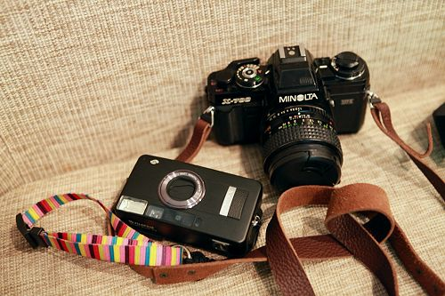   
  
蜜桃好象分两块，这儿是供工作人员使用的吧台，服务员一身黑色，系着拖到脚面的黑色围裙，范儿足。  
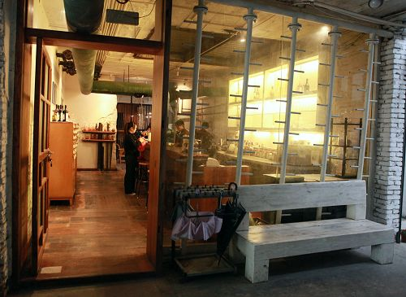  
  
应该是招牌的蜜桃咖啡？如果我没记错的话，记性超不好。   
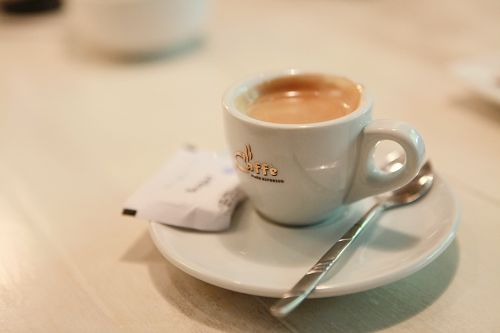  
  
原先工厂里留下的巨大排风扇，这座让顾客不可忽视的摆设如今成为餐厅里工业设计感十足的观赏品。得吊车才能搬得动它吧？  
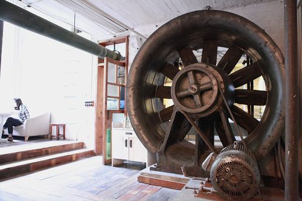   
  
卫生间里面还有个小小的庭院，长着一棵树，去的话，一定观摩一下里面的设计。  
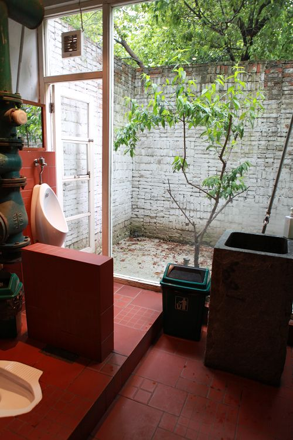

---

## 评论（13）

**shuwua** · 2010-05-12

谢谢茶这么周到的介绍，我如同去了一趟。与你们同在，阿门！

**娟琳雨筝** · 2010-05-12

很喜欢这样的地方，很生活化的感觉，似乎一切静好。更爱你们这群好朋友，羡慕你们有彼此的陪伴。呵呵

**Christina** · 2010-05-12

有机会一块玩~呵呵~

**陈问** · 2010-05-12

我残喘着回来了。客栈破网，微薄不能回复，日志不能发布，我气吐血了。。。

**java_guy** · 2010-05-12

楼下的，借个盆给哥楼上那位用用。。。

**[扑土](http://5656@163.com)** · 2010-05-12

是左八以前工作过的工作室设计的，陈老师~

**Colin Hill** · 2010-05-12

楼上的，这儿没有盆，我问问楼下的有没有杯子。“嗨，楼下那位说你呢，愣着干吗，有人吐血啦，赶紧递个杯子上来。”

**陈问** · 2010-05-12

来了来了，杯子。。。

**Christina** · 2010-05-12

楼上的抢镜啊～

**[光光](http://gaoguangguang.blogbus.com)** · 2010-05-12

空间大就是好看，英文叫me too哦，有意思。但是为什么洗手间是蹲的呢？

**Christina** · 2010-05-12

蹲的卫生吧，国内公共马桶用的不放心～

**Sherry** · 2010-05-13

不错的地方，超喜欢那么大的窗户，透亮~

**[小丹佛儿](http://blog.sina.com.cn/dinosaur313)** · 2010-05-13

这种生活还真惬意 可以工作可以生活~

