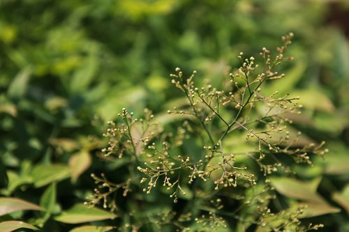
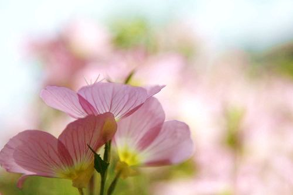

# 拍春天

一片绿色中一眼注意到这么Q的小圆球，不容易对焦，是花是果实？  
   
  
宁杭高速边上开着许多这样粉色的花，中午遛狗的时候拍它，这花每年春天都开得灿烂，野花的生命力真是强，土黄色花粉沾到我的袜子上，狗狗的脸上身上都是。  

---

## 评论（3）

**[xiangzi](http://xiangziyu.blogbus.com/)** · 2010-05-12

摄影有天份，鉴定完毕。很喜欢第2张。狠狠喜欢。

**Christina** · 2010-05-12

第二张花朵上再来点光线是不是更好？

**Sherry** · 2010-05-13

第二张很美，我越来越对粉色钟情了~~

