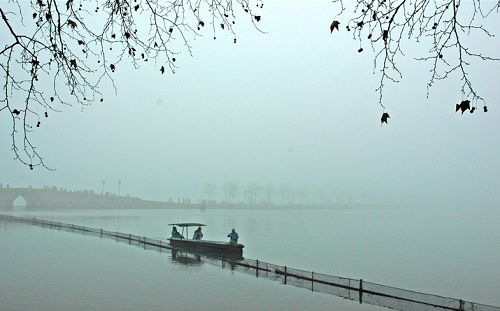

# 送给我们的杭州行

张靓颖唱的[**“印象西湖”**](http://www.3g.cn/songcity/syes/music/hz.mp3)是喜多郎作曲，听喜多郎纯音乐的[**“印象西湖雨”**](http://www.livelyidea.com/nono/Spirit%20Of%20The%20West%20Lake.mp3)也好。我们到杭州的那天也在下雨，春天如果想找个地方走走，可以考虑杭州，这时候的杭州很美。  
  
扑土推荐了范宗沛的[**“摆渡人之歌”**](http://www.soundmapping.cn/fieldrecordings/1258802702291.mp3)，好比千朵桃花一树生，非比寻常泛泛亲，你莫把姑娘当外人。他们在花丛间轻轻弹唱，我们在水波间荡漾。这深处的江南，让人怎不流连难忘。  
  
  
  
雨还在下落满一湖烟  
断桥绢伞黑白了思念  
谁在船上写我的从前  
一笔誓言满纸离散  
  
雨～～～站在湖边  
雨～～～遥望北岸  
雨还在下落满一湖烟  
断桥绢伞黑白了思念  
谁在船上写我的从前  
一笔蝴蝶满纸离散  
  
我的告别从没有间断  
西子湖上一遍一遍  
  
白色翅膀分飞了流年  
长叹一声天上人间  
雨还在下淋湿千年  
湖水连天黑白相见  
谁在船上写我从前  
一说人间再说江山

---

## 评论（4）

**喜刷刷** · 2010-05-12

喜欢喜多郎版.

**Christina** · 2010-05-12

你回南京啦？好~

**lilian** · 2010-05-12

歌词写得太美了。。。作为杭州人忍不住要自豪一下！虽在上海工作却从没想过要扎根在这里，杭州才是生活的地方啊~~

**Takemoto** · 2010-05-13

范宗沛的“摆渡人之歌”，原是评弹之音喏，苏州话吴侬软语，杭州话就比较硬了，俗话说“杭铁头”嘛

