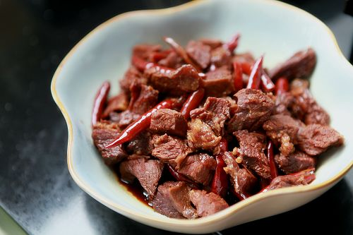
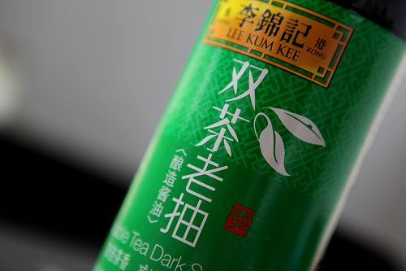
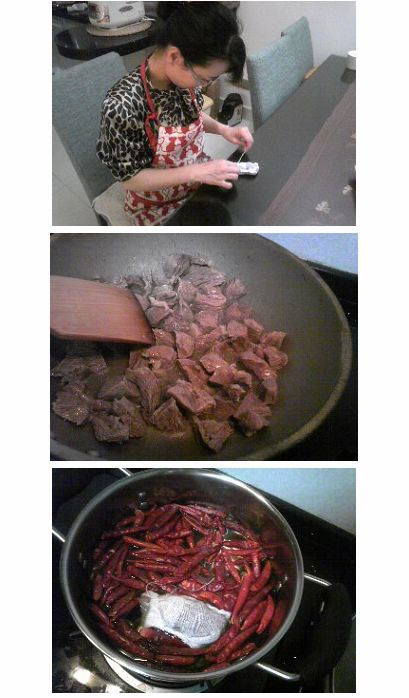

# 炖牛肉

昨晚炖烂的牛肉，今儿午饭起锅前加盐和少许鸡精。  
  
  
之前家里的黄豆酱油不怎么上色，换了双茶老抽，里面配了普尔茶和绿茶的茶粉，好极了。  
  
  
新鲜牛肉一般早晨到达超市，所以买牛肉得乘早，20多元的牛肉烧出来也就一碗的量。为了避免吃的时候挑花椒的麻烦，自缝一个小纱包，把花椒包在里面下锅煮。牛肉块儿进油里炒一下，加水、糖、料酒、酱油、花椒和干辣椒慢慢炖。  
（昨晚手机拍摄）  

---

## 评论（11）

**大湖** · 2010-05-21

OMG! you use that much Red Chile Papper in your cooking?!!

**[少爷](http://jennyshaoye.blogbus.com/)** · 2010-05-21

看来茶的厨艺大涨啊. 茶,我喜欢你原先页面那个背朝大海的女孩,她看起来好象你喔:)

**[至清](http://www.yangziqing.net)** · 2010-05-22

精致生活。

**truecolour** · 2010-05-22

这么多的辣椒会辣到什么程度啊？

**陈问** · 2010-05-22

这个双茶酱油看到推荐，我也想收购呢。你在哪里买的？

**涔伊沁** · 2010-05-23

一直很喜欢你，“知性女人”第一个就会联想到你：）不知生活中的你是个什么样子，具我所知，好像抽烟：）冒昧了

**[山树](http://shanshu.blogbus.com)** · 2010-05-23

我现在不能吃太辣的.对宝宝不好.忍…

**shenwen** · 2010-05-23

话说，看了这个辣椒和牛肉的照片，我今天飞速去超市买了牛肉，打算如法炮制一次。。。

**mandy** · 2010-05-24

建议你下次烧牛肉时加点丁香~~就在调味料处有卖，只要放一两棵。

**Christina** · 2010-05-24

这位深圳的“涔伊沁”，我每天还要如厕的，这就是现实中的我。

**okdata** · 2010-05-27

“。。。。就是现实中的我。”  
哈哈，还用电脑控制24小时恒温电饭煲。  
这玩意煮稀饭、煲汤都行。

