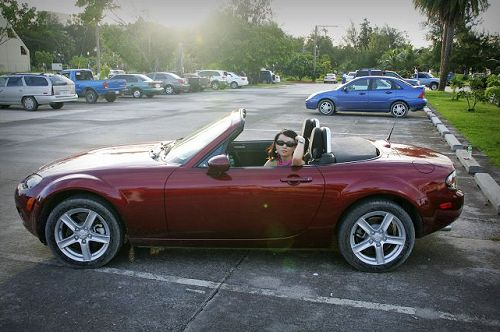

# 我看《杜拉拉升职记》

晚饭后，我捧着半个黄瓤西瓜开始看徐静蕾导演、主演的《杜拉拉升职记》。对它的注意开始于一个多月前，Hank从澳洲回来，随身的笔记本包里放着《杜拉拉升职记》的小说，非常正的大红色封面。他说：“这本书写了许多关于外企职场的经历，挺真实的，也有可借鉴的经验。”没几天我也买了一套，准备抽时间学习一下。一直到我看完电影碟片，书还没翻过。  
  
之前看到一些负面评价，这种状况下，亲身经历、亲眼所见、自己去了解时印象往往会背道而驰的。对，我对电影《杜拉拉升职记》感觉不错，有笑有感动有共鸣，不知道小说怎么样。  
  
   
  
我想谈谈以下几点：  
  
1、主要三位女职员给我的感觉每天是去shopping或参加大趴提，打扮太妖了，领口开的忒低，妆也浓！这哪里是去工作？简直就是去夜场。造型师和化妆师对职场完全没有观察，而是卖力的去打扮诸位女演员，是这部电影最大的败笔。李艾找总裁签字时，穿着露了半个乳房的衣服，有性骚扰嫌疑！这样的着装破绽太荒唐。  
  
2、销售总监王伟。。。在我看来大多数从业多年的商务男是不会穿着“窄脚西裤”去上班的，除非他刚工作，或者是个GAY。商务男也不会把自己打扮成花样美男，也少见从业多年还那么苗条的"王伟"。穿窄腿裤、打扮时尚、油头粉面的男人，这种形象在职场上很难给人以信任、塌实的印象。  
  
  
  
3、办公室恋情。。。没有理由拒绝真实的感情，工作地点可以换成百上千，有缘分又合拍的人却很难遇到。我爱上的都是身边人，因为了解，日久生情。这没什么可耻的。不合适就分开，一个人的精神与情感世界稳定满足，生活才可能平衡。  
  
4、玫瑰和王伟驾驶汽车的镜头，我当然特别想知道他们开的什么车，镜头拉下来是马自达。。。作为世界前500强DB的销售总监，这辆车有点架不住。但是杜拉拉消极购物的马自达MX5，与她还是很协调的。自从我在塞班租驾过马自达MX5之后，曾经不止2次梦见过它，这辆复古小跑车好象被我遗忘在某处，梦中的我不停寻找，每次居然是相同的梦境。国内已经进口销售，价格在33万左右。街上还是MINI跑的多，了解MX5的人还是少。  
  
  
  
5、对王伟自言自语地一句台词很有共鸣：“每天忙来忙去，不知道到底为什么而忙。”  
  
6、这是一部以爱情为主，职场为辅的电影。  
  
现实中的复杂、黑暗与丑陋，电影里基本没反映，大多是正面、阳光的部分，看的时候有笑有泪，特别收录也好玩，不要错过。我和徐静蕾同年，看她在屏幕上演，有那么几秒钟感觉在看自己。电影中解压的方式除了购物就是吃，过去我还会选择旅行或是和朋友们在一起，现在更喜欢宅在家里做一名植物园丁或是烹饪，这种解压方式既环保又实惠。相信有许多人会在电影中找到自己的共鸣，以及似曾相识的场景和感触。  
  
最近读到这样一句话：**年轻时候你特别想得到的东西，现在却越来越不在意。**  
送给大多数职场人，或有一些启发？

---

## 评论（14）

**[至清](http://www.yangziqing.net)** · 2010-05-28

没关注过此剧。  
不过意料之外的是，里面会出现文中的车辆。  
徐静蕾很有眼光。

**Christina** · 2010-05-28

应该不是导演自己选车，是为马自达做广告拉赞助吧。

**Sherry** · 2010-05-28

时装片，童话故事，不现实啊~

**chenchen** · 2010-05-28

感动，听着《淡淡地想你，淡淡地流泪》，配合你的这篇文章，都要哭了。你还是一个很感性、很真实的人，看你的衣服和拍的照片，感觉你很小资，呵呵。你爱茶我很喜欢，我也很喜欢茶。“我喜欢温暖感情，我希望我的世界是干净的”我觉得你的感情观一定是这样的，不会为了结婚而婚。我也是这样，今年我30，我最大的改变就是，今年我做好了单身一辈子的打算。不是因为无奈。而是 把生活中的很多东西看开了很多，活好每一天，就是过好了一辈子

**兔子** · 2010-05-28

书比电影好，电影弱了，更像杜拉拉恋爱记。

**喜刷刷** · 2010-05-28

豪车上坐的是你吧，不象老徐。我蛮佩服老徐的，总在做自己想做的事，且游刃有余。

**Theresa** · 2010-05-28

我周围没看过小说的直接看电影的，都挺喜欢。。 小说一派的看电影就都说是“挂羊头卖狗肉”。

**农妇某人** · 2010-05-29

我买了书，看了一半。好累人的一本书。如果硬着头皮看完我的头发会全白掉。从头到尾的算计穿小鞋和勾心斗角。不喜欢。

**五月** · 2010-05-29

说实话电影比书差远了。不过依然很喜欢老徐，不管她电影拍的好坏，她一直在突破自己，做自己喜欢的事。我参加过一次她的电子杂志搞的活动，一看她就是个非常有主见的人。

**sususu** · 2010-05-29

我还买了电视剧版的杜拉拉看呢，不过没看完。后半部明显乏力。王珞丹演职场新人的时候还是不错的，就是觉得电视剧的办公室置景太假了一点。

**Xiaona W.** · 2010-05-30

我也看了《杜拉拉升职记》，很有趣，不难找到自己的影子。我很喜欢徐静蕾的作品，在这向大家推荐她的另一部电影《一个陌生女子的来信》。

**Christina** · 2010-05-31

真实的职场“穿小鞋和勾心斗角”就是家常便饭，大家争来斗去到头来得到的东西，似乎也没什么大不了。也许作为女性没那么大野心？

电视剧的《杜拉拉升职记》看过几集，和sususu感受一样，布景太单薄了，比简陋的工作室还单薄，楼梯居然是铁架子！电视剧里的演员，没有电影里的演员给人感触饱满。

最后看了“特别收录”，现实中的老徐还是挺成熟的，一改学生样儿，抽两口烟，讲话慢条斯理，有主见。能做到自己喜欢的事，顺应内心存在的人毕竟是有限的。把对这种状态的努力作为理想或信念去坚持，对自己也是不错的鼓励。

**lilian** · 2010-05-31

先看的书，然后也看过姚晨的话剧版，最后想看老徐版的杜拉拉纯粹是冲着时装大片的噱头去的,因为我也喜欢《欲望城市》。除了觉得老徐的演技差点，别的都没太让我失望。

**[薇安](http://bulaoge.net/?vivianxu)** · 2010-06-01

最后一张好酷啊.喜欢

