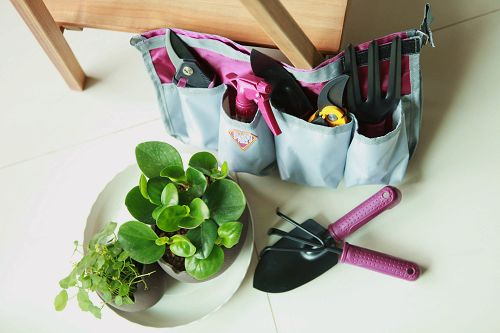
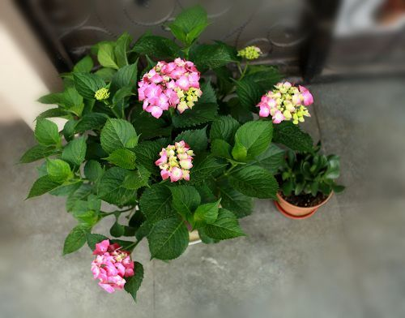

# 种植花草

我想做一名园丁，每天与花草打交道，比与人打交道要美好。  
今天收入小农具一套，颜色好喜欢，这下干劲儿更大了。  
  
   

---

## 评论（11）

**vivian** · 2010-05-28

农具哪里购入滴？好漂亮的颜色，哈哈~

**Christina** · 2010-05-28

呃，不是买的，是样品。。。

**喜刷刷** · 2010-05-28

去年从桂林某古镇上背了一棵绣球回来，被我搞格儿了。始终不解的是，我每天都蹲着惯它，但它还是非常绝情地走了，头也不回一下。。。。

**农妇某人** · 2010-05-29

嗯，这个非常同意。养花吧！比养人实在又省心。嘿嘿。

**雯子** · 2010-05-29

绣球花颜色很漂亮哦!养养花儿,溜溜狗儿,好安逸的休闲日子哦.

**[shanshu](http://shanshu.blogbus.com)** · 2010-05-29

上次还看到有蓝色的绣球花卖.农具很可爱.哈  
你等秋天开始弄吧,现在天热了,已经不适合再种植了.  
养花绝对会让人更爱生活.

**[至清](http://www.yangziqing.net)** · 2010-05-30

很精致的农具。  
不过可不要乱扔啊，砸到花花草草的不好……

**lilian** · 2010-05-31

茶养狗狗也是这么想的么?等我退休了也想养条狗。。

**[薇安](http://bulaoge.net/?vivianxu)** · 2010-05-31

养花养草,修身养性.以后就和山树同学一样了.是个爱心园丁

**Christina** · 2010-06-01

想让绣球花开出蓝色花朵给土壤加铝粉，开红色的花朵可以加些石灰，嘿嘿~对我打击很大的是我家小区的公共区域居然也有一片绣球花。。。

**[微风轻拂](http://blog.sina.com.cn/u/1738436165)** · 2010-06-03

每天与花草打交道，比每天与人打交道要美好。  
说的极是啊！

