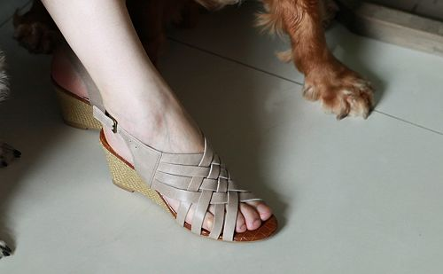

# 节日快乐。

“大力水手和忍者神龟喜欢吃什么？”  
  
早晨上班路上，101.7的播音员在广播里询问到....  
呃，totally不知道，速发短信给众友。  
  
短信回复清晰地分两派：70年代中上旬不知道，70末80后回答正确。  
有意思的是前者几乎都怀疑是不是脑筋急转弯？  
俺们除了“生不逢时”，没认真看过这两部动画片之外，还被岁月磨练出多元思维。  
  
好吧，今天不是愚人节，答案是“菠菜和意大利馅饼。”  
  
皮蛋对外面这位大叔的观望很好奇，站起来用爪子拍拍大叔的脑袋，哼~  
  
  
Maggie说：“你那双鞋打了5折。。。”（她总是告诉我不幸的消息）  
我才买一个月，穿了三次！同时买的2双鞋还没穿。。。痛心！  
  
于是我愤愤不平地又去了商场，买回这双7.5折凉鞋。并且对营业员说：“请转告厂家，为品牌形象考虑，不要短期内就折扣销售。。。”  
  
当我乐滋滋捧着它的时候，传来一个声音：“再买一双，平均价便宜了，你就赚啦？”  
恩，我承认我不会算帐，但很爱鞋。  
  
这只狗爪儿的脚背也不错，呵呵~  
  
  
我们今天都快乐！  

---

## 评论（10）

**Anyayaya** · 2010-06-01

BINGO！我统统答对！

**[薇安](http://bulaoge.net/?vivianxu)** · 2010-06-01

儿童节快乐!今天我会有个大大的礼物.哈哈哈

**Sherry** · 2010-06-01

我说的是“菠菜和批萨”，也对哦~

**喜刷刷** · 2010-06-01

全家福好温馨的,要不是你手挡了土豆的脸,她的表情一定更煽情.

**lilian** · 2010-06-01

70年代中上旬不知道。。我顺便考了几个同事，竟然都知道。。

**Anyayaya** · 2010-06-01

我女儿昨天说：明天是儿童节，我过节，所以得买个蛋糕。于是以儿童节的除夕为借口，买蛋糕，争而食之。母亲节、父亲节、国庆节、等等等等，对她来说存在的价值是鲜活的、流口水的。

**不羁之舟** · 2010-06-01

这个凉鞋我也喜欢啊 茶买的什么牌子啊

**陈问** · 2010-06-01

款式好，颜色也好看，是淡淡的米藕色

**shenwen** · 2010-06-01

呃，菠菜和馅饼，那么我显然是快乐的80后。

**河川** · 2010-06-02

请问棕黄色的luke是美系可卡吗？平时需要剪毛吗还是就这个卷卷的长度？  
灰色的土豆是什莫品种？非常喜欢。看上去很聪明！  
我正打算从这两个品种中选一种养。  
谢谢！

