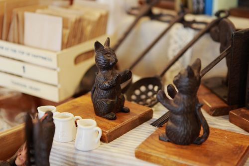

# 机器人生活

   
  
  
明天星期四了？这周过得真快，一晃眼的功夫就是小周末。这和每天差不多的生活内容，紧张的节奏有关。加班时能感觉到颈椎顶着脑壳的不适，不知道哪根神经被压迫着，忙得差不多就下班，跑去商场帮好友买打腊牛皮凉鞋，米色只剩一双37码，好在我及时赶到。回家的路上顺道去修刘海，不打理的刘海，怎么看都象个汉奸。  
  
漆黑的夜晚，驾车行驶在高架上，神情呆滞，甚至有些恍惚。大概饿着肚子会增加一丝凄苦感。想想这两点一线，偶尔改换一下线路的生活。。。想到每天早晨醒来急匆匆离家上班，在办公桌前坐下没完没了细碎又头绪繁多的工作，从上班到下班，然后为那一口饭再忙碌。就好象机器人的生活一般。醒来，开关被按下，行走的轨道、节奏以及内容已经被编程，这步走完接着就是下一步，容不得考虑，机器就这么运作的。

---

## 评论（3）

**喜刷刷** · 2010-06-03

我们都是橡皮人~

**耳雨** · 2010-06-03

好在有博客，还有微博。

**[光光](http://gaoguangguang.blogbus.com)** · 2010-06-03

玫瑰说她给你回了信的，gmail和hotmail之间有时会丢信的。我早就发现这个问题了。

