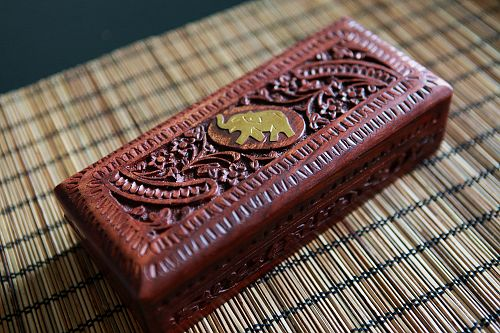
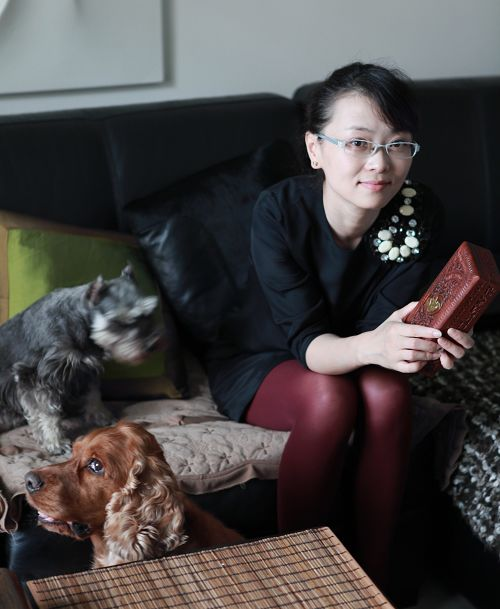
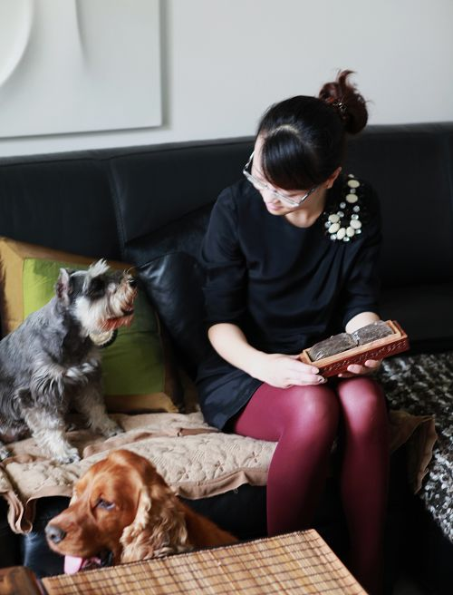
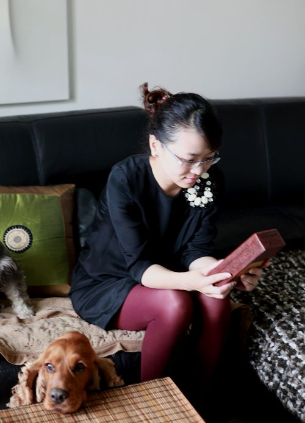

# 活色生香

每次下班到家，周围都蔓延着烹饪的香气。  
  
自从非洲人和巴基斯坦人搬来做邻居，这种气味儿从未消散过，他们的伙食貌似比中国人的还好，他们的食量貌似比中国人的庞大？  
  
有天早晨遇到那户巴基斯坦人，陆陆续续走出来约十来个，一座200平左右的房子里居然住着这么多人？他们着装朴素，浓浓的黑发黑眼，有的还穿着白色长袍。。。平时家中总会有人留守，窗帘也不会常常打开，甚至他们都没去过自己的院子，里面杂草丛生，好可惜啊，那么好的院子，种些花草该多好。十来个巴基斯坦人居住在一起，极其安静，这么有规矩的邻居，可我还是会联想到恐怖份子。  
  
不知道非洲人常住的有几个？上周搬迁到此，搬家工人身上背着巨大的LV行李箱擦肩而过，刚搬来的周末便在家开起了大趴题，狗狗被黑暗中几个黑皮肤女人惊了一下，喧闹声到凌晨还没结束。每天早晨总能听到劲爆的音乐声传出，进出脚步铮铮有声，他们的阳台上挂着尼日利亚国旗。遇见散步回来的我们，上前逗luke玩，寥寥数语，知道他们兄弟二人，各在一所大学里学习国际贸易。哥哥带着中国女友来串门，听见那位女子说：你个色狼。非洲人民真奔放呐~  
  
活色生香的生活，他们有，我也有。  
想到电影里的一句台词：你怎么知道我没有珍藏的生活呢？  
周末就快到了，不是吗？  
  
收到好友送的儿童节礼物，左三层右三层包扎严实快递给我，印度木盒里装着Black Tea，香气闻起来令人心情愉悦，送礼送到心坎儿上了。  
  
  
我家luke的小眼神，可以上漫画了。  
  
  
请忽略土豆那丛乞丐胡儿，只要喝水吃饭，它就没有体面的胡子。它来我家之后，沙发就成了它的宝座，为了满足它，上面的垫子也不能撤了，它有锋利的小尖爪。  
  
  
茶几上的那枚狗头。  

---

## 评论（8）

**[shanshu](http://shanshu.blogbus.com)** · 2010-06-03

luke的眼神好乖噢.嘻.

**zyz** · 2010-06-03

Luke 很有型！

**Mavis** · 2010-06-03

可卡的眼神写满两个字—忠厚，很爱很爱Luke~

**[三月四月](http://11)** · 2010-06-03

两个小家伙太抢镜头了，太可爱了

**喜刷刷** · 2010-06-03

luke的毛色我也喜欢

**smile** · 2010-06-04

茶姐姐，你家养狗狗你还穿丝袜啊？我现在简直不敢穿袜子啊，非得要穿的话都是躲到楼下的厕所去穿，回家前脱掉它。要不然我家itta往我腿上一扑，我的袜子就洗白啦。

**Christina** · 2010-06-04

它们知道我何时同意扒着我，有时我一个“啧”它们抬起的前爪就麻自觉的落下。所以穿丝袜也不怕。实在不行拿包挡一下，也可以。

**[B](http://wenyiran99.spaces.live.com/)** · 2010-06-04

为什么评论的时候不能直接提交，非先预览不可呢。。。

