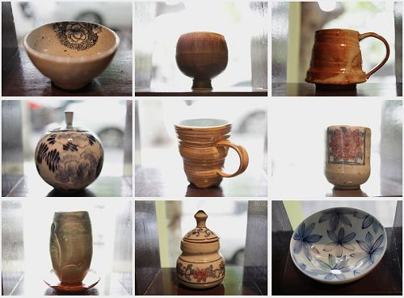
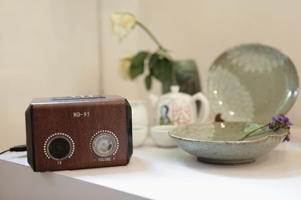
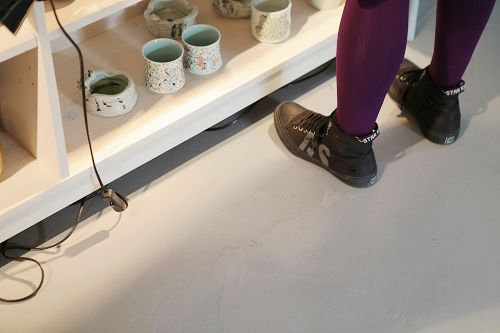
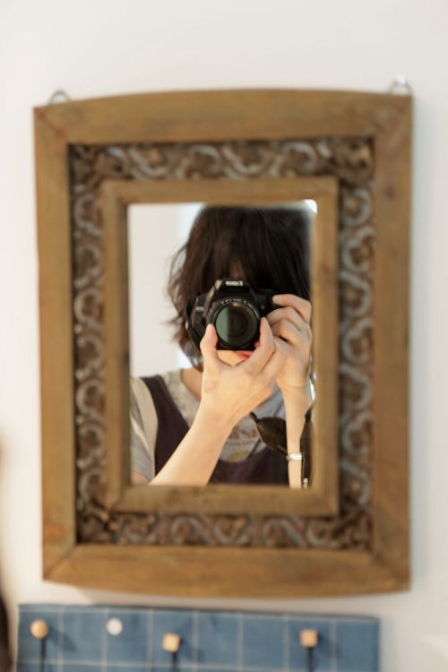
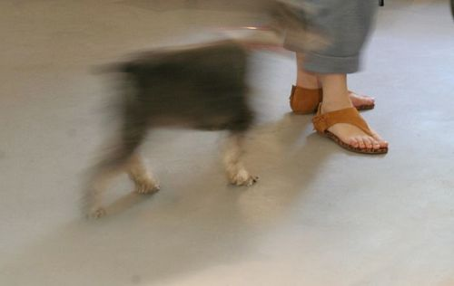
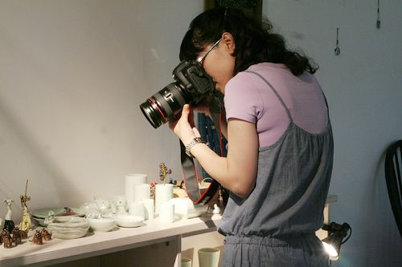
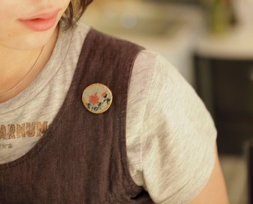
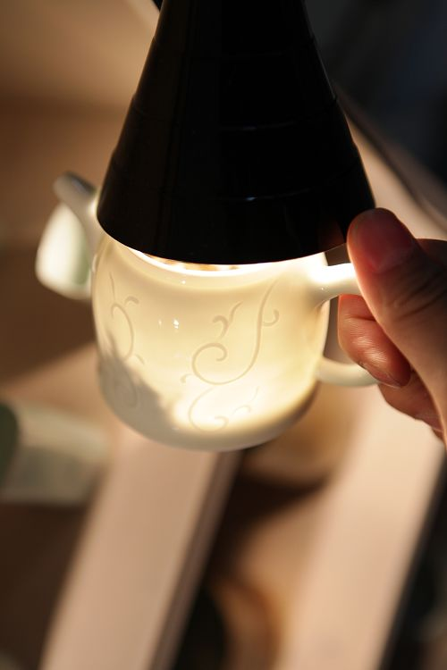
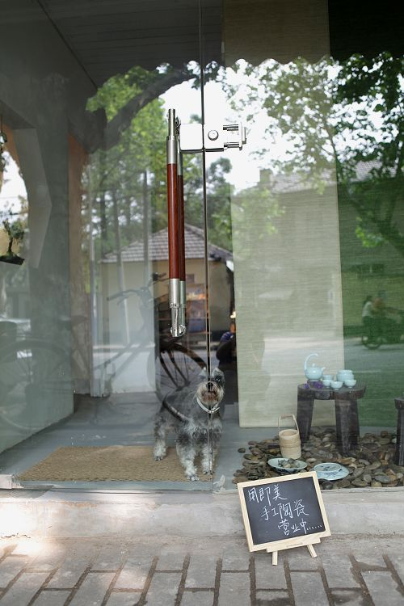

# 用．即．美

小说《平面图》作者埃德温.艾勃特是英国著名神学家和小说家，据说也是一位出色的数学家。小说中，他虚构了一个二维平面世界，并为次编制了一套完整的社会体系。这个世界里所有的物体包括生命体只有长和宽两个维度：房子是平的，实现是平的，一切都是平的。这里的居民只能看到物体的测边，感官思维里没有第三个维度的概念，因而他们无法想象世界还有高度。原因很简单，在平面国，物体如果离开平面，就等于在平面世界和他们的视线里消失，消失意味着不存在，也意味着无法感知，因为在这个二维世界里你永远也无法用事实来举证一个有“高”的三维空间。“向上，不是向北”这种话在平面国的居民听起来简直是扯淡，不仅没办法理解，他们还会将传播这类“异端学说”的人当祸害，直接抓起来关疯人院，或者拉出去处死，这样比较省心......  
  
缺失的维度制约着人们的想象力，而制定社会规则的统制阶层则有意扼杀人们的想象力。如果你使劲儿看，再加上一点儿想象力，相信你会发现平面国的某些习俗与制度与我们目前生活的地方十分贴近，尽管小说影射的是100多年前的维多利亚时代。  
  
--来自佳凝《想象力最奢侈》  
  
没想到白天的江苏路车多，人多，好在有车厢将我们与外面的世界隔离开。我们下车走入这家新开的瓷器店，白色墙壁与那些从各处收集来的瓷器单品气质般配，店家从13岁开始对瓷器有兴趣，现在兼职开这家瓷器店，意不在生意，而在于结识志趣相投的人，形成一个氛围不错的圈子。  
  
它们美且特别，期待后面陆续上的特别单品。  
   
  
对这个收音机似的物件感兴趣，但它不是收音机，会是什么呢？  
  
  
这么大号的茶杯适合放在办公室里使用。  
   
  
问问新入50MM F1.8定焦头，不知道她的相机里可有心悦的片子？  
   
  
逛店的还有无影狗土豆。--问问拍摄  
  
  
一些陶瓷小摆设也有意思。  
  
  
比如，问在瓷器店收了这枚陶瓷胸针，别在她的棉麻长裙上很和谐。   
  
  
好东西总是店家自己用了。  
  
  
没有门头，店名”和光“。玻璃门窗上倒映着民国建筑与小街，更爱它晚上的氛围，幽静，深邃，柔和。  

---

## 评论（10）

**[B](http://wenyiran99.spaces.live.com/)** · 2010-06-07

在北京的南锣鼓巷也有一家别致的瓷器店，再则就是成都的“花草虫鱼”，有机会去南京也想去这家‘用即美“瞅瞅，呵呵。还有，我本来也有个1.8/50的镜头（摔坏了，且是一摔即坏），特别适合室内人物摄影

**不羁之舟** · 2010-06-07

又多了美好的去处——话说我们都是瓷器控啊~以后也可统称美物控：）

**箱子** · 2010-06-07

早前就知道这家店了，可惜一直没去呢。  
改日去。  
其实我觉得，这么说来，大家好组个团去景德镇了。怕是去了都不想回来了。

**lusfe** · 2010-06-07

那个小玩意是音箱么

**Christina** · 2010-06-07

组团去景德镇最好，4个人一辆车，人多的话，就再加辆车去。不想回来也好哇，咱也流浪一回。

**[绿恐龙](http://blog.sina.com.cn/dinosaur313)** · 2010-06-07

我也喜欢那枚陶瓷胸针怎么办？？？

**喜刷刷** · 2010-06-07

很特别的一家店，赞镜头之美。

**[shanshu](http://shanshu.blogbus.com)** · 2010-06-08

挺喜欢这这店的.感觉很不错.

**Christina** · 2010-06-08

恐龙，喜欢的话就去买一枚吧~

**lilian** · 2010-06-09

两人穿得越来越象了：）

