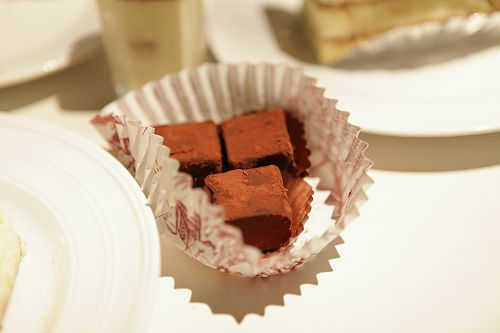
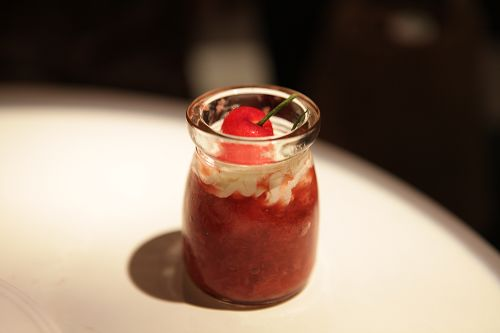
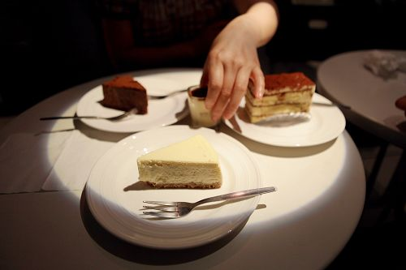
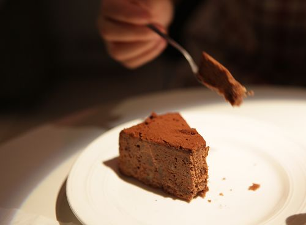
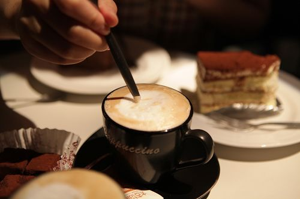
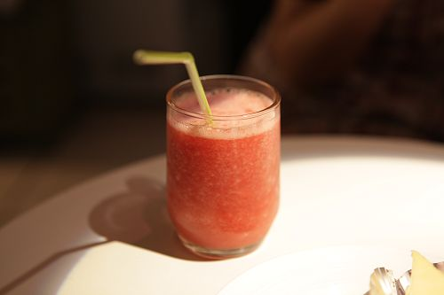

# 难忘*甜品

从瓷器店出来被女友领到一家”美丽心情“的甜品店。不确定是不是我吃过的最好吃的甜品，但它们的口味不比国外的甜品差多少，让人难忘。我想我还会去品尝N次。  
  
坐下来吃进口，整个味觉融化开来。这么好吃的甜品，店名为何如此local？而不是起个国际化的店名？所谓“酒香不怕巷子深”，是这个道理吧。店面不大，甜品好卖，也有独自前来下午茶的。据说这家店开了有10年。。。恩，在这个城市居住二十几年，还是有许多我不知道的精彩。  
  
西班牙丝绒巧克力；  
  
  
草莓布丁，这个味道一般；  
  
  
芝士蛋糕，我的最爱。还有一款榴莲蛋糕，喜欢榴莲味儿的可以尝试；  
  
  
巧克力布朗尼；  
  
  
女友在拿铁咖啡上画花脸雪糕；   
  
  
鲜草莓汁；   

---

## 评论（16）

**小原子** · 2010-06-07

拍得真美，像实物在眼前一样。。。话说老是见到那只小手 俺很眼熟~~呵呵呵呵呵……

**vivian** · 2010-06-07

在哪里~~~~~快告诉偶~~~~

**[三月四月](http://11)** · 2010-06-07

第一次去美丽心情时06年它刚开业时，小小而温馨的店，一下子就喜欢上了，它的蛋糕真的很可爱，老板是PL的三姐妹，印象好深，还有个帅哥在厨房里穿来穿去，这两年倒没去过，但还一直惦记着。打算这个月朋友生日时去定个创意蛋糕

**Christina** · 2010-06-07

我怎么听说开了10年了？店主是金鹰酒点西餐厅的厨师出身？甜品很好吃哦~

**箱子** · 2010-06-07

店主是三姐妹。不远处有他家的西餐店，也很好。。。茶。下回一定要去吃哦。

**Christina** · 2010-06-07

我们几个当时就约了找时间一起去吃的，呵呵~你来么？

**陈问** · 2010-06-07

06年可能是甜品店刚单分出来。以前是餐馆和西点合二为一的那家店。

**少爷** · 2010-06-07

可惜我还没找到一家象样的甜品店呢:(

**喜刷刷** · 2010-06-07

好象提拉米苏是它家招牌。cheese蛋糕很赞，是同类里很有内涵的代表作。

**[三月四月](http://11)** · 2010-06-08

因为它现在的版上好像写的是五周年庆，我就以为那时才开的，要不就是甜品店和西餐店是两个时间开的，厨师是金鹰出来的，这个我也知道，我打算这周去定个可爱的生日蛋糕给朋友，好期待啊

**Sherry** · 2010-06-08

这家甜品很有名啊，可以订制造型独特的生日蛋糕，去年朋友生日聚会吃过一次，很喜欢！

**sususu** · 2010-06-08

以前是开在西桥的，现在搬到江苏路来了。

**[三月四月](http://11)** · 2010-06-08

啊！现在不在西桥了?

**陈问** · 2010-06-08

西桥和江苏路都有哇。

**okdata** · 2010-06-09

有点名气，就是卡路里太高：）

**lilian** · 2010-06-09

“美丽心情”这个名字取得不错~

