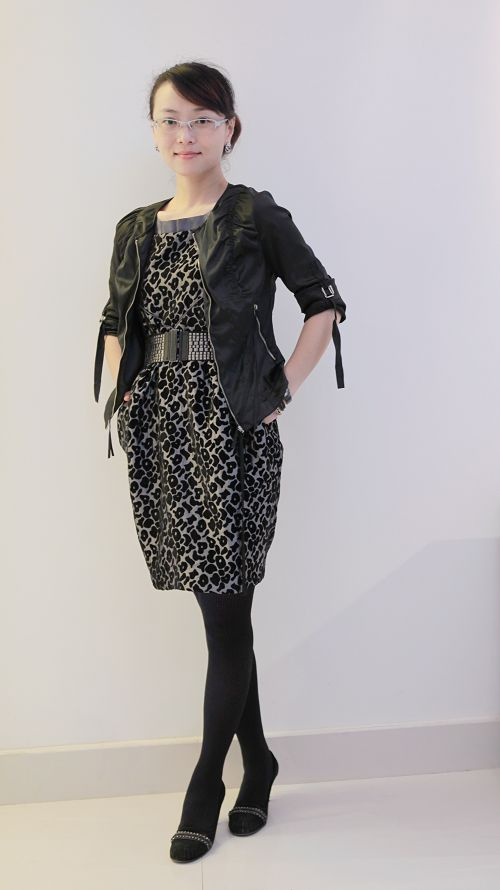
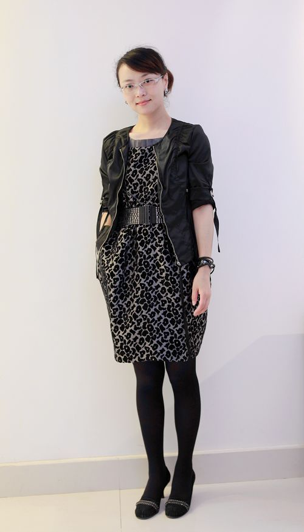

# DRESS BLOG

Some people entered in my life like sunshine in a rainy day.Some gave me difficult day but anyway I try,every day,to wake me up saying to me that a new day is a gift.  
  
The life is so stressing.  
But,is it cool?  
  
   

---

## 评论（12）

**vivian** · 2010-06-09

啊 全身都喜欢 ~

**lilian** · 2010-06-09

知性、优雅。。

**mandy** · 2010-06-09

我喜欢

**chenchen** · 2010-06-09

茶：你的气质还是淑女型的 书卷气的 白皙的
不是狂野那种

所以这样的衣服 有些花花的 貌似豹纹的 在你身上是另一种风格 呵呵 被你的气质所同化的

**Christina** · 2010-06-09

俺从来不觉得自己是淑女，也不喜欢被人这么总结，呵呵~世人惯于“以貌取人”，接触了才知道，是不是？

**Vodka** · 2010-06-09

茶，有个问题，你的全身亮点太多啦~又是豹纹，又是有拉链细节的外套，再加上手腕的腕带，腰部的腰封，还有皮鞋鞋面那一圈。太复杂了。不知道你是穿这身要出席什么很重要的场合吗？你最近的搭配有点用力过猛，呵呵~多了气场，少了简洁。

**Christina** · 2010-06-09

拉链、腕带、腰封、鞋饰遥相呼应哇~纠正一下，这连衣裙压根就不是豹纹。你看是“猛“，我看心情。不求苟同，人和人不一样，审美当然也会不同。重要的是我喜欢！

**aimda** · 2010-06-09

赞同。

**aimda** · 2010-06-09

重要的是自己喜欢！

**Anyayaya** · 2010-06-10

loving the shoes…..

**Sherry** · 2010-06-10

这一身很漂亮，我喜欢！

**d-rabbit** · 2010-06-12

你的表情永远那么恬静，我觉得总是以你不变的表情应万变的衣着。可以多拍些自然流露的神态呀。大笑，散发都可以。当然自己喜欢就好。

