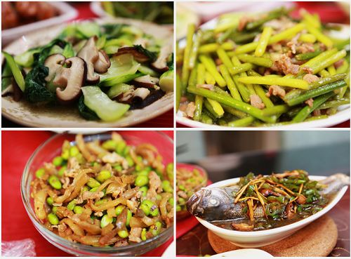

# 被美食安慰的人生。

一个人喜欢吃的理由可以如太阳为什么照耀地球一样，写成十万八千里的长卷论著，也说不清楚。**活着喘气容易，用心活着却不是一件容易的事**，用嘴吃饭人人都无师自通，用心吃饭则有一定的难度，即使名师指点也未必有几个能学得会。--ZJT  
  
生活安逸，心思渐渐放在做饭这件在以前看来婆婆妈妈的事情上。我爸爸是无锡人，擅长红烧菜肴，烹饪技术在我家是NO.1。可是我妈妈却在吃上极不讲究，只要煮熟即可，并常常表达对讲究吃穿的蔑视。在这种天壤之别的搭配下生活若干年的我，想来继承了我爸爸的爱好。讲究吃和穿，有那么可耻吗？人生最重要的莫过于吃饱穿暖，当然我们已经越过这道基础线，走向被美食安慰的境界。每每自己动手做几个家常便饭，吃下它们，如果不可口顿时感觉这一天空荡荡的。反之，则感受到“生活幸福。”  
  
我的豪华晚宴：  
上左--鲜香菇炒青菜 上右--蒜苗炒肉丝（第二次烹饪记录）  
下左--毛豆榨菜炒肉丝（南京本地家常菜） 下右--清蒸舻鱼   


---

## 评论（11）

**truecolour** · 2010-06-09

清蒸怎么跟红烧似的，有没有用李锦记的蒸鱼豉油啊？一定要用啊～

**[少爷](http://jennyshaoye.blogbus.com/)** · 2010-06-09

茶,我的脑袋里正好一片空白,不知道烧些什么来吃,嘿,准备copy你的毛豆一款,看着就很有食欲了:)

**Christina** · 2010-06-09

清蒸好了之后,把热油+蒸鱼豉油+葱姜丝+青椒丝浇在鱼身上。

那个榨菜毛豆肉丝，很下饭哦~

**[三月四月](http://11)** · 2010-06-09

我爱做菜！

**[易棋牌](http://www.eqipai.com)** · 2010-06-09

不错哦````````

**[微风轻拂](http://blog.sina.com.cn/u/1738436165)** · 2010-06-09

新鲜香菇炒青菜也是我家餐桌上常见的菜呢，，我家老爸曾用上好的树自己种过香菇，那是120%的有机食品啊，只是现在工艺改进了一些，估计营养价值不如以前了，但菌类食物总是常吃无害，每次在云贵，去餐馆吃饭时总要点个“菌菜”的。

**Sherry** · 2010-06-10

你越来越神了，看得我流口水。。我还没吃过你炒的菜呢。。抗议！

**Christina** · 2010-06-10

抗议有理，端午放假来吧：D

**Sherry** · 2010-06-10

好哎~ 开心！我来帮你打下手！^-^

**箱子** · 2010-06-11

我们是一样的，我爹烧的好吃，我妈继承我外婆，是事业女，烧菜方面没天赋。经过这么多年，才略有好转。  
我喜欢吃蒜苗的姑娘，现在并不是很多人都吃这些所谓“哄”的菜。可是我吃的，

**Christina** · 2010-06-11

想吃就吃，只要身体允许，有口福！

