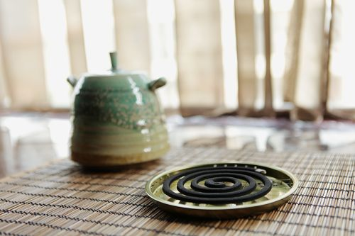
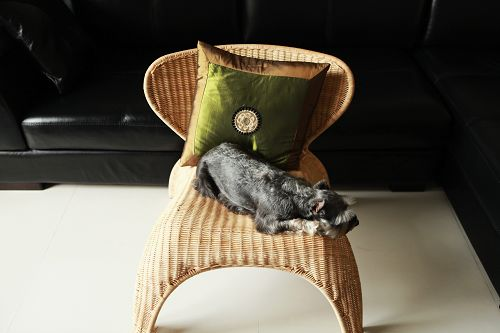

# ．宅．

作为一个伪球迷，还是观看了几场感兴趣球队的比赛直播，坐在冬天的棉毯上观看，耿耿于怀，主卧的空调因为通讯故障等人来修，前几天还可以不开空调，但是昨晚已经无法在没有空调的情况下睡觉了，遂搬到客厅过夜。大金来人维修，因为一颗铜螺丝上的过紧，开裂导致新冷酶泄露。。。安装责任还是配件质量问题？太难鉴定。白天在家做家务尽量不开空调，稍微动一动就出汗，吃顿饭一身汗，喝壶茶一身汗，晾晒衣服也会汗如雨下，我是爱出汗的主儿，天气也到了难熬的夏季。出完汗，身体顿觉舒畅。  
  
今天将棉毯从沙发上抽下放进洗衣机里清洗，给裸露的沙发上了一层皮革保护剂，用干抹布细细地揉开乳液，揉进皮革的毛孔中去，象保护自己的皮肤一般。假期除了电视机，最累的就是洗衣机了。  
  
几天下来，感受作为一名职业主妇，并非轻易之事，在家的时间会比在办公桌前还要忙碌。这忙碌让人心甘情愿。如果可以这样度过夏天，也是美事一桩。  
   

---

## 评论（7）

**箱子** · 2010-06-18

恩，我终于知道你窝在哪里了。。。我们靠的很近哇。。。。

**Chrisitna** · 2010-06-18

假期，我一直等她召唤呢，还有与你见面。呵呵~

**okdata** · 2010-06-21

灭蚊还是黑蚊香好，缺点是它的烟尘。  
有时想着不如用艾条浸着除虫菊酯点，至少有点古风，还少了雪茄的尼古丁。  
其实高楼也摆脱不了蚊蝇，便利的电梯不仅送上猫狗，也给你送来麻烦。

**Chrisitna** · 2010-06-22

这是无烟蚊香：P

**okdata** · 2010-06-22

哦，学习了。明天让孩子去买

**lilian** · 2010-06-28

在杭州已经用蚊帐了，但还是防不胜防，半夜进行了一场人蚊大战。好在上海没蚊子，可以高枕无忧。

**Christina** · 2010-06-28

可以把冷气开的足一些，也可以在睡觉前关闭门窗，点蚊香，睡觉前开窗通风。

