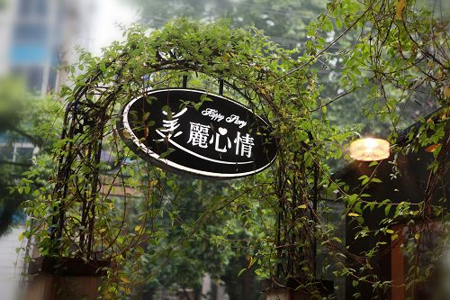
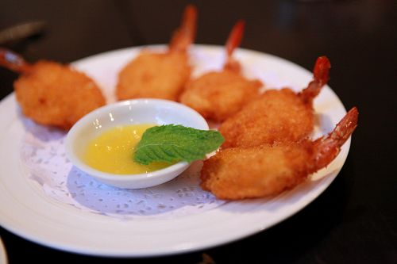
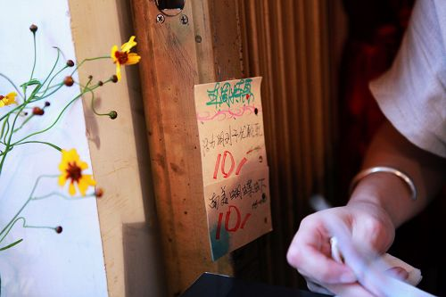
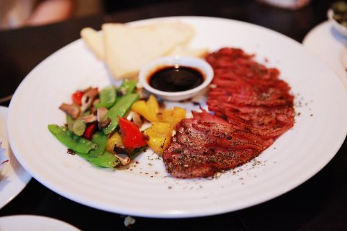
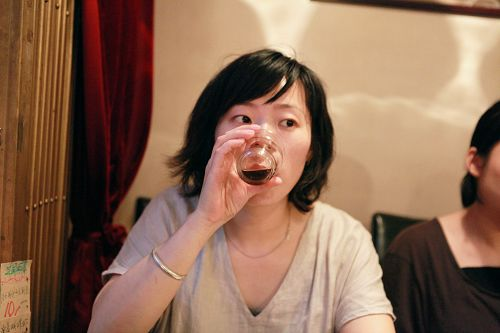
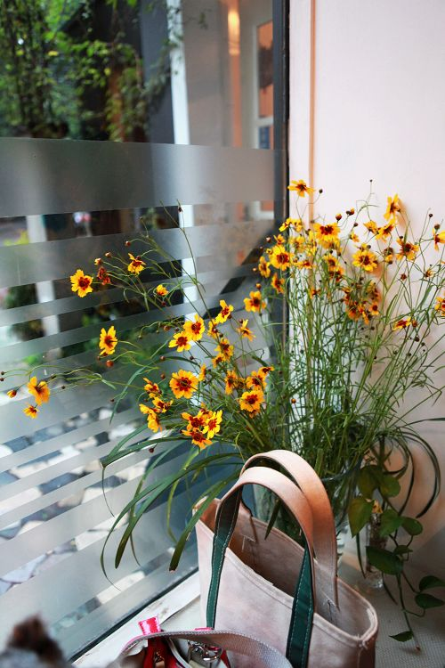
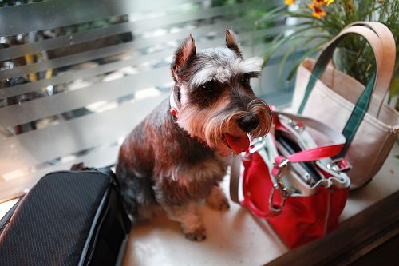

# 美丽心情

择日不如撞日，非计划内聚餐，去“美丽心情”吃了顿西餐。  
菜点可口，凭这一点可以忽略店家服务态度与环境吧？  
  
   
   
   
   
   
   

---

## 评论（13）

**Anyayaya** · 2010-06-18

这家餐厅可以带狗？。。。。

**箱子** · 2010-06-18

恩，我喜欢她家搭配时候用的无花果。问问说，你家的狗可温柔了，可以用她来战胜我对狗狗的恐惧心。。。

**[三月四月](http://11)** · 2010-06-18

中午在同事家干掉半个美丽心情的蛋糕，晚上打算再去定一个芝士的

**Chrisitna** · 2010-06-18

我们请求带狗进去的。。。  
我家两条狗狗都很温柔，你完全可以忽略它们是狗。  
其实，现在我也想念它家的甜点啊！抹下口水~

**shuwua** · 2010-06-19

土豆啊，真是一枚温油的女狗啊！

**Chrisitna** · 2010-06-19

是啊，超级温油女，哈哈哈哈~我们吃饭它坐那里一动不动的，看着我们吃，它好象也很享受的样子：P

**喜刷刷** · 2010-06-19

土豆也有美丽心情.

**Edward** · 2010-06-19

流口水ing…

**小原子** · 2010-06-20

哈哈~~土豆笑得好可爱欧~~我看了下它的裙边，毛确实从胸部下面开始不剃了，胡子也是左右梳的……学习了!

**Chrisitna** · 2010-06-20

小原子，偶真的觉得皮蛋好可怜呐~不要打我哦~

**[三月四月](http://11)** · 2010-06-21

周六去了后，拔在那里看了好久都不知道该定什么味道的，最后想到你说过芝士好吃，还是定了芝士，做了个麻将造型，今天晚上拿到，期待中……

**Christina** · 2010-06-21

麻将造型???????归归，一定是送给麻将迷滴~真新鲜啊，居然店家有这种造型的蛋糕，呵呵~有没有去它家西餐店吃过？

**okdata** · 2010-06-22

宁海中学那边路难走。  
其实绿地楼上的东西也是不错的

