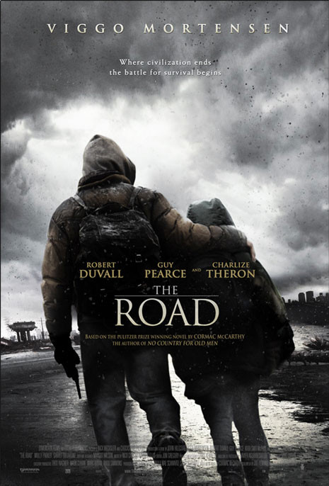
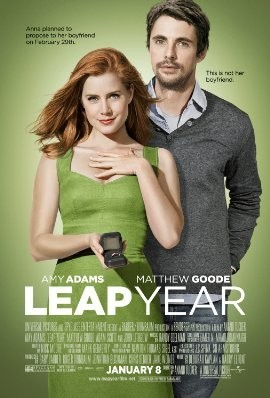

# 又是“末日”。

看了一部超级郁闷的电影： [**《THE ROAD》**](http://www.mtime.com/movie/77467/)，久久排遣不了心中怨气，悻悻然地去看这部电影影评，大多评价不错，我想谈谈自己的观后感，作为保留意见。  
  
在《2012》，[**《The Book of Eli》**](http://www.mtime.com/movie/88351/)之后《THE ROAD》又是一部讲述世界末日的电影，没什么特别的故事情节，整部电影都在讲述情感、心理以及生命承载的磨难，世界末日下展示出的不同人性。让我怨恨的是父亲对儿子的溺爱。。。极其艰苦又毫无希望的环境下求生，溺爱等于害了孩子。看电影我有很强的代入感，每每看到父亲对孩子无微不至的照顾，以及孩子纯洁心灵下仍然保持着人性的善良，我总会着急的说上两句。恶劣环境下只有强者才能生存。  
  
电影就是电影，不现实的是一家四口以及一条狗在电影快结束时出现了，父子两已经挣扎在死亡线上，那么4个人1条狗，如何度过漫长的饥饿、人食人的危险、恶劣的自然环境以及疾病的困境？看到4个人1条狗的出现，我一点没感受到希望，而是觉得滑稽，这就是电影，观众真能在情感上得到慰籍吗？  
  
如果在电影那样的情况下，我会选择生？还是会选择死？  
答案是：选择死。  
  
  
  
近期观影单：  
\*\*《THE PRISONER》（囚徒末路）--精神病医生也未必能绕出那些情节来；  
\*\*《SHUTTER IS LAND》（禁闭岛）--Teddy说：“你想象野兽一样活着？还是希望做个好人死去？”我认为这才是这部电影想要表达的真谛。  
\*\*《INVICTUS》（不败雄心）--适合在世界杯期间观看，讲述1995年南非英式橄榄球队的故事；  
\*\*《LOVE ME STILL》（依然爱我）--黑暗的表面下是一颗颗真实的心灵；  
\*\*《THE MESSENGER》（亡情使者）--需要耐心去体会的悲痛；  
\*\*《EXTRAORDINARY MEASURES》（特别措施）--同样讲述人性、求生与爱，但看得人神清气爽。  
\*\*《SOLOMON KANE》（所罗门·凯恩 2010）--符合我喜欢电影的类型，魔幻、真人、战争、正义战胜邪恶、斗士。   
\*\*[**《Valentine's Day》（情人节）**](http://www.mtime.com/movie/105580/)-- 爱情轻喜剧，作为女友或妻子的女性可以认真观看一遍。  
  
  
  
\*\*《Leap Year》（闰年）-- 闰年四年才一次，而真爱一生只有一次。安娜和很多女孩一样，想要早日迈入婚姻的殿堂......好爱这部电影里的歌曲:You Got Me、Dream a Little Dream of Me，女主角都市女性的优雅气质摇曳在她时刻都穿着的高跟鞋上，很有风韵。

---

## 评论（7）

**陈问** · 2010-06-19

哈哈，这部电影太无聊了，估计想在无聊的背后探讨下生命的哲学意义。但是，我们给它很低的评分。。

**wind** · 2010-06-19

偶然从ＢＢＳ上看到一篇关于美国狗证上的九句话，看后感触良多，与大家分享一下。

1）我这一生大概能活10到15年，和你分别是件无比痛苦的事。

2）在给我命令时请给我理解的时间，别对我发脾气，虽然我一定会原谅你的，你的耐心和理解能让我学得更快。

3）请好好对我，因为世界上最珍惜最需要你的爱心的是我，别生气太久，也别把我关起来，因为，你有你的生活，你的朋友，你的工作和娱乐，而我，只有你。

4）经常和我说话吧，虽然我听不懂你的语言，但我认得你的声音，你是知道的，在你回家时我是多么高兴，因为我一直在竖着耳朵等待你的脚步声。

5）请注意你对待我的好，我永远不会忘记它，如果它是残酷的，可能会影响我永远。

6）请别打我，记住，我有反抗的牙齿，但我不会咬你。

7）在你觉得我懒，不再又跑又跳或者不听话时，在骂我之前，请想想也许我出了什么问题，也许我吃的东西不对，也许我病了，也许我已经老了。

8）当我老了，不再像小宝贝时那么可爱时，请你仍然对我好，仍然照顾我，带我看病，因为我们都会有老的一天。

9）当我已经很老的时候，当我的健康已经逝去，已无法正常的生活，请不要想方设法让我继续活下去，因为我已经不行了，我知道你也不想我离开，但请接受这个事实，并在最后的时刻与我在一起，求求你一定不要说“我不忍心看它死去“而走开，因为在我生命的最后一刻，如果能在你怀中离开这个世界，听着你的声音，我就什么都不怕，你就是我的家，我爱你！

　　“有个朋友说,她的爱犬,说不定是她前世走失的家人,今世回来,要和她重新相伴一生！”　　　　　　　　　　　
\*\*\*\*\*\*\*\*\*\*\*\*\*\*\*\*\*\*\*\*\*\*\*\*\*\*\*\*\*\*\*\*\*\*\*

祝有爱心的你~美丽常在！周末愉快~！

**Chrisitna** · 2010-06-20

这部片的确烂，还是快看完了才发现是烂片。看得我郁闷死了~

**Sherry** · 2010-06-20

昨天才看了《情人节》，爱情是简单的，但人是复杂的，也许变简单一点，爱情就来了。。

**okdata** · 2010-06-22

思想是件麻烦的事情  
如孕育婴儿，十月而成  
生活踏实的多，简单重复  
生活重压下依然思考，智者的特征

**angie** · 2010-06-22

推荐一部印度电影《我的名字叫汗》

**lilian** · 2010-06-28

我也喜欢魔幻的，去找找。。最近正在看《迷失》。

