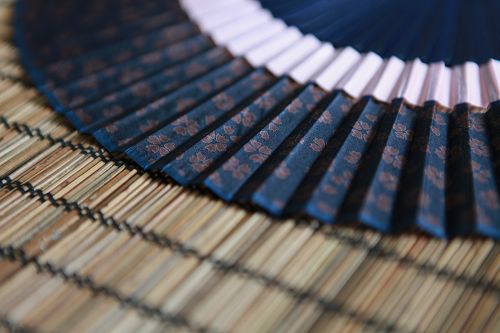

# 夏日de扇

夏季随身携带一把绢麻小扇，温度也立刻优雅起来。  
  
   

---

## 评论（10）

**泡泡的妈** · 2010-06-29

优雅如茶~~

**ilovehangzhou** · 2010-06-29

嗯哼

**陈问** · 2010-06-29

一点也不艳啊。素雅的很。

**sophie0927** · 2010-06-30

最喜欢第二张, 那个含情默默啊, 说不出的风情万种:)

**旗旗** · 2010-06-30

这美扇子太适合你了，古雅清丽，一看再看~~

**sophie0927** · 2010-06-30

好姑娘, 放大来给我欣赏了:)

**纸鸢** · 2010-07-01

怎一个优雅了得！

**Christina** · 2010-07-01

sophie0927，你也是好姑娘，谢谢你的表扬，嘿嘿~

**喜刷刷** · 2010-07-01

2的表情好.luke的卷毛耳朵也可爱.

**Ray** · 2010-07-11

沒載眼鏡很有氣質

