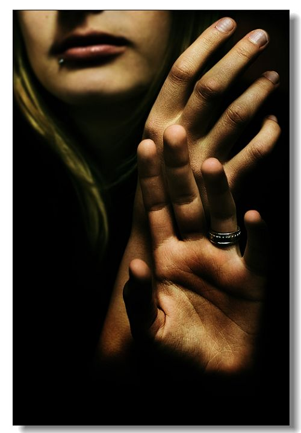

# 飞越疯人院

  
*get up off your knees  
By: Jochen van Eden*  
  
6月的南京不知是否还有梅雨季节？这些天闷热，气压低。傍晚，坐在客厅的藤椅上，或看电视或看杂志，不开空调，点上一支蚊香，与身后阳台上的花草做伴，摇把折扇，泡壶热茶喝。皮肤溢出细密的汗珠，“桑拿”后顿觉舒爽。这仿佛就是我喜爱的2010年夏季的摸样。  
  
早晨上班的电梯间，听身后几个后勤部门的同事聊电视台天气预报。“天气预报出丑了，今年没有梅雨季节。”另一人接着说：“电视台也聪明啊，人家说要调整梅雨天气的标准。。。”听得我这个板着面孔准备冲进办公室，进行冷漠又疯狂工作的人...心里融化开来。这些很生活的对话，意味着一种平衡。后勤工作相对清闲，既然拿不到什么钱，却也获得了一份清闲，可以过上细腻的生活。而我们这个部门，任何TIME制度下，都要迟半小时下班，加班时间从下班后一小时二十分之后开始计算。。。工作中就是更换演唱重金属摇滚与民谣，有时还必须来段RAP。这是一群机器人在进行机械化运动，这是多么喜悦的工作场景？这些，让我们生活在“走马观花”中，不知不觉。  
  
这种感受可以用一部电影名称总结“飞越疯人院”[**《One Flew Over the Cuckoo's Nest》**](http://www.mtime.com/movie/10578/)，电影里“麦克.墨菲”装作精神异常，被送进了精神病院，他的到来挑战了医院严格的管理制度。。。”而我们深知“人类对于另类从来就是置之死地而后快”，于是在我们的社会中极力装作身心平衡的正常人，说别人所说，笑他人所笑。所以说，《One Flew Over the Cuckoo's Nest》完全具备社会学的研究价值。有人认为：“相比自由，人们更想要的是安全，而最安全的立场，就是‘跟大多数人站在一起’。”**自由何以成为悲剧？**  
  
有位女友，09经济危机期间，英国总部倒闭，中国公司二把手的她赋闲在家到现在，她说：“现在可好，花得少了，也不必去挣更多的钱，舒服。”

---

## 评论（7）

**旗旗** · 2010-06-30

是啊，忙的焦头烂额的，需要自我调试，实现飞跃：D

**HANK** · 2010-06-30

飞越疯人院，我心中的TOP10 之一。当酋长把枕头按在麦克的头上是，我也几乎要窒息了。

**微笑着沉默不语** · 2010-06-30

冒死问一声“茶美女”是做什么工作的呢？你以前在博里好像提过做生意，但还是好奇嘿嘿~~~

**Chrisitna** · 2010-06-30

我的工作就是混吃等死哎。

**richard** · 2010-06-30

忙=心亡

**小翌** · 2010-07-01

请问前面提到的定做的包包，在哪里可以买到？

**喜刷刷** · 2010-07-01

我是飞越不了了,就混混吧

