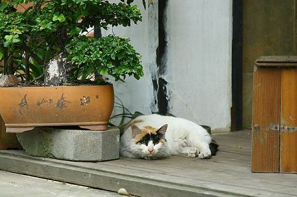

# 苦夏

[**箱子**](http://xiangziyu.blogbus.com/)拍摄的“苦夏”中的一张照片，好传神的苦夏啊，收藏之。今天还蛮适合带上相机走出去拍拍照的。每年的夏天都是独一无二的，今年夏天认识了箱子，一想到她，就想起前天晚上我们两人坐在客厅里夜聊的情景，她的眼皮困得耷拉下来，看来我们是靠精神支撑着夜聊啊。无论如何，不要让我们的相机错过今年的夏天。  
  

---

## 评论（9）

**雯子** · 2010-06-30

好肥的猫哦!你更新的快哦.

**箱子** · 2010-06-30

冤枉啊，其实我真的不太困，我那天是眼皮肿，过敏滴。。。

**陈问** · 2010-06-30

夏聊夜。我在想，蚊香缭绕吧，感觉真回肠。

**Chrisitna** · 2010-06-30

真回肠。。。你也别忘记眷顾夏夜的星空啊~

**Sherry** · 2010-06-30

夏天就是犯困哦。。

**喜刷刷** · 2010-07-01

多拍点多拍点,我已经热得受不了了.

**Christina** · 2010-07-01

多拍点 与 热得受不了，逻辑怎么联系啊？

**喜刷刷** · 2010-07-01

对哟,我语无伦次的,我想说的是热死了,你们多拍点清凉的夏.

**无名** · 2010-07-02

好娴静的夏季。

