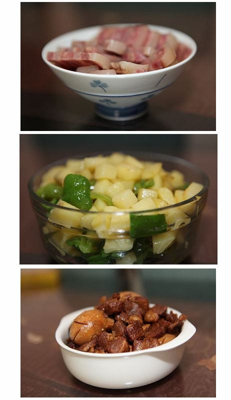

# 今日午饭

借鉴问问土豆粒烹饪法，没有豆瓣酱，清炒也不错。  
另有西红柿汤一例，没有汤的夏季餐，总好象少了什么。  

---

## 评论（8）

**喜刷刷** · 2010-07-01

厨艺很不错啊,掉口水.

**Christina** · 2010-07-01

你消失后又出现啦？你的厨艺比我的好，我们可是尝过的啊~

**[JOHN](http://lifetea.org/article/2675/-)** · 2010-07-01

拍照很匆忙啊,失焦…不过很想大口吃肉诶.

**angie** · 2010-07-01

想吃。。

**[光光](http://gaoguangguang.blogbus.com)** · 2010-07-02

第一个是薰蹄吗？看起来工艺高超的样子，这个你都会做？

**Christina** · 2010-07-02

这个在超市买的现成的，放点调料就可以吃唠。如此复杂的食物，估计我这辈子都做不出来啊~

**[少爷](http://jennyshaoye.blogbus.com/)** · 2010-07-02

我也看着第一盘,应该很好吃

**sususu** · 2010-07-05

第一个是肴肉吧，蘸点醋吃就很好。我也很爱吃。  
最后那个是红烧肉加蛋吧，看上去肉炖得很酥烂啊，鸡蛋也很入味的样子。

