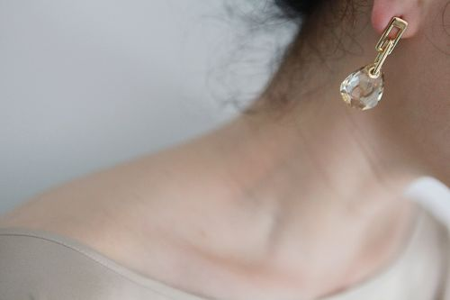
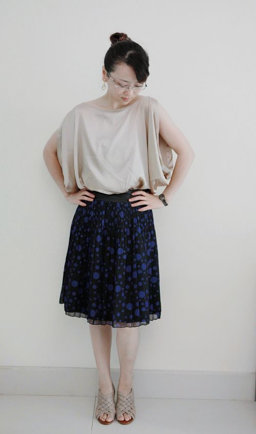
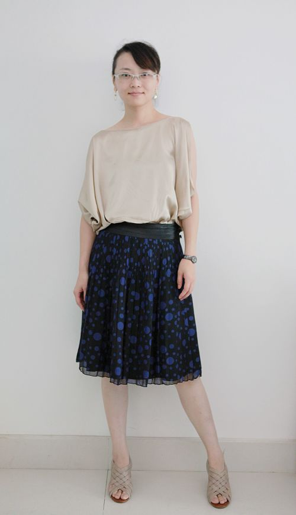

# DRESS BLOG

今天中午做了许多事儿，做了午饭，翻了杂志，喝了茶，拍了照，真好。  
   
   

---

## 评论（12）

**喜刷刷** · 2010-07-01

第一张太好了,表扬摄影师.

**sophie0927** · 2010-07-01

孔雀, 这是脑子里冒出的第一个词.

**Justblue** · 2010-07-02

其实俺倆蠻象，都喜歡大狗、攝影，還有吉普～

**微笑着沉默不语** · 2010-07-02

个人的一点愚见：如果下半身换成小脚裤或是设计感强的黑裙子可能更显个性，嘿~~~

**Christina** · 2010-07-02

貌似你经过了一番研究？

**[少爷](http://jennyshaoye.blogbus.com/)** · 2010-07-02

茶身材好,穿什么都好看…

**不羁之舟** · 2010-07-02

喜欢这美妙的裸色~茶把狗狗养的嗲肥，自己嗲瘦~

**微笑着沉默不语** · 2010-07-03

下半身略显普通的纱裙有点委屈了那件美丽的短袖；）小小的建议嘿嘿，喜欢看你的dress blog, go girl!

**clara_001** · 2010-07-05

一直以来不想打击你，你和我长的太像了，方脸短粗的脖子，圆肩膀，看似很瘦但是没有腰，腿是弯的小腿尤其粗，五官里鼻子最难看，由于是方脸尖额头短脖子什么发型也不出彩，尤其是头型长的难看，别人发髻都很清爽，我们的发髻却像个老太太。我没有骗你，我们俩相似度有90%。还有，你的穿衣品味有点低俗，虽然气质盖过了衣服，但是如果高雅一点可能会更好

**clara_001** · 2010-07-05

你的圆肩膀和窄肩膀毁了这个类似蝙蝠衫的衣服，穿上很没精神，像个街头买菜的老太婆，不是嫉妒你，是说的实话，知道吗，我很害怕和你一样成为剩女，因为我们长的实在太像了

**clara_001** · 2010-07-05

有时候觉得你的衣服和气质都好，就是长的太菜了，没料，要什么没什么，就连看似好看的第一张，那脖子也是有短又粗还有很多皱纹，没有一点修长细腻的感觉

**Christina** · 2010-07-05

哈哈哈，你对你自己如此了解，对我貌似更了解啊，看到你“因此”卖力的写了这么多，辛苦了。我真为自己感到高兴，哈哈哈～我会努力更新DRESS BLOG哒：P另，奉劝一句：要想人不知，除非己莫为。

