# 只是“到此一游”。

“七一”活动地点：沙家浜。  
  
牺牲周末一天时间，8：30出发，路上2个多小时车程。到达后即在“五福酒店”吃午饭，饭后被雷电交加的大雨困住，打牌、聊天及发呆来消磨时间，雨渐渐小时，出去转一圈。门票100元每位，折后55元。地方政府以旅游带动经济的想法，在这座人工园子里处处可见，肯定花了不少钱建造。  
  
虽然下了雨，天气依然闷热，我既带了草帽又带了雨伞，还穿了长袖衬衣。浑身粘糊糊的不知是汗还是雨水，感觉糟透了，值得庆幸的是带的卡片机。看了下园子里处处是公款来活动的各单位党员同志，谁自己花钱跑这儿旅游，脑子估计缺氧了。往年活动去的茅山，那次我没去，据说也是极其无趣。形式主义，什么时候才能消失？  
  
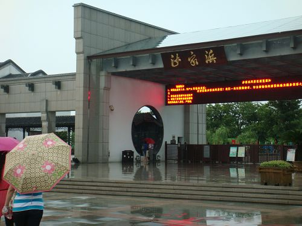  
  
江南也有好景色；   
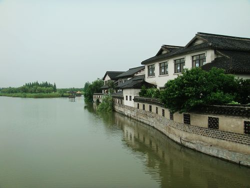  
  
新四军官方英文缩写；  
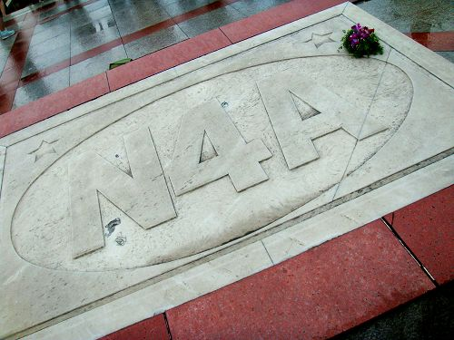  
  
不知哪个单位的党员活动，搞得象摸象样，拉起旗帜来拍集体照。一阵风吹过，我的鸡皮疙瘩又出来了。   
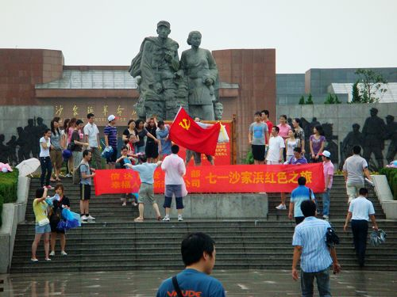  
  
耳熟能详的革命电影在这里也能寻找到踪迹；  
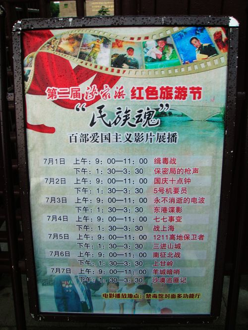  
  
样板戏居然有日文和韩文版本；  
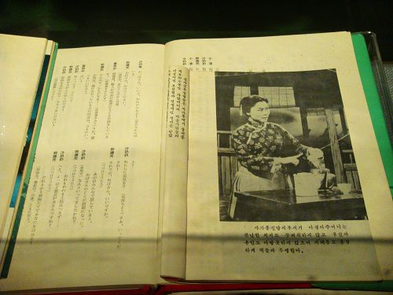  
  
第三代“春来茶馆”，面对面怎么也找不到茶馆的感觉，就是一个商业铺子；  
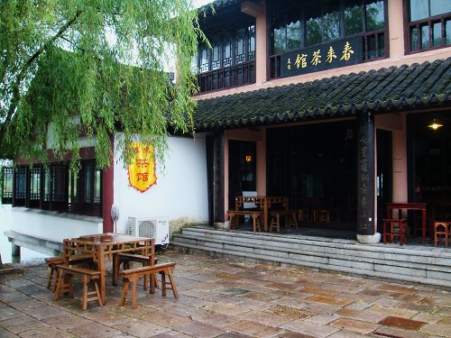  
  
没来得及去看南京的荷花，在沙家浜倒遇到，美；  
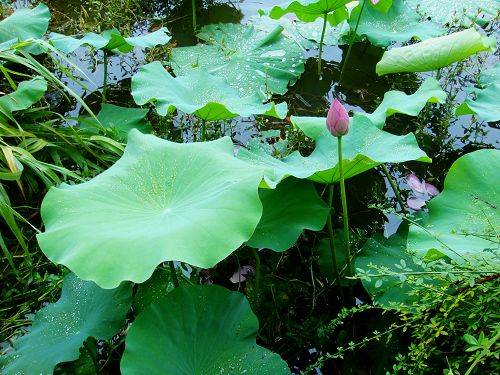   
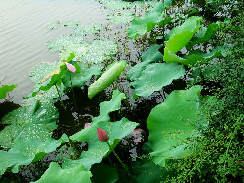  
  
摇浆于芦苇荡间，船程不长，边上的水芦叶子可以包粽子，江芦叶子就不行了。  
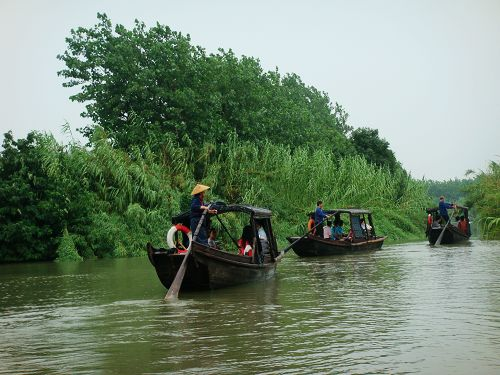  
  
卡片机拍摄的合影照，每个人看上去都很美。  
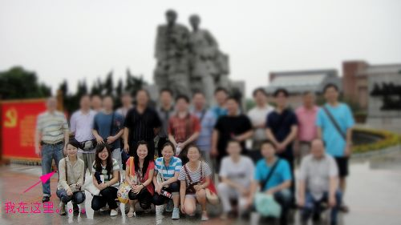  
  
横泾小街，人工制造，人为做旧，实在无趣；  
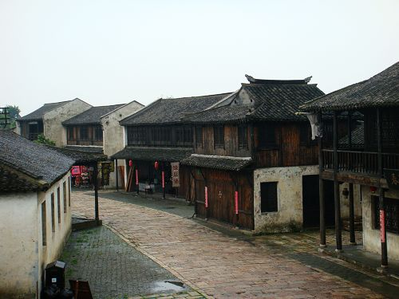  
  
“武大郎炊饼”的吆喝：潘金莲制造，西门庆监制。买了四包准备送给JM们吃，回家自己先尝了尝，直接扔垃圾桶了。  
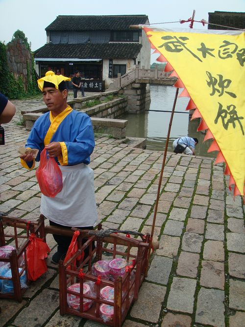

---

## 评论（4）

**shuwua** · 2010-07-05

你这个直接扔垃圾筒，笑死我了。心意收到啦！

**angie** · 2010-07-05

顶“垃圾桶”，哈哈哈

**小原子** · 2010-07-06

啊？扔啦？狗也不吃啊？啊哈哈哈………

**箱子** · 2010-07-06

这种天出门，要穿快干衣。

