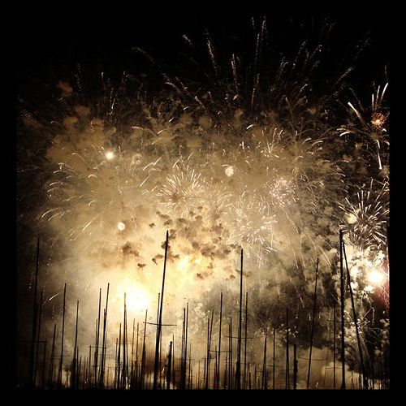

# 救的是谁的火？

你在火急火燎的救火，有人偏偏不在状态轻描淡写地撩下一句话，没有关心，没有救火的愿望，完全置身事外。这句话将你变成纵火犯。作为救火员，是不是会突然间爆发呢？答案是肯定的。**不领情倒也没什么，问题是救的是谁的火？**  
  
我常对朋友说，别人没要求你帮忙，你最好什么都别做。最后你做的就变成是“你应该的”。年龄，是不是还可以用来解释面对问题所产生时的“不成熟”呢？我，有包容心，一般在我发完脾气之后。事情做了，脾气也发了，人也得罪了，结论是情商低的人可以出口到火星去。  
  

---

## 评论（9）

**箱子** · 2010-07-07

你这样，最得不偿失。名声是别人给得，好坏不去计较也罢，可是做也做了，还没落下好心情，自己累。  
不过我也这样。所以现在慢慢的变成了一个不积极的人。

**itsmin** · 2010-07-07

亲爱的，救火也罢，擦屁股也罢，原则是保持距离，不要把自己搭进去。以前看智慧书，里面有讲到类似的东西。回来找给你看看。

**不羁之舟** · 2010-07-07

喜欢茶这样的 救火队员。一团火一样的心 别人，别人有很多，对的人一定能明白，虽然不一定站出来表达。就是因为热情的人多了 这个世界才值得留恋。

**sususu** · 2010-07-07

我特别能理解这种情绪。怎么着救的都是你的火，被救火的人也该力所能及地做点事吧，反倒翘着脚事不关己的样子了，看起来就窝火。

**itsmin** · 2010-07-07

就是这段话了：Notice those who stick in the mud, and observe how they call others to their aid so as to console themselves with a companion in misfortune. They seek someone to help them to bear misfortune, and often those who turned the cold shoulder on them in prosperity now give them a helping hand. There is great caution needed in helping the drowning without endangering oneself.

**陈问** · 2010-07-07

我们都是有热情的人。但是理智告诉我们，人是不能太热情滴，当面对不同的人时，应该要把握。

**rose** · 2010-07-07

对于“不识好歹”的人，咱直接把TA“陌生化”了。

**喜刷刷** · 2010-07-07

我知道有的人不假思索地帮助别人是种本能。

**农妇某人** · 2010-07-08

我猜你大概也是胆汁质的……没事儿，这次人家不领情下次他/她真有需要你也纹丝不要动……

