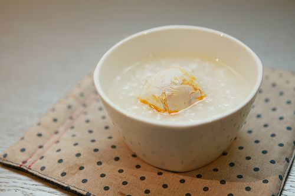

# 恍然间。。。

  
*晚饭吃到嘴已经9点多。中午炖的白米粥，就着小菜、咸鸭蛋和烧饼，夏季餐只要清淡，怎么简单都能接受。无论白天多忙，晚上依然坚持看部电影，吃半个西瓜。*  
  
这两天不知是被内分泌还是工作闹腾的，很容易激动。事后又后悔，冷静下来想想也有更好的方法，干吗要发火呢？今天主动找人家沟通，对方没事似的说：“只要人nice，发点火算啥。。。”瞬间让我得到宽慰，不发火的人也有，如果不是修养特别好，那城府肯定不是一般的深，当然也不是什么好人。沟通好了理解了，感觉跟在西方电影里似的，呵呵，如果中国人相处都这么简单，多好。  
  
“你最近怎么不去上海看世博。。。”  
“我连南京城都不愿意多跑，更别说出城了。”  
  
北京哥们儿结婚，有国际小乐队来助兴，据说还有些名气。婚礼在这个周六的上午10点开始，请了一堆朋友来参加，当然有李延亮，现在的他是不是长变形唠？饭局从明晚开始，先是朋友聚餐，然后是婚礼餐。想想就感到高兴，且蠢蠢欲动，那么多年没见的亲爱的们，现在都成啥摸样了？哥们儿用他那大舌头发着北京特有的卷舌音，说：“你老憋在南京干吗？你就不能来北京一趟吗？你要星期六早上到，你就甭来了，来了也没人接你。”即使在南京，大多数时候也是“憋”在家里，这世界上没有一个地方比憋在家里让我感到更舒心。据说女人到35岁才会玩够。。。过了30岁我才搞定自己，那颗总想外出撒野的心，恍然间就变了。**现在的“我”让我感到轻松。**

---

## 评论（9）

**陈问** · 2010-07-08

喜欢大鸭蛋黄，还冒油！

**Mandy** · 2010-07-08

现在的鸭蛋虽然有油，但蛋黄没过去那么红了。

**lilian** · 2010-07-08

我这周也频频跟人开火，跟中了邪似的，所以到现在还有点恍恍惚惚。。。“主动找人沟通”。。我还真没有这样的风度，但又不得不沟通，终归都是工作搭档，除非不打算做下去。

**itsmin** · 2010-07-09

想起了席慕容写过的诗句：

你流泪恍然于时日的递减，恍然于

无论怎样天真狂野的心

也终于会在缰绳之间裂成碎片。。。

那首诗叫做《沧桑之后》，意境很深也很美。有时候会想，那桐花初放繁星满天是怎样的一个夜晚啊。

**Christina** · 2010-07-09

青春就象一条野狗在“桐花初放繁星满天的夜晚”茫然地四处游荡。

**Frank** · 2010-07-09

Kids are always the priority for most ladies.

**itsmin** · 2010-07-09

你可真行啊，放条野狗出来游荡，再怎么桐花初放繁星满天都废了。哈哈。

**killusoftly** · 2010-07-09

还有李延亮，派头真不小啊。

**okdata** · 2010-07-13

方底白瓷园碗盛白粥，黄油鸭蛋伏其中，诱人  
只是下面的棉垫照的弱点，像刚扯下的硬纸板

天气不好容易烦躁，及时发泄很重要，不然痘痘就来了

桐花初放繁星满天的夜晚，美好、慌乱的夜色，确实是青春躁动的写照

谁说35岁有家的女人一定是玩够的了？如是这样哪来盛行的下午茶？

赞同博主的话，人都是被自己搞定的，不是游荡后的沉寂，就是通晓下的自敛，要么疲倦而至困顿，尽享生活

