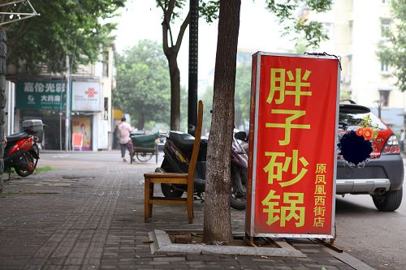
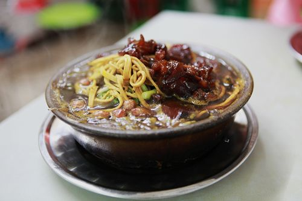
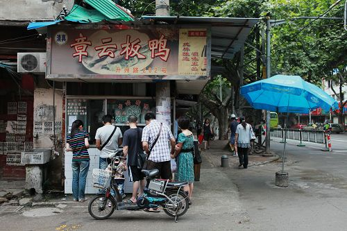
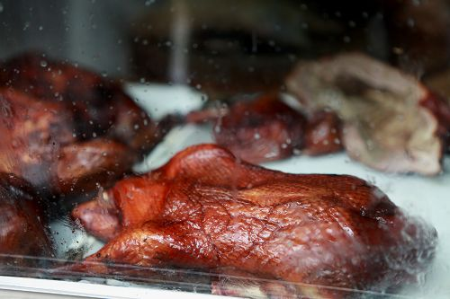
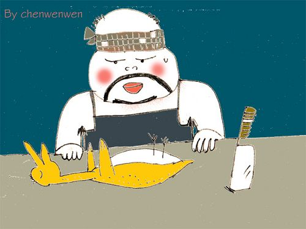
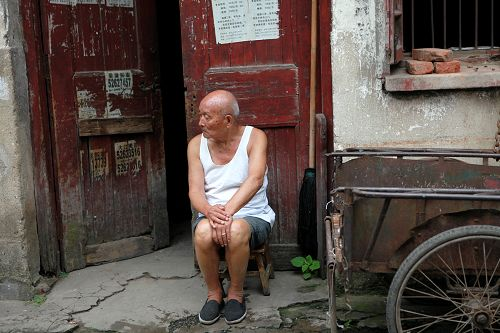
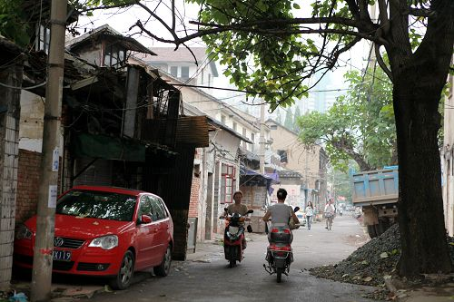
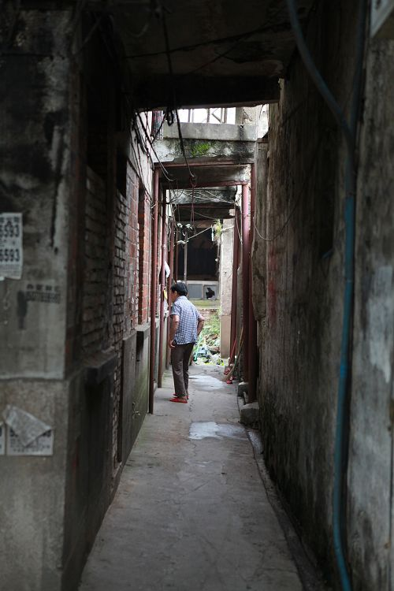

# 吃，在缘分到来时。

周末雄心壮志跟随[**“系出民门”**](http://xiangziyu.blogbus.com/tag/美食/)的脚步，从升州路一路追到南湖。这些平常美食，过去也曾体会，倒未有情愫纠缠。如果人与美食也有缘分在其中的话，缘分到了，便生出爱来。  
  
\*\*\*“系出民门”之胖子砂锅\*\*\*  
由于信息错误，在文体路上开了个来回，最终在文体西路19号找到它。的确是位肚子浑圆的胖子老板，敞开式厨房面向小街，老板站在里面进行烹饪。店里四个桌子，十六张凳子，空调充足，还算干净。他家的砂锅区别在于，吃不出味精、鸡精的味道，咸淡适中。牛肉、牛筋松紧度炖得恰到好处，不因为小店，不因为是小食，而疏于用心。  
   
  
  
\*\*\*“系出民门”之章云烤鸭\*\*\*  
位于升州路与评事街交叉口，顾客排队的那家正是“章云烤鸭”。可以理解SHUWUA买了后边走边吃缘于何故，刚出炉的烤鸭的确要美味几分。南京烤鸭店数以千计，也可能数以万计？有谁统计过？在这座盛产烤鸭与盐水鸭的城市，能找到符合自己口味的鸭子店，还真需要花些功夫，靠口碑相传是生意之道，也为吃货们提供了觅食捷径。听问问说章云的盐水鸭也不错。  
  
问问童话[**“胖子叔的鸭子店”**](http://mosquito511.blogbus.com/logs/68245883.html)的现实版便源于章云烤鸭对面的鸭子店。果然有位胖子叔，但没有问问画里的胖子叔慈祥阔爱，黑忽忽的面庞在没有灯光的橱窗后面更加灰暗，估计看到排队在别人家鸭子店前的顾客，心情更加灰暗吧？不免让人想到了“相从心生”。我貌似不经意地扭头瞥了一眼，胖子叔敏感地拿起大菜刀，在他的商品上轻轻切了一下，再平常不过的心理反应，如果你看过问问的这篇童话，这一幕会让人暗自发笑。  
   
  
  
童话《胖子叔的鸭子店》里超级阔爱的胖子叔。  
  
  
  
“章云烤鸭”所在的评事街，曾是南京历史上最繁华的地区之一，如今苟延残喘似乎走到了尽头，请看这篇[**《评事街的最后碎影》**](http://js.xhby.net/system/2009/04/29/010492803.shtml)。南京这样的老巷子，越来越少了。  
   
   

---

## 评论（10）

**itsmin** · 2010-07-12

刚刚还看到新闻说镇江千年粮仓遗址还没来得及挖掘便被地产开发商破坏，再看到这篇《评事街的最后碎影》，让人感慨，虚幻的年代，再不需要真实的历史了？

**Chrisitna** · 2010-07-12

全民向钱看的时代，也是一场革命，把什么都革掉了，谁的虚华盛世？那位坐在阴暗潮湿又破旧不堪的房子门口的老人，仿佛时代的一声叹息。

**箱子** · 2010-07-12

冤枉啊。。。胖子自己和我说，文体路19号。  
你的砂锅拍的比我的好。我爱这张，多五光食色啊！以及烤鸭，我一直想拍挂炉里的，可惜现在多难找这样的情景。

**Chrisitna** · 2010-07-12

你在电话里告诉我“文体路18号”。。。。让我好一阵儿找找找，不过越饿越能品出砂锅的美味啊！

**[三月四月](http://11)** · 2010-07-12

我很喜欢评事街的老巷子，现在拆了一大半了吧  
里面的七家湾锅贴，老太皮肚面都是我最喜欢的

**陈问** · 2010-07-12

破旧的城南老巷子，虽然落败，因为这些老人的存在，还是有人间烟火气。

**箱子** · 2010-07-12

绫庄巷也很棒。。。可以去看看，就在章云板鸭后面的巷子里，可以通。。。我小时候住过。。。好爱。虽然有些大妈怪不可爱的。可是大多数还是很和蔼。。。

**Chrisitna** · 2010-07-12

这附近有处巷子叫“灯笼巷”，你觉得如何？

**okdata** · 2010-07-13

拆了一半的评事街，老城南的记忆  
唯有自行车或奥拓之类尚能穿越的街巷  
隔个半年去一次那里的快乐钟表店，享受那里的零件

**箱子** · 2010-07-13

这里的巷子大多是按旧时居住人的工作来命名的。是集体小作坊的集体回忆啊

