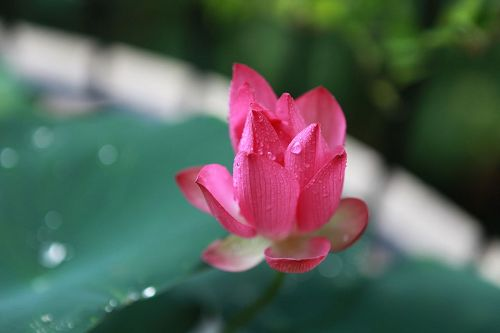
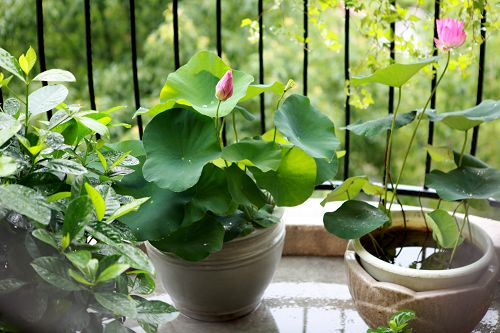
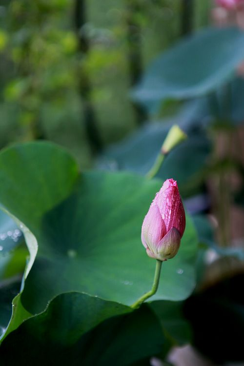

# 夏。雨。菏。

在胖子砂锅巧遇问问，吃完砂锅，她走到她的汽车旁，打开后备箱给我看她搬来的茉莉与荷花，震住我唠，5个花苞，深受打击，前一天我搬回的那盆相比之下无比瘦弱，于是当天下午又去搬了一盆回来。。。依然是盆比花贵，但这次是移栽到盆里的。打算将瘦弱的那株淘汰给老爸。话说她打开后备箱的一刹那，那种交流的快感真是不言而欲呢。  
  
下大雨的天气，最先入住的“瘦子”绽放出动人姿态，美得那么地不真实，象是画出来似的。哎，也许自己留着欣赏也挺好。无论养什么都需要了解和积累，即使它们不能顺利活过今年，对自己也是促进，明年再来。工作到中午，居然想念家中的荷花唠~  
   
   

---

## 评论（12）

**陈问** · 2010-07-12

后买那头缸很不错哎。

**Chrisitna** · 2010-07-12

据说是仿古缸，死沉死沉滴，你打算请回家的石槽估计得俩张飞才能搬得动啊~祝愿你和你家W早日练成俩张飞，搬的时候别忘记通知我们去观摩哦~

**陈问** · 2010-07-12

我以为你说，来帮我们搬，结果是来观摩……

**Chrisitna** · 2010-07-12

哈哈哈哈哈~好奇你们什么时候能练成张飞，以及，张飞搬石槽。。。比司马光砸缸要有吸引力得多啊：D

**箱子** · 2010-07-12

哎，我来帮你们关注下石材市场可有。。。有消息告诉你们波。

**[Iced Tea Brewers](http://www.elementtea.com/iced.html)** · 2010-07-13

Hi, thank you for your great post. I really appreciate the efforts you have put in your blog. It is interesting and helpful. Good luck with it!

**Xiaona W.** · 2010-07-14

太美了，很令我心动，请问花盆种养的荷花是否可以放置在室内还是一定要在阳光充足的室外？

**Chrisitna** · 2010-07-14

荷花要晒太阳的，最好放在有阳光的露台上。

**喜刷刷** · 2010-07-14

你的瘦子和问的胖子形成了强烈的视觉冲击,不一样的体态,却都是可爱.

**Chrisitna** · 2010-07-14

可是我现在也有一盆“胖子”哦~

**大姜炖去** · 2010-07-15

接天莲叶无穷碧  
我想如果有一天自己家有一汪清池，多种一些荷花可能会更美  
另：幸好你标题用句号分开了

**Jianfeng Ji** · 2010-07-16

不言而欲——不言而喻

