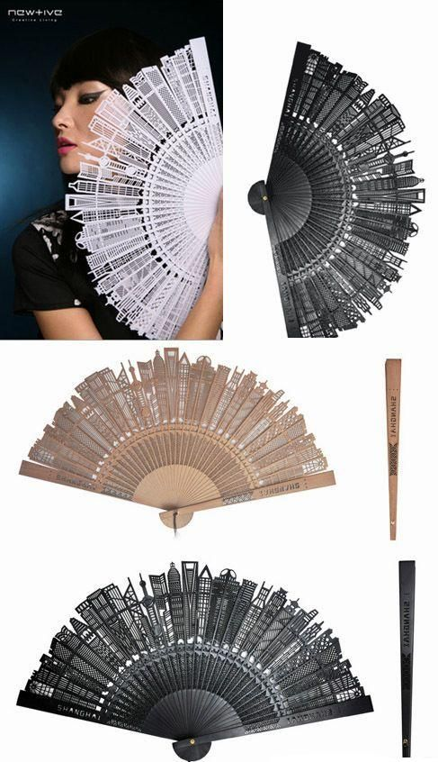

# @Carl Liu设计

上海工设成员、著名设计师刘传凯先生（Carl liu）设计的“上海微风”扇子，囊括了很多上海知名建筑，太有想象力了。如果把南京的建筑也整成一把扇子，上面会是些啥？  
  

---

## 评论（6）

**okdata** · 2010-07-13

金陵饭店、长江路九号、国际广场烂尾楼、绿地紫峰、金鼎湾、新街口老交行、1912、江苏路、颐和路、励志社、老外交部、交通部、、、

**[光光](http://gaoguangguang.blogbus.com)** · 2010-07-13

要是在扇子边缘弄一个圈，把所有建筑物圈起来，空的部分有纱，这样扇子会不会更精致呢，现在看起来有点像个破扇子。

**路路** · 2010-07-14

你认识carl？？   
真是ACCD毕业的人才啊

**Christina** · 2010-07-14

从功能角度，错落的扇子顶端加上同色系的蕾丝是会更加精致些，也不用担心扇的时候刮到皮肤；

如果它仅仅作为展示的艺术作品，这样倒也无可挑剔。

**itsmin** · 2010-07-14

真是充满想象力的设计。

**箱子** · 2010-07-14

很有意思。以及楼上的那位说的，为什么要有金鼎湾？

