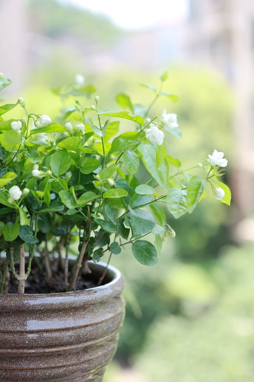

# 茉莉花开

今天出太阳了，特别高兴。赶紧将茉莉花搬到朝南的窗台上。江苏民歌《茉莉花》，歌词写的是“好一朵美丽的茉莉花。。。”，我觉得它的外观并不美丽，它的美在于它的芬芳，实在是适合夏季的花朵。  
  
原先盛开的荷花，昨夜便走到了尽头，花瓣飘落，露出鲜嫩的莲蓬，小花苞却比之前更茁壮。荷花开的快，谢得也快。早晨给植物浇水，看到两只彩色的鸟儿边飞边在捕食飞行的昆虫。大自然真是神奇的画师，从未停止过作画。  
  
我，爱这样的早晨。  
  

---

## 评论（13）

**[至清](http://www.yangziqing.net)** · 2010-07-14

真是一个可爱的早晨，有阳光，有花香，还有对这个造成浅浅的爱恋与满足。

**喜刷刷** · 2010-07-14

喜欢你今天清晨的每滴感受,滴滴沁入我心.真好.

**Chrisitna** · 2010-07-14

为了你的喜欢，来，咱们亲一个~

**ALENA** · 2010-07-14

我，也爱这样的早晨

**[光光](http://gaoguangguang.blogbus.com)** · 2010-07-14

我早晨都在睡懒觉，然后争分夺秒的出门。浇花都是在黄昏，完全错过了美好的清晨。小时候家里也有这种茉莉，出门上学的时候要摘几朵放包里，一天都是香的。

**[薇安](http://bulaoge.net/?vivianxu)** · 2010-07-16

感觉清新的很。

**[少爷](http://jennyshaoye.blogbus.com/)** · 2010-07-19

这样的早晨真的很美

**[shanshu](http://shanshu.blogbus.com)** · 2010-07-19

这个花盆很好看.不知道重不重?

**卉子882** · 2010-07-19

美，真美。但好几天没更新了哦。期待新的但同样美的清晨，或中午，或傍晚，，，，，，

**箱子** · 2010-07-19

没有更新，可见有多忙！

**frank** · 2010-07-20

我一朋友外派海归南京，公司给每月4500元租房，能租到什么样的房子？

**Christina** · 2010-07-20

要看在什么位置了。你朋友工作的地点在南京哪个区域？可以帮你推荐租赁房。

**frank** · 2010-07-20

江宁，朋友去福特研发中心，谢谢推荐。

