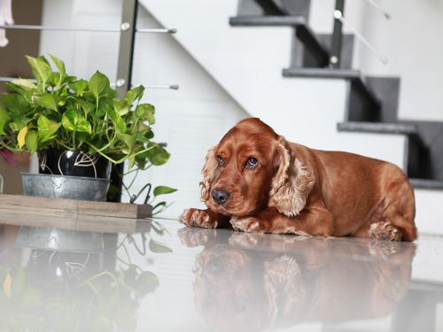
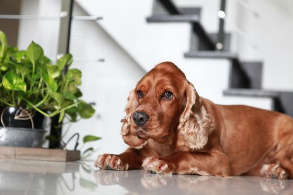
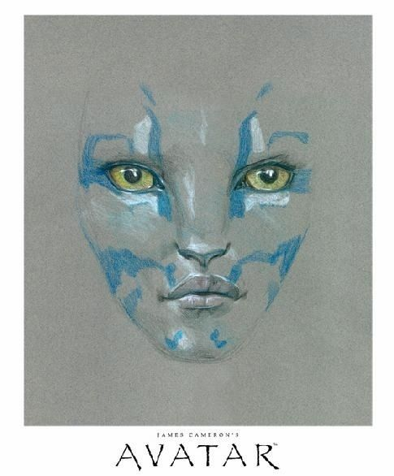

# 这些夏天。。。

有了他们的夏天，这季节也没那么难熬。  
  
putoo：“买好了野营地毯跟个小马灯，为将来的湖边煮茶~列个表：帐篷、蚊香、烧水器具、矿泉水2桶、零食、啤酒、烟、狗、驴车、卷筒纸...”  
  
我不禁想起有人曾兴致勃勃要在自家大露台扎个帐篷，望山，观星，与虫鸣蛙叫相伴一宿。  
  
箱子：记得高中后面有片芦苇荡，晚上我们逃开自习躲进去，全是萤火虫啊，当时为了和学长是哒，还请学长把时下流行的佳得乐饮料玻璃瓶盖戳了洞，逮了萤火虫进来养。。。  
  
Sherry：夏天出门转悠，满眼都是美少女白花花的腿。短裙短裤加人字拖，组合成夏日热辣的马路风光。偶尔看到一个连衣裙淑女的背影，走过一回头，原来是个美孕妇啊。。  
  
问问：小烂热夜。无人无风无清凉。我自盛一碗绿豆汤，温了，裹绵糖，饮爽淡，断肉念。继续何先生的上学记，艳羡他在乱世中有一段自由散漫的读书好时光。  
  
小原子 ：趁着大雨点开到了大桥南堡，雨终于开始甩下了，下到看不清旁边倒后镜的情况，我要超车都抖活活的，刚过大桥的一半，雨突然小了，小到再开2步发现北堡路况根本没有水的痕迹，一路到家也没有下雨的样子，小摊贩照样卖着西瓜羊肉串。。。。就看我顶着水灵灵的车子进院子佬。  
  
旗旗：夏天是绿豆粥，酸梅汤，玉簪花，秋海棠，小龙虾吃个遍，比谁的西瓜籽吐的远，知了像沸腾高压锅一样的叫声，荷花瓣放拳眼拍响的童年记忆，趿丫拖吃莲实，露大腿兼露蚊子包，鸟不畏人，草比人高，凉席什么的最讨厌了，空调打低，裹棉被乱梦到天亮（个别失眠且抽疯文青半夜起来画花也不是不可能）。  
  
Maggie：今年西瓜真便宜,上周末买到5毛一斤的,回家高兴了一整天,今天居然买到了4毛的,也很甜.瓜农很无奈地说,没法子,城管追着抓,天天拖着瓜跑更亏!  
  
shuwua:清早起来去爬山，起点就在楼旁。结果，爬到了南高峰。在山顶遇上老年登山队登顶成功，分享零食。我有幸尝了甘草青梅，华味亨的，很好吃，清甜甘草香，老伯说超市有卖，类似面包干的羊角蹄，圣女果干和内蒙古沙枣。结果池得意了，下山到了龙井村，走了几百米，打辆出租回宾馆。赶上早饭，吃了碗小米粥。  
  
沈先生：童年的夏日夜晚，大人们会把竹子做的床或躺椅搬到院子里，用井水早早把西瓜冰镇起来。晚风习习中躺在竹床上仰望星空，充满幻想。那时一切都是纯自然的，低碳的！可如今我已几乎没有邻居的概念，也早已忘了乘凉这回事。  
  
我的夏天则是吃西瓜、看电影看杂志、喝茶、散步，按时给植物浇水。。。每天既变换又稳定。印象最深刻的事儿是有一次和狗狗们外出散步的雨夜，遇到一条过路的蛇，好在狗狗们完全没有发现它，我浑身鸡皮疙瘩的跳过那条蛇，自那之后外出散步我换了球鞋。其实多数的夜晚遇到的是青蛙或癞蛤蟆，狗狗们凑近了嗅，它们一跳一跳的，狗狗们也跟着点头，直到失去兴趣。  
  
狗狗身上的毛被剃了又剃，空调房间不爱呆了，晚上Luke独自睡在餐厅的墙角。那是它认为最凉快也最安全的地方。的确，没空调的时候餐厅最凉快，人家才不是傻大哥呢。中午被我训了一顿，眼神里满是哀怨。  
   
  
  
近期观影单：  
\*\*\* [**《人在囧途》**](http://data.ent.sina.com.cn/movie/10503.html)--最近看得最搞笑的一部。小成本制作，《投名状》的导演。不过中间穿插的孤儿救助女那段太牵强，情绪上出现停顿，不流畅。据说打败了好莱坞大片《罗宾汉》成为同档期票房黑马。与家人一起看很不错。  
**《Exam》（终极面试）**--仍然是小成本制作，比《人在囧途》的制作成本还要少，只有一个场景：考试现场。因为时间原因分两个晚上看完。没看完的时候心里惦记着，到了第二天晚上兴致昂然...揭开神秘的面纱，不过如此。从未见过如此面试的场景，堪比生死之战。开始，觉得所谓精英就是没问题也会找出问题来纠缠，都想胜出的心理作用下，爆发出本质的人性，喜欢研究心理的人倒可以边看电影边琢磨。该片的导演也是位作家。  
\*\*\*[**《The Bounty Hunter》（赏金猎手）**](http://www.saymov.com/archives/138)--看的时候难免会联想到Brad Pitt  
和Angelina Jolie主演的[**《Mr. & Mrs. Smith》**](http://ent.china.com/zh_cn/movies/page/info/mams/index.html)，甚至会将两位女主角不由自主地放在一起比较。。。每个人都有八卦的浅质？轻喜剧的《The Bounty Hunter》，讲述同一个真理：夫妻之战永远没有输赢之分。不过总是吵架跟情趣压根搭不上边，吵个几年，也索然无趣了，吵架多么伤神啊。所以电影还是电影，斗给观众看，夫妻之战加上凶杀侦破，倒也不算乏味。  
\*\*\*[**《Pergy Jackson & Olympians-The Lightning Thief》（波西-杰克逊与火神之盗）**](http://www.mtime.com/movie/82775/)--哈利波特的现代版，导演也是哈利波特第一、二部的导演，用了希腊神话里的人物关系，人神生育的现代Demigod，主角清一色俊男靓女的青年。电脑特技比国内电视台正在播放的《倚天屠龙记》简直好了十万八前里，据说《倚天屠龙记》是张纪中拍摄的最后一部古装武侠剧，真是糟蹋了邓超。我特爱看象《Pergy Jackson & Olympians-The Lightning Thief》这样人神或人鬼的电影，既现实又神秘，尤其爱里面奇形怪状的神兽们。编剧是位教师，平时也写作，他的儿子非常喜欢阅读希腊神话，他为他儿子写了这本书，火了，有人来买他的版权拍了这部电影。估计还会有续集。强烈推荐。（这部电影貌似没有豆瓣们出现，一看到“扎堆”我就头大。）  
\*\*\*[**《Brooklyn's Finest》（布鲁克林警察）**](http://group.mtime.com/filmov/discussion/908441/)--通过三位警察的不同职业生涯，呈现出不同的价值观，道德观。豆瓣有句评价：“他们都醉了，他们都死了，他们都在路上相遇，在泥淖里挣扎，他们都无法左右自己，左右别人了。”我们的人生何尝不是这样？（本人看电影前基本不看影评，但每次更博搜电影连接，总会出现豆瓣们。）  
[**《混混天团》**](http://cdbeta.com/read.php?tid=600&ordertype=desc)--摇滚乐+黑社会？我都不相信梦想了，不知道生活在如此压力下的人们是否还有真梦想？  
[**《The Losers》**](http://group.mtime.com/abnormal/discussion/833648/)--不用动脑筋的美国片。女主角Zoe Saldana 是《Avatar》里的女阿凡达原身。  
  
  
这张名为《内提力》(Neytiri)的手稿，为该片导演詹姆斯-卡梅隆亲手绘制，当时画出这样一幅图画是为了给影片设计人员一个创作方向。《内提力》是一张规格为17×22英寸的限量微喷印画，是50张手写编号限量版中的一张。这50张图每一张都分别有单独的卡梅隆的手写编号，而且还各自都有真品凭证，售价250美元，装裱后售价405美元。

---

## 评论（14）

**陈问** · 2010-07-21

你这里是夏天百态啊。打开盒子，纷繁一片。

**itsmin** · 2010-07-21

路克第一张真的是灰常哀怨的眼神，都快流眼泪了都。哈哈。

**Christina** · 2010-07-21

它只有为了吃吃吃…才有这种表情，哈哈哈哈~

**箱子** · 2010-07-21

第一张表情也太委屈了吧！来，我来安慰一个。今年奇怪了，院子里居然少有青蛙蛤蟆，难道都跑你那去了？我期待哈利波特。

**shuwua** · 2010-07-21

剃了毛，Luke变年轻了。

**[至清](http://www.yangziqing.net)** · 2010-07-22

有了你们，这个夏天清凉了许多，呵呵。

**[三月四月](http://11)** · 2010-07-22

好文啊，值得反复看好几遍。我昨晚也经历了南京大雨，桥北地干干的情况。在南京我浑身湿了个透，还奇怪我妈妈怎么一直没来电话关心我

**Christina** · 2010-07-22

shuwua 俺们Luke少年老成型的，MM们可喜欢啦，嘻嘻~

**[铁观音](http://www.8mart.cn)** · 2010-07-22

我也讨厌夏天 哈哈 热死了

**喜刷刷** · 2010-07-22

luke最近脸都变长了,不会笑了.

**Christina** · 2010-07-23

俺家Luke表情丰富，嘻嘻~

**okdata** · 2010-07-23

畅快的出汗，大口的喝水，不用老跑休息室…..  
少吃饭，多食瓜，减重….  
看师傅的单子，上午江东中路晚上桥北，中间插着美凯龙，乐此不彼….  
哎，这个夏天哦….

**Christina** · 2010-07-23

搞装修啊？搞装修没有车，是不是很累？

**okdata** · 2010-07-23

累是肯定的，一直企盼着早点结束  
想着紫金晨霭、玄武波粼，也就罢了  
不过夜枕中央路，比较痛苦

