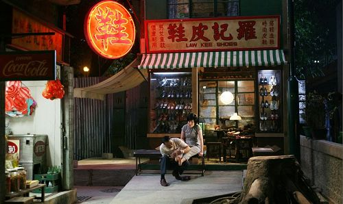
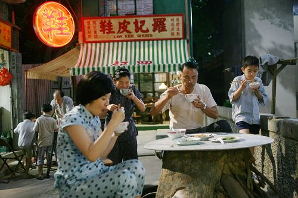

# 岁月．神偷

有些时候固执让人一旦确定了印象，比较难改变。比如对香港电影，接受不了大多数香港演员的演技，讲起话来一副是非脸，另外，他们的方言，与我们说同一句话，粤语10个音调下使用嘴唇的频率高于国语，絮絮叨叨得多。  
  
但《岁月神偷》，让人喜出望外。符合当下怀旧复古风，以香港60年代为背景，故事情节平常又平凡，情绪上也没有大起大落，就是那种缓缓地，细密又稳重的一点点将观众的情感挖掘出来，悄无声息打动着你。同时也有那份对于我们小时侯生活的回忆。  
  
“吴君如”一改笑星路线，演绎一位能说会道的贤惠妻母。她说如果5年前她可能不会接这样的角色。。。如果5年前我也体会不了这部电影的动人之处。“任达华”出演老实巴交，勤恳劳作，万千百姓中的一个小人物，演技非同以往。大儿子“罗进一”，一位美少年，他拥有世界上美好的一切，因为太美好，从形象到生活，所以他的遭遇给人的触动最强烈。导演“罗启锐”说电影中那个弟弟罗进二有他小时候的影子。  
  
这部以60年代香港为背景的电影播出后，许多香港市民前往“永利街”送系黄丝带。本来面临拆迁的永利街，幸免于难，得以受到香港政府的保护。我们失去许多老街巷，失去的还有永远追不回的岁月。**在幻变的生命里，岁月，是最大的神偷。**  
  
别忘记带上纸巾，当你准备观看《岁月神偷》的时候。  
  
   
  
请注意这个场景，就是我们小时侯的记忆。  

---

## 评论（2）

**shuwua** · 2010-07-25

我最近也看了这部电影，一步佳，一步难，记住了。

**Xiaona W.** · 2010-07-26

我也很喜欢这部电影，＂做人，总要信＂，值得记住的励志谏言。很喜欢剧中的弟弟，大杂院的场景唤起我对童年的记忆。

