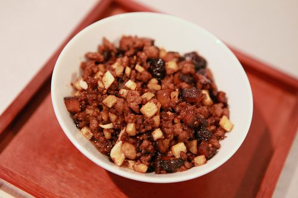
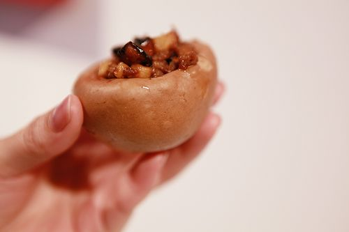
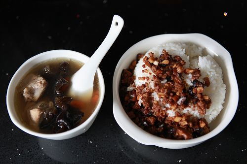

# 简单也好。

肉末、香菇和胶瓜丁，炒出来，夹在窝窝头里，就着西红柿鸡蛋烫饭，晚饭也就解决了。  
夏季的伙食在没有太多热情烹饪的时候，简单也好。  
  
话说巴基斯坦邻居，经过无意中的观察，发现这儿就是众多巴基斯坦IT者的食堂，跟俺们90年代外派常驻机构也带厨师一样。这位黑胡须的巴基斯坦厨师，中午还要去送饭，用那种钢管状的手推车，无论烈日还是大雨，都会推着锅碗外出送往不可知的地点。他自个儿在家时，常常播放奔放又高昂的巴基斯坦流行歌曲，干活也有劲儿。每天闻着各种美妙的烹饪气味儿，真想去搭个伙儿。周末见一群巴基斯坦男人在邻居家的卡宴Turbo S车前拍照留影，这情形跟出差国外的同事在豪车前留影一个劲儿，第三世界国家的人民果真质朴的阔爱。以及，他们居然很怕狗，见着就让。  
  
这两天睡眠质量极其差，夜里经常醒。星期一早晨去上班，头疼得厉害，为此午睡一小时，闭上眼睛，脑子却还是清醒的。看到JM们有人最近睡眠也不好，是季节原因吗？  
  
   
  
  
\*\*\*\*\*\*\*\*\*\*\*\*\*\*\*\*\*\*\*\*\*\*@7月27日\*\*\*\*\*\*\*\*\*\*\*\*\*\*\*\*\*\*\*\*\*\*\*\*\*\*  
香菇胶瓜肉沫拌白米饭+配黑猪肉仔排木耳枸杞汤=7/27午餐  

---

## 评论（9）

**喜刷刷** · 2010-07-26

手艺不错啊,比饭店的卖相还好!吃了几枚?

**陈问** · 2010-07-26

想吃。碗的形状也好。

**Chrisitna** · 2010-07-26

两枚，饱了。这夏天让人又爱又恨，这两天打不起精神来。问问，见你收藏肉躁饭，这个也可以拌米饭吃，方便简单，又快捷，省了七个碟子八个碗的忙碌。

**陈问** · 2010-07-26

如果他愿意吃猪肉的话，我们早就吃上个十次八次了。

**Chrisitna** · 2010-07-26

你用牛肉沫，也可以哇~省事儿~

**[三月四月](http://11)** · 2010-07-27

看着咽口水

**旗旗** · 2010-07-27

我也觉得睡眠不好和季节有很大关系。第二张馋死我了，哈哈

**[少爷](http://jennyshaoye.blogbus.com/)** · 2010-07-29

巴基斯坦和印度人，见狗象见鬼一样。在英国也是，英国有不少印巴移民。据说在他们的文化里，狗是和魔鬼相似的东西。我也只是听来，没作过考证。

**Chrisitna** · 2010-07-29

天呐，原来是这样的，有的巴基斯坦男人见了我家狗，吓得躲在我身后啊。。。当时我就觉得很奇怪，它们长相不凶，就那么点儿大。。。原来有这样的文化在里面。

