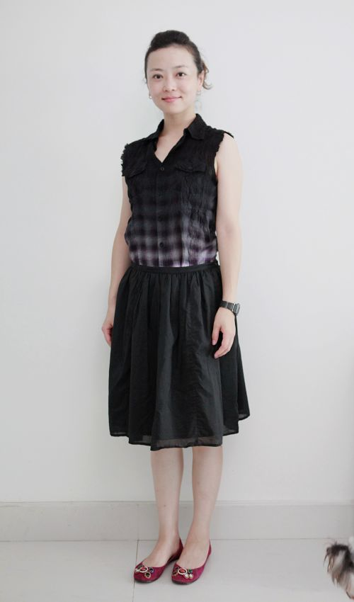

# DRESS BLOG

也许搭配黑色鞋更协调，但这双今夏最爱的平底鞋，虽是皮质，却极其柔软。  
出勤率较高。  
  

---

## 评论（8）

**旗旗** · 2010-07-27

此鞋我也爱，百搭~一身深色不用再搭黑色鞋来，这个最好，像森林里的一声短笛一样点睛

**Chrisitna** · 2010-07-27

你终于来唠，太好了~

**rebecca_cn** · 2010-07-27

漂亮也！  
不要换鞋，如果是黑色就太正统了点，这一抹红才是亮点!

**[supra shoes](http://www.sweetcheap.com)** · 2010-07-27

气质美女~

**喜刷刷** · 2010-07-27

我也觉得这双提亮,比黑鞋那种协调型儿的更出彩.

**[scarlett](http://scarletty.blog.sohu.com/)** · 2010-07-28

这种渐变的格子还蛮有气质，或许是因为穿在Christina的身上？  
这样的浅跟浅口鞋子真的太舒服了，穿了它后会觉得再穿高跟鞋是折磨自己。

**[septulip](http://septulip.spaces.live.com/)** · 2010-07-28

同感，黑鞋太单调了，红色才出彩。

**Chrisitna** · 2010-07-28

是玫红色。

