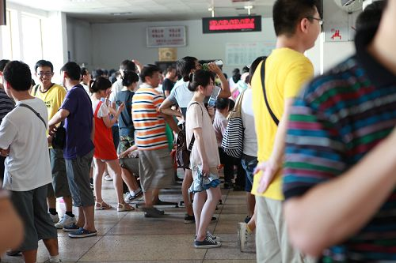
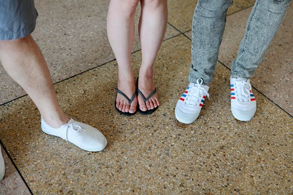
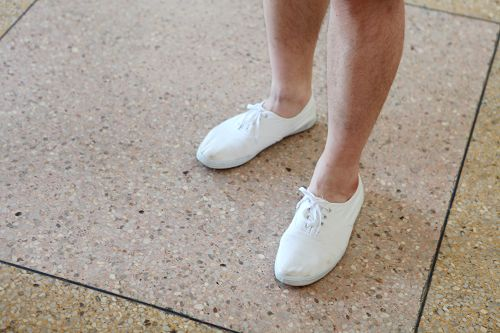
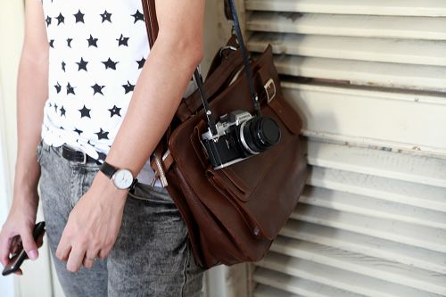
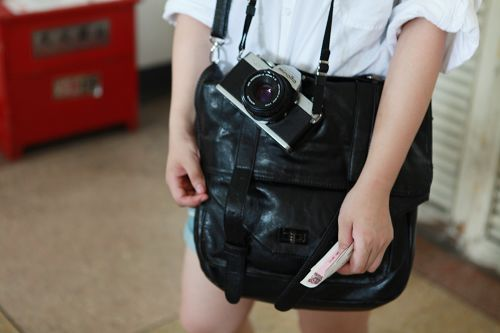
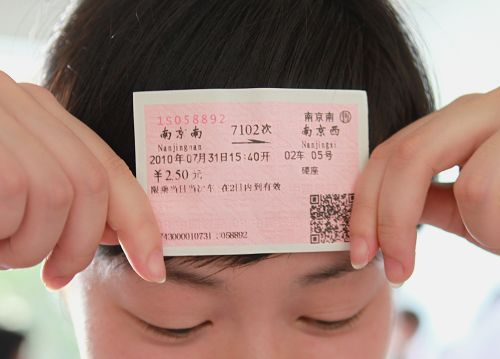
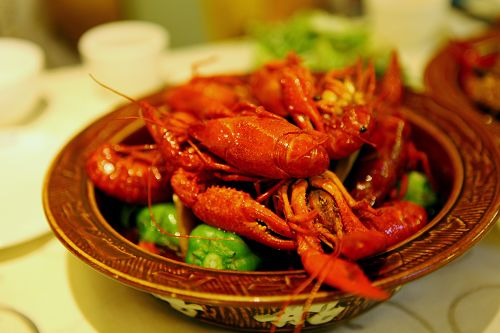

# 一场夭折的“怀旧之旅”。

据说绿皮火车即将消失，一行六人准备星期六下午乘火车南站至西站的列车，为了凑着某人的时间，尽量安排在星期六的下午，结果人家还是抽不出时间来。于是我们剩下的四人在火车南站集中，哦，天呐，这个平时冷清又冷清的中华门火车站候车室塞满了豆瓣们，以及真文艺、伪文艺、小文艺和老文艺们，几乎清一色端着或数码或胶片相机，还有举着摄象机的。。。这么多文艺人同时出现还是蛮壮观的，这情形比天气还热，让人窒息。  
  
7102次延迟，延迟，延迟到我们无法再继续等待的地步，因为每个人身上的衣服几乎被汗浸湿，我甚至能感觉到汗珠从后背流向腰际的过程。候车室里的空调被房间里的人群捂温了，几乎成了摆设。听说前一天7102次晚点，晚上8点才到。。。人群中不停擦汗的我们，决定放弃这次“怀旧之旅”。  
  
汗，我很羞愧，瞧瞧人家文艺的多么萌啊，我这么个既不文艺也不爱扎堆滴人，为何鬼使神差到了这里？不搭调啊，也不想搭调啊。  
   
  
光光说的挺对的，豆瓣上全是文艺青年，小孩子多。这些文艺孩子们如今时髦地穿起了小时侯我们穿的那种白球鞋，扫一眼过去，好几双，这也是扎堆的一种，南京文艺青年的习惯？有位穿着小白鞋，特潮的男生问：“你有豆瓣吗？”  
“没有。”  
“那你在XICI玩吗？”  
“不玩。”  
“那你在哪儿玩呢？”  
“在家。”。。。  
   
   
  
  
皮质书包款+胶片机，在我看来这是圈子的象征。  
   
  
  
史上最便宜的火车票，史上是不是最慢的火车，不确定。但我知道从中华门到下关乘汽车也用不了2小时。即使同行的人再文艺，我们也经受不了高温的折磨，就此告别。  
  
  
夭折之旅，总要在别处得到平衡，晚饭豪吃龙虾喝啤酒，没啥说的。问问制作的冰镇乌梅汤，用啤酒瓶装了赶到火车站送给我们，晚饭的时候我们全给干了。收到问问借给我的书《送你一颗子弹》，其实我已经被下午的酷热与扎堆的文艺豆瓣们给击中了。现在，我特有兴趣知道豆瓣们如何度过这个下午的？  
   

---

## 评论（11）

**狼京李核儿** · 2010-08-01

怎么能把自己摘到@文艺@之外尼？别推辞了，呵呵。

没想到咱狼金会有那么矫情的活动，我一直觉得狼京人够糙。没想到细人也不少。

**陈问** · 2010-08-01

不是借的书，是送的书~~不过你假象是借的，读起来就快了。(**\_\_**)

**[光光](http://gaoguangguang.blogbus.com)** · 2010-08-01

呵呵，豆瓣用户的平均年龄我估计就是21，22岁，不会超过25岁。我现在基本就是只用它来记录我看过的电影。南京热死人了吧，你还想去坐火车？照片上那种胶片相机我也有一个哎，从来没用过，还有很多镜头，说不定可以卖给文艺青年。

**[至清](http://www.yangziqing.net)** · 2010-08-01

那张火车票倒是很吸引人啊。

**itsmin** · 2010-08-01

哈哈，不搭调也不想搭调的茶也很能忍啊，要是俺们的话一看势头不对指定立刻走人。飞机延误尚可忍受，火车的话就太辛苦。。。那环境，那味道也太折磨人了。

**Sherry** · 2010-08-01

一不小心扎进了潮人的堆，身上趟着热汗，心里流着冷汗。。

**喜刷刷** · 2010-08-01

见了这场面,才知道南京的“文艺青年“可真多啊,显然,你们是混进了革命队伍的那一小撮儿,没有一个有小白鞋.看来,还是去吃龙虾喝啤酒适合你们!

**lusfe** · 2010-08-02

南京的小龙虾呀， 想念啊～～

**[山树](http://shanshu.blogbus.com)** · 2010-08-02

你开始玩胶片了？

**Chrisitna** · 2010-08-02

怎么会，没那么快，数码还没玩好尼~

**lilian** · 2010-08-03

哎唷,这火车票很多呢…

