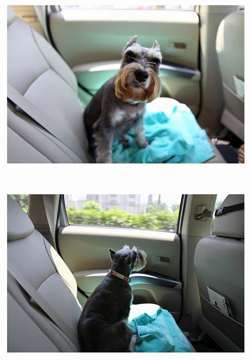

# 爱．周末

今天不过星期二，又开始盼望周末了，估计连照片中的它也一样。狗狗们是否有周末的概念？它们会不会想主人为什么今天会在家呢？土豆似乎开始了解哪些时候可以跟随到门口，哪些时候只需要目送。当然还没有Luke那么了解，一般时候Luke消失的很快，没有任何留念地消失到餐桌下面，占据一处它认为最凉快的领地。  
  
上个周末带着土豆外出，吃香的喝辣的都有它的份儿，哪怕只是一点点给它解解谗。周末的它无论如何都是满足的，象我们一样满足。  
  
  
\*\*\*\*\*\*\*\*\*\*\*\*\*\*\*\*\*\*\*\*同情有时@Night\*\*\*\*\*\*\*\*\*\*\*\*\*\*\*\*\*\*\*\*\*\*\*  
  
晚上从父母家回来，又一次遇见那只流浪的小黑狗，尾巴耷拉着，一副垂头丧气的摸样，迈着小碎步，见人就躲。土豆上前与它相互嗅了嗅，之后它赶紧离开。  
  
它居然还活着，这更加让人伤感。听隔壁小区的保安说它是工地上做饭的人抛弃的，它每天会往返工地与各个小区之间，每天。我想带它回家，它从保安手中挣扎逃走，自那次之后，已有大半年时间过去，它依然小心翼翼游荡在各个小区里。似乎连同类都不愿靠近。有时我下班回家的路上远远看它卧在路的中央，见车近了便缓缓走开。如果能抓到它，带它回家，让它快乐，我是不是会长期让它留在家中，对此我并不确定，毕竟三条狗对于我来讲的确多了点。有时我就是这样走一步看一步。  
  
从家中端了狗粮出来寻它，见它卧在远处黑暗的水泥地上，扔几把狗粮过去，它再次慢悠悠地离开，躲进车肚子下面，我把狗粮倒在车的外围，希望它能饱餐一顿，希望它喜欢吃。不得不说那个非常莫落的小身影很让人牵挂。  
  
很困惑的问题是，为什么对于狗狗的这份同情，却少于对人？这种情绪相信并不只是个人的，而存在于部分人群中。我们同情动物，但对人却同情的少。。。这是为什么？是因为人类比动物更可恶？因为人类可以自力更生，而狗狗却更加需要人类帮助？

---

## 评论（5）

**箱子** · 2010-08-03

一把乖巧的胡子啊。

**Karen** · 2010-08-04

或許是因為人懂得偽裝，所以我們對人的同情少了，戒心也大了吧!?

**scarlett** · 2010-08-04

我想是人类的可怜总有可恨之处，而动物的可怜却是绝对的无奈。

**喜刷刷** · 2010-08-04

无论哪个角度看,土豆都是锥形个的小精灵.

**耳雨** · 2010-08-04

“人天生有爱心，可惜这个社会让人心生戒备，所以在宠物身上寄托和释放爱心”——一个看破红尘，潜心研究佛学典籍的人说的。

