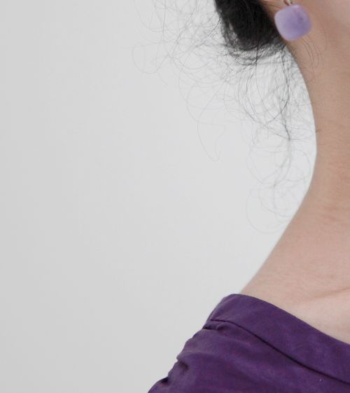
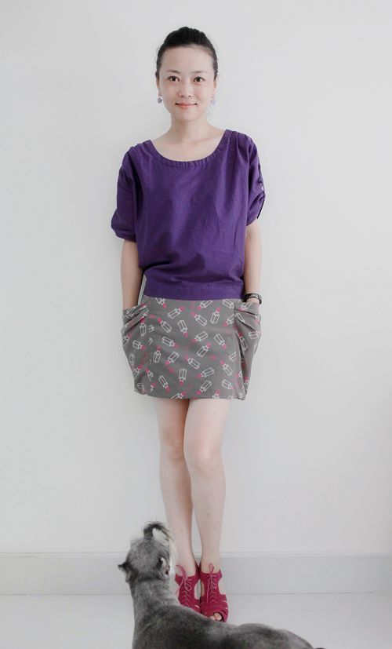

# DRESS BLOG

送给网络上的人：我们每一个人，在这里既是说者，也是听者，当我们质疑、批判甚至辱骂他人的言论时，其实，我们也面临相同的困境。  
  
面对同样一个信息，别人读到积极而自己读到残酷？你可以评论也可以不评论，你转发什么，写什么内容，选择关注什么，不关注什么，都代表了你对社会，对人性的关注点，如果你觉得自己看到的是一个残酷世界，那么现实生活里，你是不是也看见这些呢？还是说你一直回避它们，虽然它们一直在那里。一切都和你自己的内心相关。  
  
虽然交流充满魅力，但当你一言刚出，即刻众说纷纭时，这种感受，可不轻松。不得不感慨，当我们获得交流的权利时，这种对自己生活碎碎念的交流，也有它的有限性。  
  
   

---

## 评论（21）

**[JasonChen](http://jasonchenzl@126.com)** · 2010-08-04

姐姐,您真的岁月了.  
从6,7年前开始看你的blog,今儿看到第二张照片,不禁黯然.

**ilovehangzhou** · 2010-08-04

人人都岁月，姐姐挺好的

**Christina** · 2010-08-04

不岁月的是妖精。

**Ladult** · 2010-08-04

我觉得一直挺美挺年轻。从四五年前看茶博到现在，这种干净利落淡然而又充满自信的美，没有因岁月而减一分。

**Vodka** · 2010-08-04

鞋子和裙子搭配得很出彩！

**scarlett** · 2010-08-04

喜欢那种圆领、灯笼袖的衣服，穿起来有些公主气 ：P

**rebecca** · 2010-08-04

这种干净利落淡然而又充满自信的美，没有因岁月而减一分  
==================  
说的是啊！  
而且茶身材一直保持的很好，对生活的态度真是值得欣赏！

**喜刷刷** · 2010-08-04

嘿嘿,裙子高头也是密密麻麻的小口红啊,小臭美的~

**Mandy** · 2010-08-04

岁月这东西为气质加分，中国人的审美难道一直停留在幼齿品味？

**[光光](http://gaoguangguang.blogbus.com)** · 2010-08-04

我要给你发一封密电码，你没有隐秘留言这样的功能吗？

**Chrisitna** · 2010-08-04

没有哇，可以发到tecinese@gmail.com，因为我不是经常看邮箱，所以你发了后通知我一下，免得发生象上次那样，错过玫瑰的E-MAIL。

**[光光](http://gaoguangguang.blogbus.com)** · 2010-08-05

我给你发了密电码，也是我的gmail发的。

**onfire518** · 2010-08-05

第二张照片有点诡异，感觉整个人被拉长了。

**onfire518** · 2010-08-05

这种干净利落淡然而又充满自信的美，没有因岁月而减一分  
==================  
说的是啊！  
而且茶身材一直保持的很好，对生活的态度真是值得欣赏  
＝＝＝＝＝＝＝  
没生小孩，当然身材会保持的住!有了小孩，很多女孩子都身材大变样。。。

**没被抓到的贼** · 2010-08-05

妖精姐姐  
搭衣达人  
美,就一个字

**itsmin** · 2010-08-05

老去的是岁月，心态，却可以永远保持成熟，从容和淡然。

**sususu** · 2010-08-05

茶也经常戴眼镜的啊，可是为什么摘了眼镜，眼睛还是那么好看呢，不像我等眼镜族摘了眼镜好像眼睛底下有一圈印子。

**朵几** · 2010-08-06

美女，你的这套衣服我好喜欢 请问什么品牌？

**Christina** · 2010-08-06

D&G上衣+日本品牌的裙子。

**abidingstar** · 2010-08-07

你有没有baby啊？

**yunyan** · 2010-08-13

衣服很漂亮，请问哪里买的？

