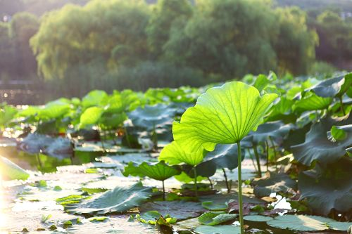
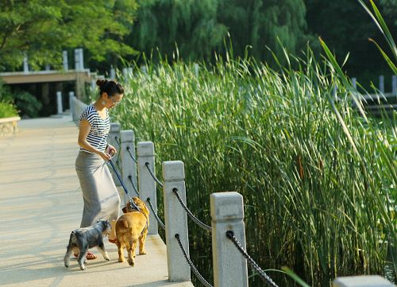
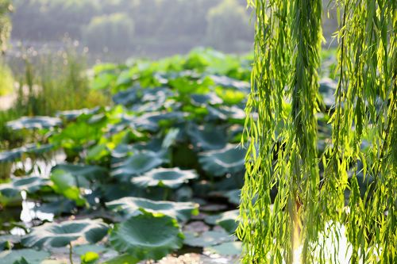
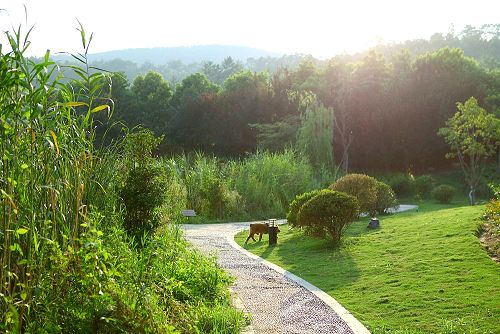
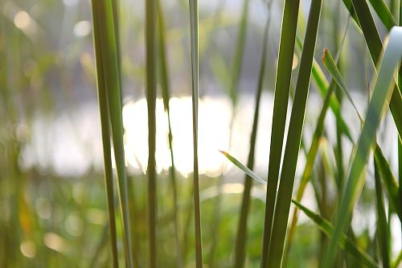

# 暑气和风

丰盈流溢的秋意还没到来，立秋几日，此时，才是真正的暑气和风，正午仍然赫赫炎炎，早晚的风却已经凉爽了许多，不再是带着热感的暖风。周末的傍晚迎着夕阳在小区里散步，景物被笼罩在金色的光晕中，很容易就陶醉了。每个周末都是一个暂停，释放压力。有张弛的生活节奏也好，有了对比，属于自己的时间才无比珍惜。  
  
   
   
   
   

---

## 评论（6）

**itsmin** · 2010-08-09

美女，这个造型很S.

**jolycai** · 2010-08-09

美女，那个滴水观音放阳台上，是不是太阳晒太多了，叶子都有点黄了

**Christina** · 2010-08-09

这篇没有滴水观音啊？  
放朝北阳台就没问题，不要直射阳光。我家滴水观音疯得了，拼命长。记得早晚浇水，叶面喷点水，但是千万不要最热的中午浇啊~

**Theresa** · 2010-08-10

南京还有这么绿色的小区？ 真美。想现在父母住的市中心小区只有几片绿叶。

**[yumuwan](http://yumuwan.com/)** · 2010-08-10

好美的博客，图片、文字，都是。  
无意间闯进，打扰。

**okdata** · 2010-08-13

环境挺好，羡慕。  
当初看了大山地和巴厘原墅也不过如此。至于江北的绿城、山河水，每天两趟80km的路程，心里还是害怕。仅一年时间都翻了三倍，吓人。  
当初退掉的依云溪谷，也涨得厉害  
不过说实话，这些房子买得起用不起。  
只是，依旧向往

