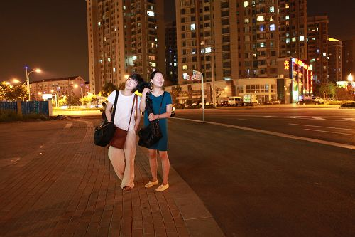
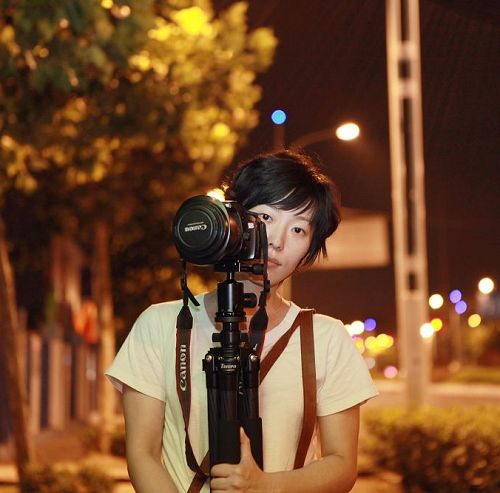

# 夜色温柔

晚上与问问和箱子姑娘，三个人带了三部相机，两个闪光灯，两只三脚架。如此隆重只因第一次乘坐2号线，不仅拍摄了地铁，还在户外的夜晚练习使用外置闪光灯。晚上的光线其实也挺美的，对拍摄者要求更高。我目前还不能熟练设置灯光的角度，仍然处于以量而不是以质取胜的阶段。图慢慢上。  
   

---

## 评论（7）

**[yumuwan](http://yumuwan.com/)** · 2010-08-11

第二张人像后面彩色的光点，非常之有趣，或可单独造一张作品。

**scarlett** · 2010-08-11

果真很强大，第二张效果很好！

**[septullip](http://septulip.spaces.live.com/)** · 2010-08-11

茶，今天看见淘宝首页广告有一家茶器店，不知道你是否喜欢。我可不是替谁做广告哈，只是分享。

**箱子** · 2010-08-11

我以后不能和问问并排站，她是无辜，我是呆。。。啊啊啊！其实还有几张很美的。。。

**shuwua** · 2010-08-11

单眼皮性感小女生！

**陈问** · 2010-08-11

强烈要求上恶少与无辜少女图……

**okdata** · 2010-08-13

南京的夜色不错

