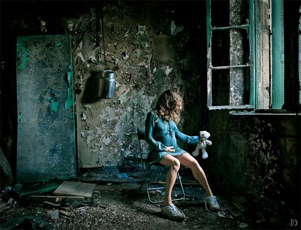

# “像野狗一样生存”

从美院毕业后，像野狗一样地生活，正是我比较理想的状态。野狗呢，就是饿了去找吃的，吃饱了，就随地大小便，愿意和别人咬架就咬架，愿意和别人亲热就亲热。没人管你，没有任何一个东西制约你，你也不向任何人献殷勤，你献也没有用，因为你找不到对象，也找不到目标。*方力钧《像野狗一样生存》*  
  
   
Between past and future  
  
晚上无风，闷热。加班刚到家，无食欲，盛碗冰银耳羹，额外加入绵糖。  
  
这周生活质量差，前三晚都是凌晨一点多才睡，第二天面目狰狞的去上班，所有肌肉因缺觉呈下垂状，就这么拖着进入下一个夜晚。饭吃得随意，电影一部没看，恨不能穿家居服直接出门，每天紧张愤怒骂娘。还是会极力控制，自控也他妈的累，对着电话喋喋不休耍嘴皮子时，我就是条疯狗。

---

## 评论（3）

**okdata** · 2010-08-13

疯狗不是野狗，  
前者是团体中的另类  
但自由的个体终究要归入社会

**[至清](http://www.yangziqing.net)** · 2010-08-13

生之不易，你我心知肚明。  
只是这世间，谁不如此？  
若不如此，又怎会对比出原来世间还有那么多令人惬意而愉悦的事情呢？

**箱子** · 2010-08-13

好好调整，别忘记明天下午去拿葡萄。就快见面了。我也是，骂娘。

